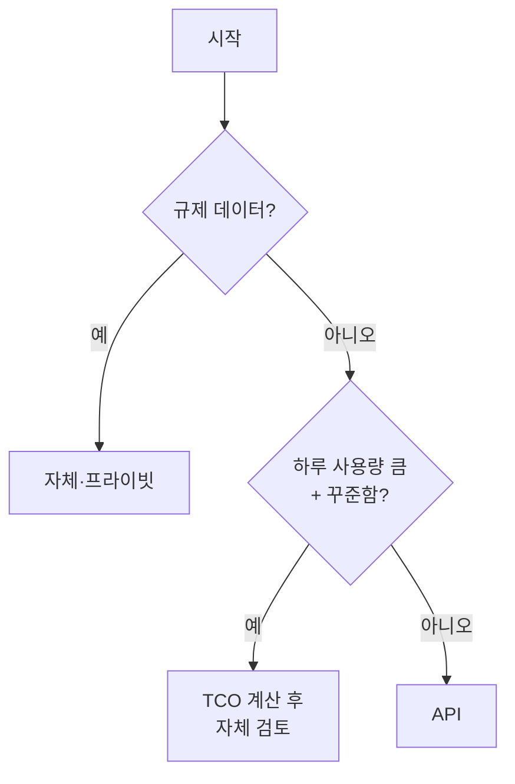

# API vs 자체 호스팅

> 모델을 외부 API로 쓸지, 내 GPU 서버에서 직접 돌릴지 정하는 선택. 핵심 변수는 사용량·GPU 활용률·보안 요건이다.

## 쉽게 말하면
택시와 자가용의 차이다. 가끔 타면 택시(API)가 싸다. 매일 장거리를 달리면 자가용(자체 호스팅)이 싸지지만, 보험·정비·주차(운영 비용)를 내야 하고 차가 서 있는 시간도 돈이다.

## 자세히
- **API**: 쓴 토큰만큼 지불. 최신 대형 모델 접근, 운영 부담 없음. 데이터가 외부 사업자로 나간다.
- **자체 호스팅**: GPU 비용이 고정이라 사용량이 많고 꾸준할수록 토큰당 비용이 내려간다. 활용률 50%면 실효 단가가 대략 2배라는 설명이 있다. 운영·장애 대응·인력까지 넣으면 GPU 대여료의 3~5배가 든다는 주장도 있다(업체 블로그, 수치는 예시 수준).
- **손익분기**: 보편 값은 없다. 사례로 하루 수천만~수억 토큰 선에서 나온다는 계산이 있고, 저렴한 오픈모델 API와 비교하면 영영 안 맞을 수도 있다.
- **프라이버시가 비용을 이긴다**: HIPAA, GDPR 거주 요건, 비밀유지 의무가 있으면 자체 또는 프라이빗 엔드포인트만 가능할 수 있다.
- **하이브리드**: 단순·대량 요청은 작은 자체 모델, 어려운 요청은 API로 보낸다([모델 라우팅](#model-routing)).
- 오픈 가중치 모델을 직접 돌리는 법은 [GPU 기초](#gpu-basics), [GGUF 형식](#gguf-format) 참고.

## 그림으로 보기

## 예시
- 사내 문서 검색 PoC: 하루 수만 토큰 → API가 압도적으로 쌈.
- 병원 진료 기록 요약: 외부 반출 불가 → 프라이빗 배포.

## 헷갈리는 것과 비교
| 개념 | 차이 |
|---|---|
| API | 종량제, 운영 없음, 데이터 외부 전송 |
| 자체 호스팅 | 고정비, 운영 부담, 데이터 통제 |
| 온디바이스 | 사용자 기기에서 실행, 소형 모델 한정 |

## 더 읽을거리
- [Self-Hosted LLM vs API: The Break-Even, Calculated(FindStack)](https://findstack.com/resources/self-hosted-llm-vs-api-cost) — 손익분기 계산(업체 글).
- [Self-Hosting an LLM: What It Costs(Netzstrategen)](https://ai.netzstrategen.com/en/insights/self-hosting-llm-costs-guide/) — 숨은 비용.
- [Self-host calculator(BenchLM)](https://benchlm.ai/tools/self-host-calculator) — 계산기.
