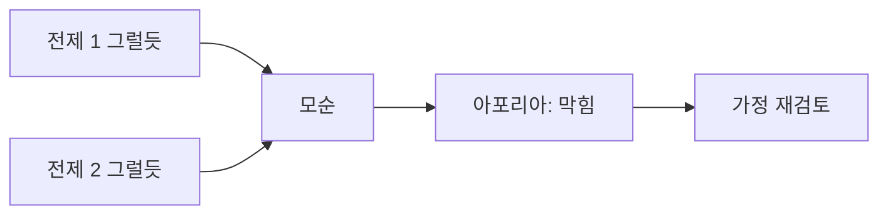
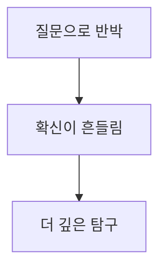

# 아포리아

> **아포리아**는 똑같이 그럴듯하지만 서로 모순되는 전제 때문에 생기는 **해결되지 않는 철학적 막다른 길**, 또는 그 막힘에 당황한 상태다.

## 쉽게 말하면
수학 문제를 풀다 "이 조건도 맞고 저 조건도 맞는데 둘이 같이 안 된다"에 막힌 순간이다. 답이 없어서 불편하지만, 내가 당연하게 믿던 것을 다시 보게 되는 순간이기도 하다.

## 자세히
(Wikipedia "Aporia" 확인)
- **정의**: 탐구에서 "똑같이 그럴듯하나 서로 모순되는 전제들에서 생기는, 해결 불가능해 보이는 막다른 길", 곧 역설. 그런 퍼즐 앞에서 당혹스러운 상태를 가리키기도 한다.
- **수사학**: 수사적 목적으로 하는 **의심의 선언**(종종 가장한 것).
- **교육적 의미**(권고·해석): 소크라테스식 대화에서 반박 끝에 결론 없이 끝나는 상태는 실패가 아니라 **더 깊이 탐구하게 하는 출발점**일 수 있다. 학습자가 막힐 때 곧바로 답을 주기보다 무엇이 충돌하는지 말하게 한 뒤 힌트를 준다([근접발달영역](#zone-of-proximal-development)).

## 그림으로 보기

## 예시
- "AI가 만든 글의 저작자는 누구인가?"에서 "창작은 인간만 한다"와 "AI가 창작물을 만든다"가 충돌하는 순간.
- AI 튜터에게: "내가 막히면 답을 주지 말고 어떤 두 믿음이 충돌하는지 물어봐 줘."

## 헷갈리는 것과 비교
| 개념 | 차이 |
|---|---|
| 아포리아 | 모순 전제로 막힘 |
| [엘렝코스](#elenchus) | 막힘을 만드는 반박 기법 |
| 딜레마 | 두 선택지 사이 선택 문제 |
| 역설 | 모순을 낳는 명제 |

## 더 읽을거리
- [Aporia (Wikipedia)](https://en.wikipedia.org/wiki/Aporia)
