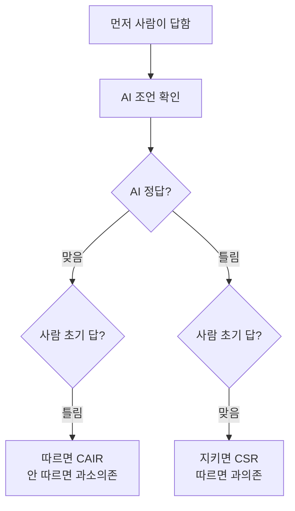
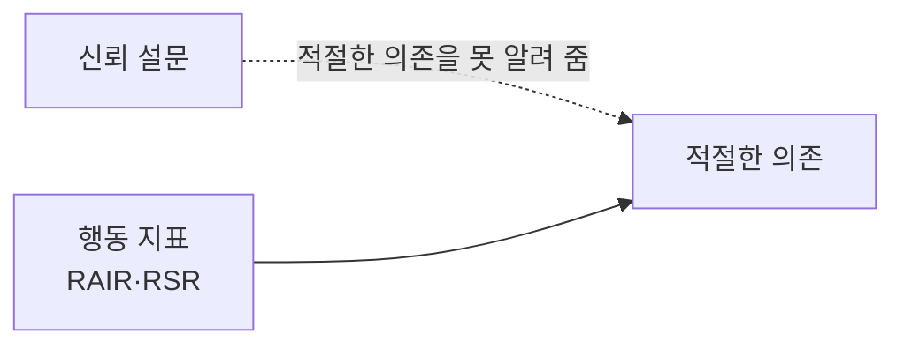

# 적절한 의존 지표

> 적절한 의존(appropriate reliance)은 AI가 맞을 때 따르고 틀릴 때 따르지 않는 정도다. 이를 재는 객관 지표(RAIR·RSR 등)가 연구마다 달라 비교가 어렵고, 신뢰 설문은 적절한 의존을 알려 주지 못한다는 논쟁이 있다.

## 쉽게 말하면
내비게이션을 얼마나 "믿는지" 묻는 설문과, 실제로 맞는 안내는 따르고 틀린 안내는 무시했는지 세는 것은 다른 일이다. 설문 점수가 높아도 맹신일 수 있다. 그래서 "행동을 세는" 지표가 필요하다.

## 자세히
- **신뢰 ≠ 적절한 의존**: Raees·Papangelis(arXiv 2604.23896, 2026-04)는 신뢰 측정이 적절한 의존을 알려 주지 않는다는 증거가 있다고 정리한다. 기존 구성 개념을 Traditional·Appropriateness·Dominance 세 관점으로 나눠 객관 지표를 평가하고 연구 간 합의를 촉구한다(초록 열람, 본문 미확인).
- **RAIR·RSR(Schemmer 등, IUI 2023)**: 사람이 먼저 답한 뒤 AI 조언을 보고 최종 답하는 설계에서 네 경우를 센다.
  - 먼저 틀림 + AI 맞음 → 따름: 올바른 AI 의존(CAIR) / 안 따름: 과소의존
  - 먼저 맞음 + AI 틀림 → 지킴: 올바른 자기 의존(CSR) / 따름: 과의존
  - **RAIR** = CAIR ÷ (먼저 틀렸고 AI가 맞았던 모든 경우), **RSR** = CSR ÷ (먼저 맞았고 AI가 틀렸던 모든 경우). 둘 다 높을수록 적절하다.
- **예시 수치**: 200명 실험에서 LIME 설명을 보이자 RAIR가 29.59%→38.87%로 올랐고(p=0.05) RSR는 71.87% vs 69.45%로 유의한 변화가 없었다. 설명은 신뢰를 바꾸지 않았다. 팀 성능이 사람 단독보다 유의하게 좋지 않아 "적절한 의존"에는 이르지 못했다고 논문은 결론짓는다.
- **한계**: 사람의 초기 답을 먼저 받아야 해 실제 업무에선 쓰기 어렵다. 이분법 정의를 비판하며 결정이론 기반 대안을 제안한 연구(Guo 등 2024)도 있으나 본문은 열지 않았다(검색 요약 기준).
- **정확도만 보면 안 되는 이유**: 과의존 감소와 과소의존 증가가 서로 상쇄되면 총 정확도는 그대로다([제2 의견 효과](#second-opinion-effect)).

## 그림으로 보기

## 예시
- 사내 AI 보조 도구 시범 운영: 직원 판단과 AI 판단을 둘 다 기록하고 최종 결정과 정답을 대조해 RAIR·RSR를 계산한다.
- 교육 활용: "설문 만족도 90%인데 오류를 못 걸러냈다면?"을 사례로 신뢰와 의존의 차이를 설명한다.

## 헷갈리는 것과 비교
| 개념 | 차이 |
| --- | --- |
| 신뢰(trust) | 태도(설문). 행동과 어긋날 수 있음 |
| 단순 의존(reliance) | AI를 따른 비율. 맞고 틀림을 구분하지 않음 |
| [AI 과소의존](#undertrust-ai) | 적절한 의존이 깨지는 한 방향 |
| 팀 성능 | 사람+AI 정확도. 지표가 아니라 결과 |

## 더 읽을거리
- [From Trust to Appropriate Reliance (arXiv 2604.23896)](https://arxiv.org/abs/2604.23896) — 측정 구성 개념 정리(초록)
- [Appropriate Reliance on AI Advice (arXiv 2302.02187)](https://ar5iv.labs.arxiv.org/html/2302.02187) — RAIR·RSR 정의와 실험
