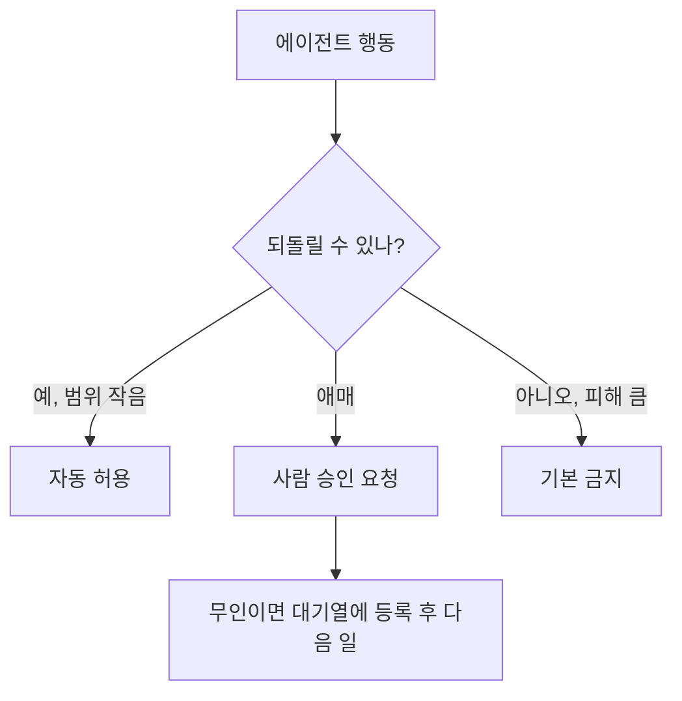

# 승인 정책 설계

> 에이전트의 어떤 행동은 자동으로 허용하고, 어떤 행동은 사람 승인을 거치게 할지 "위험도"에 따라 미리 정해 두는 설계.

## 쉽게 말하면
회사 결재 규정과 같다. 5천 원 사무용품은 팀원이 바로 사고, 500만 원 장비는 부장 결재, 계약서 서명은 대표 승인이다. 모든 걸 결재받게 하면 일이 멈추고, 아무것도 안 받으면 사고가 난다. 기준은 "되돌릴 수 있나, 피해가 얼마나 큰가"다.

## 자세히
- **위험도 축**: ① 되돌릴 수 있나(파일 읽기 vs 삭제·결제·메일 발송) ② 영향 범위(내 샌드박스 vs 외부 서비스·고객) ③ 민감도(비밀키·개인정보 접근).
- **3단 구성 예**: 자동 허용(읽기·로컬 테스트) / 승인 요청(외부 전송, 설치, push) / 금지(키 파일 읽기, 전체 삭제, 결제).
- **승인 피로**: 승인 창이 너무 많으면 사람이 무심코 다 허용한다. 안전한 행동은 허용 목록으로 빼서 승인 횟수 자체를 줄인다. Claude Code는 위험한 명령만 분류기가 검토하는 auto 모드를 기본으로 제공한다(2026-11 문서).
- **무인 실행의 함정**: 사람이 없는 예약 실행에서 승인 창이 뜨면 몇 시간씩 멈춘다. 그래서 "승인이 필요한 일은 등록만 하고 다음으로 넘어가는 대기열"로 설계한다(예: 이 지식 기반의 approval 큐).
- **강제 수단**: 권한 allow/deny 목록, [훅](#hooks-guardrails), [최소 권한](#least-privilege-agents).

## 그림으로 보기

## 예시
| 행동 | 정책 |
| --- | --- |
| 파일 읽기, 테스트 실행 | 자동 |
| `git push`, 패키지 설치 | 승인 또는 허용 목록 |
| 결제, 계정 생성, 키 발급 | 사람만 |
| `rm -rf`, 비밀키 파일 열기 | 금지(훅으로 차단) |

## 헷갈리는 것과 비교
| 개념 | 차이 |
| --- | --- |
| [사람 개입(HITL)](#human-in-the-loop) | 큰 개념. 승인 정책은 그 개입 지점을 정하는 규칙 |
| 최소 권한 | 처음부터 권한을 적게 주는 것 |
| 승인 vs 감사 로그 | 전자는 사전 통제, 후자는 사후 추적 |

## 더 읽을거리
- [Claude Code: Best practices](https://code.claude.com/docs/en/best-practices) — auto 모드·권한·강제 규칙
- [Claude Code: Hooks guide](https://code.claude.com/docs/en/hooks-guide) — 차단 훅
