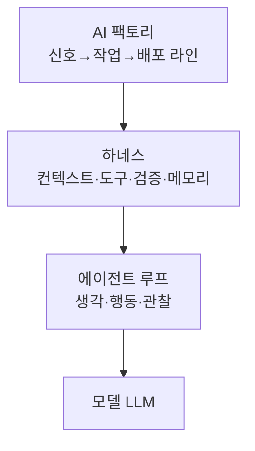
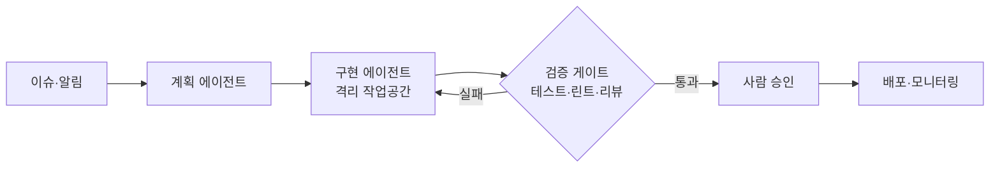

# AI 아키텍처

> 에이전트를 실제로 움직이는 뼈대. 모델(두뇌) 자체가 아니라 그 **주변 구조** — 반복하는 루프, 모델을 감싼 하네스, 그것을 대량 생산 라인으로 키운 AI 팩토리 — 를 다룬다.

## 쉽게 말하면
같은 선수라도 코치·장비·훈련 체계·경기 규칙에 따라 성적이 달라진다. 모델이 선수라면 아키텍처는 구장과 팀 운영이다. 2026년 현재 "모델을 바꾸지 않고 환경을 설계해 성능을 올린다"는 접근이 큰 흐름이다.

## 자세히
세 층으로 보면 쉽다.
1. **[에이전트 루프](#agent-loop)**: 생각 → 도구 호출 → 결과 관찰을 반복하는 가장 작은 단위.
2. **[하네스](#harness)**: 루프를 둘러싼 컨텍스트·도구·계획·권한·검증·메모리. 하네스 엔지니어링은 2026-02 Mitchell Hashimoto 에세이에서 시작해 같은 달 OpenAI가 체계화했다(OpenAI 글 2026-02-11: 엔지니어 3→7명, 5개월간 손코딩 0줄로 약 100만 줄·PR 약 1,500개 — 회사 자체 보고).
3. **[AI 팩토리](#ai-factory)**: 이슈 같은 신호를 받아 역할별 에이전트가 격리 환경에서 만들고, 검증 게이트와 사람 승인을 거쳐 배포까지 도는 운영 모델. 병목은 생성이 아니라 **검증**이다.

공통 원칙: 사람은 운전대(우선순위·수용 기준·검증), 에이전트는 실행. 실패하면 "더 열심히"가 아니라 "어떤 능력이 빠졌나"를 묻고 저장소에 읽을 수 있는 형태로 넣는다. 주의: 하네스 장치는 "모델이 아직 못 한다"는 가정이라 모델이 좋아지면 낡는다.

## 그림으로 보기

## 예시
- 짧은 AGENTS.md(목차) + `docs/`를 기록 시스템으로 두면, 에이전트가 필요한 문서만 찾아 읽는다.
- 레이어 의존 규칙을 린터로 강제하고, 에러 메시지에 수정 방법을 적어 에이전트가 스스로 고치게 한다.

## 헷갈리는 것과 비교
| 개념 | 차이 |
| --- | --- |
| 프롬프트 엔지니어링 | 한 번의 지시문 다듬기 |
| 컨텍스트 엔지니어링 | 모델에 넣을 정보 전체를 관리 |
| 하네스 엔지니어링 | 컨텍스트에 더해 도구·검증·정리까지 환경 전체 |
| AI 팩토리 | 하네스를 여러 에이전트·여러 작업으로 확장한 생산 라인(NVIDIA의 "AI 팩토리"=데이터센터 용어와는 별개) |

## 더 읽을거리
- [Harness engineering (OpenAI, 2026-02-11)](https://openai.com/index/harness-engineering/) — 기준 문서. 사용자 지식 기반의 요약에서 확인(원문 직접 열람은 이번 실행 아님)
- [Lilian Weng — Harness (2026-07-04)](https://lilianweng.github.io/posts/2026-07-04-harness/) — 개념 정리
- [Martin Fowler — Harness engineering](https://martinfowler.com/articles/harness-engineering.html) — 실무자 관점
