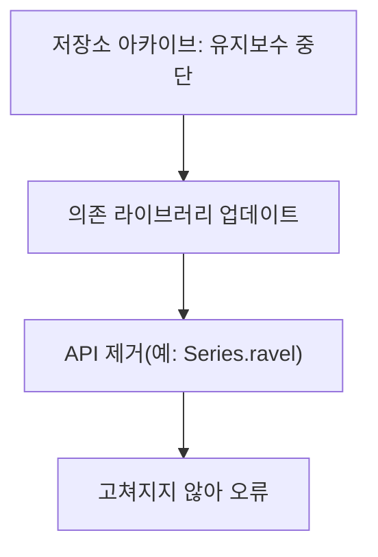

# 아카이브된 도구 사용 위험

> 오픈소스가 **"아카이브(읽기 전용)" 처리되어 더 이상 유지보수되지 않으면**, 시간이 지나 의존 라이브러리(pandas·protobuf 등)가 바뀔 때 **고쳐지지 않은 채 깨진다.** 쓰기 전에 상태를 확인하고, 깨질 때를 대비해 버전을 고정하거나 대체재를 알아 둬야 한다.

## 쉽게 말하면
단종된 가전제품은 지금은 잘 돌아가도 소모품·수리 부품이 끊기면 어느 날 고칠 수 없게 된다. 아카이브된 오픈소스도 같다. 오늘 되는 것이 내년에도 되리라는 보장이 사라진다.

## 자세히
(GitHub 저장소 `PAIR-code/facets` 첫 화면과 PyPI JSON을 WebFetch로 확인하고, 이 세션에서 `facets-overview`를 가상환경에 설치해 **직접 실행**했다. GitHub API는 403으로 열리지 않아 별도 지표는 확인하지 못했다.)
- **상태 확인(저장소)**: Facets 저장소는 **2024-07-27에 소유자가 아카이브**해 읽기 전용이다. 릴리스는 첫 화면에 표시되지 않고, "공식 Google 제품이 아니다"라고 적혀 있다. 알려진 이슈로 Chrome에서만 동작한다.
- **패키지 상태(PyPI)**: `facets-overview`의 최신 버전은 **1.1.1(2023-05-24)**. 의존성은 numpy ≥1.16.0, pandas ≥0.22.0, protobuf ≥3.20.0이고 `requires_python`은 지정돼 있지 않다.
- **직접 실행 결과(2026-11-22 설치 환경, Python 3.11)**
  | 환경 | 결과 |
  |---|---|
  | `facets-overview 1.1.1` + **pandas 3.1.1**(+numpy 2.4.6, protobuf 7.36.2) | `ProtoFromDataFrames` 호출이 **`AttributeError: 'Series' object has no attribute 'ravel'`**로 실패 |
  | 같은 패키지 + **pandas 2.2.3** | 성공(proto 1,297 bytes). 다만 **`Series.ravel is deprecated`** 경고가 출력됨 |
  → 아카이브 시점 이후 pandas에서 `Series.ravel`이 제거되어 **고쳐지지 않은 코드가 최신 pandas에서 깨졌다**. 패키지 메타데이터는 `pandas>=0.22.0`이라 설치는 막지 않는다. (이 노드가 직접 재현한 한 가지 호출이며 모든 기능이 깨졌다는 뜻은 아니다.)
- **체크리스트(제안)**
  1. 저장소가 **아카이브/마지막 커밋·릴리스 날짜**를 확인한다(PyPI 업로드 날짜 포함).
  2. 핵심 의존성의 **현재 버전**에서 작은 스모크 테스트를 돌려 본다.
  3. 필요하면 **버전을 고정**한다(`pandas<3` 등)하거나 별도 가상환경에 격리한다. → [가상환경에서 버전 고정](#pin-library-version-venv)
  4. 업무에 중요한 파이프라인에는 쓰지 않거나 **대체 도구**(예: TFDV·Great Expectations 등)를 병행한다.
  5. 포크가 활발한지 확인한다(이 노드에서는 확인하지 않음).

## 그림으로 보기

## 예시
- 블로그가 권하는 데이터 시각화 도구를 설치했는데 최신 pandas에서 AttributeError → 저장소가 아카이브된 상태이므로 pandas 버전을 낮춰 환경을 분리하거나 다른 도구를 쓴다.
- 교육 활동: 저장소 상태·PyPI 날짜·의존성 버전을 확인하는 3분 점검표를 직접 작성해 보기.

## 헷갈리는 것과 비교
| 개념 | 차이 |
|---|---|
| 아카이브된 도구 | 유지보수 중단, 읽기 전용 |
| 안정(stable) 도구 | 변경이 적어 오래 쓸 수 있음. 활발히 유지되는지는 별개 |
| [튜토리얼 버전 확인 습관](#tutorial-version-check) | 자료와 설치 버전을 대조 |
| [Facets Overview](#facets-overview) | 이 위험의 구체 사례 |

## 더 읽을거리
- [PAIR-code/facets (GitHub)](https://github.com/PAIR-code/facets) — 아카이브 상태 "archived by the owner on Jul 27, 2024"(직접 확인).
- [facets-overview (PyPI)](https://pypi.org/project/facets-overview/) — 1.1.1 릴리스와 의존성 메타데이터(JSON 직접 확인). 설치·실행 결과는 이 노드의 직접 시험이다.
