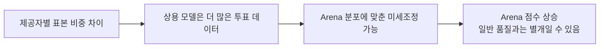
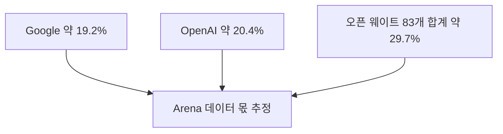

# Arena 데이터 접근 불균형

> 사용자 투표로 순위를 만드는 Chatbot Arena에서 제공자마다 모델이 투표(전투)에 노출되는 비율과 순위표에 머무는 기간이 달라, 일부 제공자가 더 많은 데이터와 피드백을 얻는다는 분석이다. 이 불균형은 점수 비교의 공정성과 "Arena에 맞춘 과적합" 문제로 이어진다.

## 쉽게 말하면
전교 모의고사에서 어떤 반은 시험을 매주 보고 다른 반은 한 달에 한 번 본다면, 자주 본 반은 시험 유형에 익숙해져 점수가 오른다. 실력이 같아도 시험 경험의 양이 달라서 생기는 차이다.

## 자세히
출처는 The Leaderboard Illusion(arXiv 2504.20879, 초록과 본문 앞부분 열람)이며 저자들의 분석이다. 해당 플랫폼의 입장은 이번에 확인하지 못했다.
- **표본 추출과 퇴출의 불균형**: 상용 비공개 모델이 오픈 웨이트·오픈소스보다 더 자주 표본으로 뽑히고 덜 퇴출된다. Google과 OpenAI가 Arena 데이터의 각각 약 19.2%·20.4%를 받은 반면 오픈 웨이트 모델 83개가 합쳐 약 29.7%를 받았다고 추정한다. 상용 제공자 전체는 약 61.4%이고 완전 오픈소스 41개는 합쳐 약 8.9%라고 한다. OpenAI·Google·Meta·Anthropic 4곳이 62.8%를 차지해 선도 학계·비영리 연구소 몫의 약 68배라고 쓴다. 하루 최대 표본 추출률은 Google·OpenAI가 34%, Reka가 3.3%였다.
- **데이터를 쓰면 얼마나 오르나(저자의 미세조정 실험)**: ArenaHard 승률이 Arena 데이터 0%에서 23.5%, 70%에서 49.9%로 112% 상대 상승했지만 MMLU는 66.5%에서 30% 데이터 때 64.4%로 내려갔다가 70%에서 65.9%로 회복해 향상이 Arena 분포에 특화돼 있을 가능성을 보였다. 이 때문에 저자는 모델들이 일반 품질이 아니라 Arena의 특성에 과적합한다고 주장한다. 실험 설계의 세부는 열람하지 못했다.
- **권고(같은 논문)**: 점수 철회 금지, 비공개 변형 수 상한 공개, 퇴출 기준 공개와 라이선스 범주별 하위 30% 퇴출, 공정한 표본 추출, 시험·퇴출·표본 모델 전체 목록 공개.
- **독자에게 주는 시사점(해석)**: 순위표 점수는 모델이 받은 표본 수와 최적화 노출의 차이에 영향받을 수 있다. 같은 점수라도 신뢰구간이 다르고, 업무 적합성은 자기 데이터로 확인해야 한다([자사 데이터로 직접 평가](#own-data-evaluation)).
- **한계(해석)**: 표본 비중 차이가 곧 순위 왜곡을 뜻하는 것은 아니다. 논문의 추정 비율은 공개 데이터와 가정에 기반하며 정확한 크기는 논란의 여지가 있다.

## 그림으로 보기

## 예시
- 모델 공급자를 고를 때 Arena 순위 하나로 결정하지 않고, 우리 업무 질문 200개로 후보를 비교한다.
- 교육 활용: "많이 연습한 학생의 점수 = 실력인가?"를 토론하며 벤치마크 점수의 해석 한계를 가르친다.

## 헷갈리는 것과 비교
| 개념 | 차이 |
| --- | --- |
| [선택적 점수 공개](#selective-score-disclosure) | 좋은 변형만 공개하는 편향. 이 글은 데이터 접근의 불균형 |
| [리더보드 작은 격차](#leaderboard-small-gap) | 상위 주제 |
| 데이터 오염 | 시험 문제가 학습 데이터에 섞이는 문제. 이 글은 투표 분포에 맞춘 최적화 |
| [자사 데이터로 직접 평가](#own-data-evaluation) | 순위표를 넘어 업무에 맞는 평가 |

## 더 읽을거리
- [The Leaderboard Illusion (arXiv 2504.20879)](https://arxiv.org/abs/2504.20879) — 데이터 접근 불균형 분석
