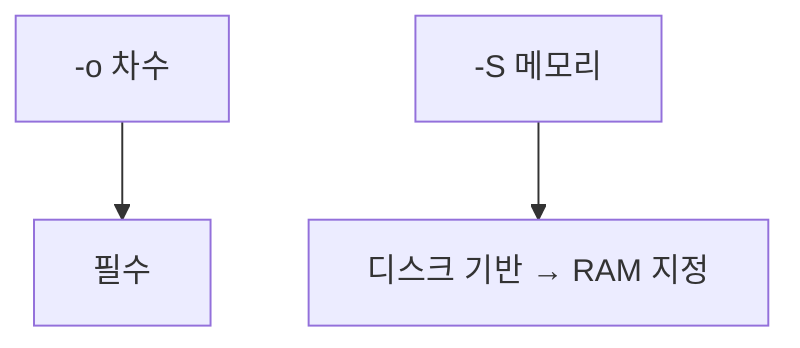

# ARPA 형식

> N-그램 언어 모델을 사람이 읽을 수 있는 텍스트로 저장하는 표준 형식이다. KenLM의 `lmplz`는 이 형식으로 모델을 내보내고 `build_binary`가 이진 형식으로 바꾼다.

## 쉽게 말하면
"이 단어 다음에 저 단어가 올 확률"을 적어 둔 큰 확률표를 텍스트 파일로 저장한 것이다. 사람도 열어 볼 수 있지만 실제 사용 때는 빠른 이진 형식으로 바꾼다.

## 자세히
(KenLM lmplz 문서를 직접 열어 확인. ARPA 파일 내부 문법의 세부는 이번에 확인하지 않았고 이 노드는 생성·변환 절차 중심이다.)
- **생성**: `bin/lmplz -o 5 -S 80% -T /tmp <text >text.arpa` — 말뭉치를 표준 입력으로 주면 ARPA 모델이 표준 출력으로 나온다. 수정 Kneser-Ney 스무딩으로 **가지치기 없는** 모델을 추정하며 디스크 기반이라 `-S`로 RAM을 지정한다.
- **옵션**: `-o` 차수(필수), `-S` 메모리 한도(접미사 %·b·K·M·G·T, 없으면 KB), `-T` 임시 파일 위치, `--prune`(기본 꺼짐, 차수별 임계값은 비감소·첫 값 0, 원시 빈도 기준), `--discount_fallback`(단일 출현 유니그램이 없는 클래스 기반 모델용), `--interpolate_unigrams 0`(SRILM과 같은 유니그램 처리, `<unk>`에 훨씬 큰 확률).
- **입력 형식**: 단어는 공백·탭·캐리지 리턴으로, 줄은 개행으로 구분. **UTF-8**이고 **토큰화는 미리** 해 둔다. BOM 제거. `<s>`, `</s>`, `<unk>`는 `--skip_symbols` 없이는 거부. gzip·bzip2·xz 입력은 컴파일 지원 시 가능.
- **이진 변환**: `bin/lmplz -o 5 <text | bin/build_binary /dev/stdin text.binary`.
- **한계(문서)**: 명시적 `<unk>`가 든 말뭉치는 미지원, 샤딩과 이진 직접 출력은 향후 과제.

## 그림으로 보기



## 예시
```bash
bin/lmplz -o 5 -S 80% -T /tmp < wiki.txt > wiki.arpa
bin/build_binary wiki.arpa wiki.bin
```
- 교육 활용: 작은 말뭉치로 직접 ARPA를 만들어 열어 보는 실습.

## 헷갈리는 것과 비교
| 개념 | 차이 |
|---|---|
| ARPA | 텍스트 형식(사람이 읽음) |
| KenLM 이진 형식 | 빠른 mmap 조회용 |
| [KenLM](#kenlm) | 이를 만드는 도구 |

## 더 읽을거리
- [KenLM 추정(lmplz) 문서](https://kheafield.com/code/kenlm/estimation/) — 옵션·입력 형식.
