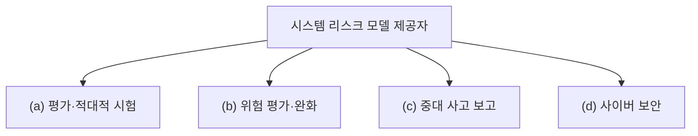
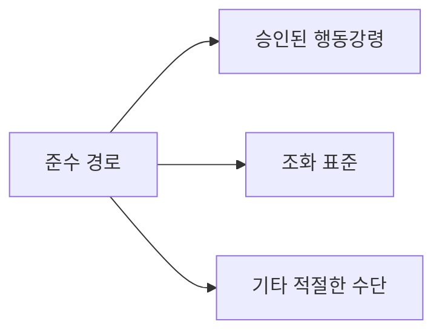

# 55조 시스템 리스크 의무

> EU AI Act 55조가 시스템 리스크가 있는 범용 AI(GPAI) 모델 제공자에게 53조·54조 의무에 더해 지우는 네 가지 의무: 평가(적대적 시험 포함), 위험 평가·완화, 중대 사고 보고, 사이버 보안. 준수는 행동강령·조화 표준·기타 수단 중 하나로 보인다.

## 쉽게 말하면
일반 제조사의 기본 안전 의무 위에, 대형 화물 트럭 제조사에게 충돌 시험 공개, 위험 분석 보고, 사고 즉시 신고, 보안 점검을 추가로 요구하는 것이다.

## 자세히
출처는 artificialintelligenceact.eu의 55조(열람)와 행동강령 안전·보안 장(앞부분 열람). 법률 자문이 아니다.
- **1항 (a) 평가**: 현재의 인정된 방법으로 모델을 시험하고 문서화된 "적대적 시험(adversarial testing)"으로 대규모 위험을 찾아 줄인다.
- **1항 (b) 위험 평가·완화**: EU 전역에 광범위한 위험을, 개발·출시·사용에서 비롯되는 것을 포함해 식별하고 줄인다.
- **1항 (c) 사고 보고**: 중대 사고와 시정 조치를 기록·문서화하고 AI Office(필요시 국가 당국)에 지체 없이 통지한다.
- **1항 (d) 사이버 보안**: 모델과 기반 인프라를 적절한 수준으로 보호한다.
- **2항 준수 경로**: 승인된 행동강령(56조)으로 조화 표준이 나오기 전까지 준수를 보일 수 있다. 행동강령도 표준도 따르지 않으면 집행위가 평가할 다른 적절한 수단을 보여야 한다. 조화 표준 준수는 해당 의무에 대한 적합 추정을 준다.
- **3항**: 영업비밀 등은 78조에 따라 비밀로 다룬다.
- **행동강령 안전·보안 장과의 대응(열람한 앞부분 기준)**: 평가는 위험 분석(약속 3)과 독립 외부 평가자 접근, 위험 완화는 약속 4~6, 사고 보고는 약속 9, 보안은 약속 6(보안 목표, 모델 탈취 방지)에 대응하는 것으로 읽을 수 있다. 이 대응은 이 글의 해석이다.
- **53·54조와의 관계**: 55조 제공자는 53조(기술 문서, 하류 정보, 저작권 정책, 학습 요약)와 54조(역내 대리인 등) 의무도 진다. 54조는 이번에 열지 않았다.
- **오픈소스 면제 제외**: 시스템 리스크 모델은 53조 2항의 오픈소스 면제를 받지 못한다([GPAI 오픈소스 면제](#open-source-exemption-gpai)).

## 그림으로 보기

## 예시
- 사고가 발생하면 제공자는 기록·문서화한 뒤 AI Office에 지체 없이 알린다(조문 구조에 따른 설명 예).
- 교육 실습: 네 의무 각각에 해당하는 구체 활동(예: 레드팀, 위험 시나리오 문서, 사고 로그, 접근 통제)을 한 줄씩 적는다.

## 헷갈리는 것과 비교
| 개념 | 차이 |
|---|---|
| 55조 의무 | 시스템 리스크 모델의 추가 의무 |
| 53조 의무 | 모든 GPAI 기본 의무 |
| [안전·보안 장](#safety-security-chapter) | 55조 이행 방법을 보이는 행동강령 장 |
| [시스템 리스크 모델](#systemic-risk-model) | 이 의무의 대상 |

## 더 읽을거리
- [AI Act Article 55](https://artificialintelligenceact.eu/article/55/) — 의무 조문(열람)
- [Code of Practice 안전·보안 장](https://code-of-practice.ai/?section=safety-security) — 이행 약속(앞부분 열람)
