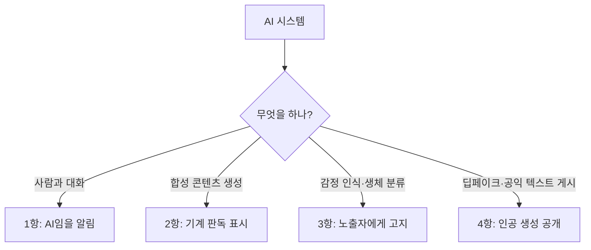
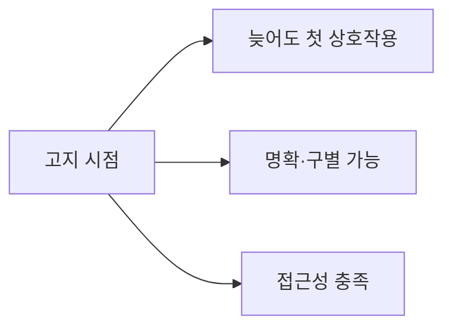

# 50조 투명성 의무

> EU AI Act 50조: 사람과 직접 대화하는 AI는 AI임을 알리고, 합성 콘텐츠(음성·이미지·영상·텍스트)는 기계가 읽을 수 있게 표시하며, 감정 인식·딥페이크·공익 텍스트를 쓰는 배포자는 고지해야 한다는 의무.

## 쉽게 말하면
"이 상담원은 AI입니다", "이 영상은 AI로 만들었습니다" 같은 표시를 하라는 법이다. 속지 않을 권리를 위한 라벨이다.

## 자세히
출처는 artificialintelligenceact.eu의 50조와 113조 페이지(열람). 이 페이지는 개정 표시("amended", "new")와 충돌하는 문구가 섞여 있어, 확정 문구와 날짜는 관보(Official Journal)로 확인해야 한다. 법률 자문이 아니다.
- **1항(상호작용 AI의 제공자)**: 사람과 직접 상호작용하도록 의도된 시스템은 사용자가 AI와 대화 중임을 알 수 있게 설계해야 한다. 합리적으로 잘 아는 사람에게 명백한 경우는 제외. 범죄 수사·기소 목적의 법적 허가 시스템은 예외(일반에 공개된 범죄 신고용은 제외).
- **2항(생성형 AI의 제공자)**: 범용 AI를 포함해 합성 음성·이미지·영상·텍스트를 생성하는 시스템은 출력이 "기계가 읽을 수 있는 형식으로 표시되고 인공적으로 생성·조작된 것으로 탐지 가능"해야 한다. 기술적으로 가능한 범위에서 효과적·상호운용적·견고·신뢰할 수 있는 해법. 보조적 표준 편집, 입력 데이터를 실질적으로 바꾸지 않는 출력, 법적으로 허용된 수사 용도는 제외.
- **3항(감정 인식·생체 분류 배포자)**: 노출된 사람에게 시스템의 작동을 알리고 개인정보는 GDPR 등에 따라 처리. 수사 용도 예외.
- **4항(딥페이크·공익 텍스트 배포자)**: 딥페이크 이미지·음성·영상은 인공적으로 생성·조작됐음을 공개. 명백히 예술·창작·풍자·허구 작품은 감상을 해치지 않는 방식으로 존재만 알려도 된다. 공익 사안을 대중에게 알리려고 게시하는 AI 생성·조작 텍스트도 공개해야 하나, 사람의 검토나 편집 통제를 거쳐 편집 책임자가 있으면 공개 의무가 없다.
- **5항(방식)**: 정보는 명확하고 구별 가능해야 하며 늦어도 첫 상호작용·노출 시 제공하고 접근성 요건을 충족한다.
- **6항**: 고위험 의무나 다른 EU·국내 투명성 의무에 영향을 주지 않는다.
- **7항**: 집행위는 AI 생성 콘텐츠의 탐지·표시·라벨링 행동강령을 장려하고, 부적절하면 이행법으로 공통 규칙을 정할 수 있다.
- **적용일(113조 페이지)**: 일반 적용일은 2026-08-02. 같은 페이지는 고위험 AI(부속서 III)가 2027-12-02, 부속서 I 계열이 2028-08-02이고 일부 조항은 더 이른 날짜라고 적지만, 충돌하는 문구가 있다고 스스로 경고한다. 과징금은 50조 본문에 없고 99조를 봐야 한다(이번에 확인하지 않음).
- 50조가 적용되는 세부 유예(기존 시스템 등)가 개정으로 있는지는 이번 자료로 확인하지 못했다.

## 그림으로 보기

## 예시
- 챗봇 첫 인사에 "AI 상담원입니다" 표시, 이미지 생성 서비스는 출력 파일에 메타데이터·워터마크 표시(방식은 기술적으로 가능한 범위).
- 교육 실습: 자기 회사 AI 기능 5개를 1~4항 중 어느 의무에 해당하는지 표로 분류.

## 헷갈리는 것과 비교
| 개념 | 차이 |
|---|---|
| 제공자 의무(1·2항) | 시스템 설계·표시 |
| 배포자 의무(3·4항) | 사용 단계의 고지 |
| 고위험 의무 | 별도 장(III), 50조는 영향 주지 않음 |
| [AI Act 적용 일정](#ai-act-enforcement-timeline) | 날짜 구조 |

## 더 읽을거리
- [AI Act Article 50](https://artificialintelligenceact.eu/article/50/) — 조문(열람)
- [AI Act Article 113](https://artificialintelligenceact.eu/article/113/) — 적용일(열람)
