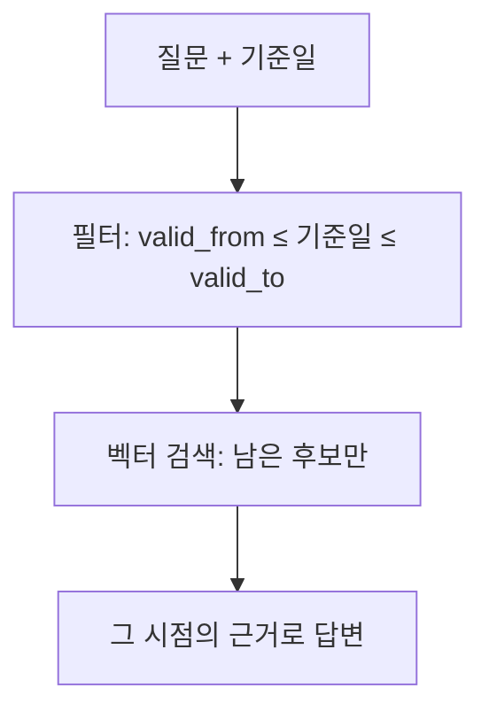
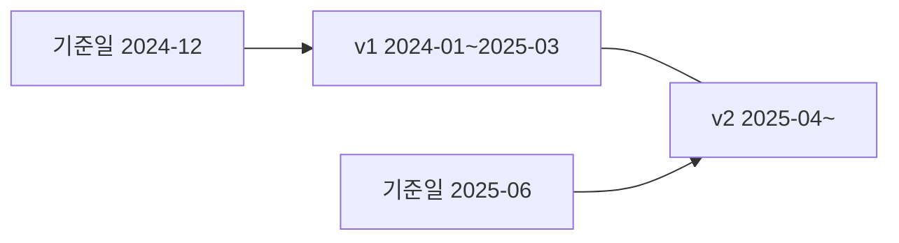

# as-of 날짜 필터

> RAG 검색에서 **"지정한 기준일(as-of date) 시점에 유효했던 문서만" 근거 후보로 남기는 필터**다. 문서에 유효 시작일·종료일을 붙여 두고 검색 전에 거른다. "작년 규정은 뭐였지?"처럼 과거 시점의 정답이 필요한 질문과 낡은 문서 배제에 쓴다.

## 쉽게 말하면
법전에는 개정 이력이 있어서 "2024년 12월 시점의 환불 규정"을 보려면 그날 유효했던 조문만 펼쳐야 한다. 최신 조문만 보면 과거 질문에 틀린 답을 하고, 옛 조문까지 섞으면 현재 질문에 틀린 답을 한다.

## 자세히
(이 세션에서 `langchain-core` **1.8.4**의 `InMemoryVectorStore`와 가짜 임베딩으로 **직접 실행**한 장난감 실험이다. 임베딩이 가짜라 **검색 순위 자체는 의미가 없고** 필터의 통과/제외 동작만 본다. 다른 벡터 DB는 필터 문법이 다르다.)
- **설정(실행)**: 환불 정책 문서 2개 — "14일"(유효 2024-01-01~2025-03-31), "30일"(유효 2025-04-01~9999-12-31) — 와 배송 문서 1개(2023-06-01부터 계속). 메타데이터에 `valid_from`, `valid_to`를 넣고, 필터 함수 `valid_from <= 기준일 <= valid_to`(ISO 날짜 문자열 비교)로 거른다.
- **결과(실행)**: 검색어 "Refund policy"
  | 기준일 | 반환 문서 |
  |---|---|
  | 2024-12-01 | 배송 5일, **환불 14일** |
  | 2025-06-15 | 배송 5일, **환불 30일** |
  | 2022-01-01 | **없음**(그 시점에 유효한 문서가 없음) |
  | (필터 없음) | 배송, **환불 30일, 환불 14일 둘 다** |
  → 필터 없이는 **옛 규정과 새 규정이 함께** 반환되어 모델이 어느 쪽이 현재인지 모른다. as-of 필터는 한 시점에 유효한 버전 하나만 남긴다. 유효 문서가 없으면 **빈 결과**가 나오므로 "근거 없음"으로 답하는 처리가 필요하다.
- **이 방식이 사전 필터(pre-filter)다**: 순위를 매기기 전에 후보를 제한하므로 낡은 문서가 후보에 못 들어온다. 시간 감쇠(최신에 가중)와 달리 **확정적 제외**다. → [신선도 메타데이터](#freshness-metadata)
- **설계 요점(제안)**: ① 문서 버전마다 `valid_from`/`valid_to`(또는 `version`)를 기록 ② 질문에서 기준일을 추출하거나, 없으면 "오늘"을 기본값으로 ③ 날짜 형식은 ISO(YYYY-MM-DD)로 통일(문자열 비교가 순서와 일치) ④ 종료일 없는 문서는 먼 미래 값(예: 9999-12-31)으로 표현 ⑤ 개정 시 옛 문서를 **삭제하지 말고 종료일만 닫아** 과거 질문에도 답할 수 있게 한다. 삭제 정책과 충돌할 수 있다. → [Tombstone 삭제](#tombstone-deletion)
- **한계**: 이 시험은 날짜가 정확히 메타데이터에 있다는 전제이며, 질문에서 기준일을 올바르게 뽑는 일(자연어 → 날짜)은 시험하지 않았다.

## 그림으로 보기

## 예시
- "2024년 12월 기준 환불 기간은?" → 기준일 2024-12-01로 필터해 14일 문서만 근거로 사용.
- 교육 활동: 규정 개정 이력 3개를 표로 만들고 기준일 5개에 대해 어떤 버전이 유효한지 채워 보기.

## 헷갈리는 것과 비교
| 개념 | 차이 |
|---|---|
| as-of 필터 | 기준일에 유효한 문서만 남김(확정 제외) |
| 시간 감쇠 | 최신에 가중치(낡은 문서도 후보에 남음) |
| [질의 인식 최신성 게이트](#query-aware-recency-gate) | 질문에 따라 최신성 적용 여부를 결정 |
| [신선도 메타데이터](#freshness-metadata) | 이 필터가 쓰는 필드 |

## 더 읽을거리
- [langchain_core InMemoryVectorStore (LangChain 참조)](https://reference.langchain.com/python/langchain_core/) — 이 노드는 설치한 패키지로 필터 동작을 직접 시험했으며, 참조 페이지는 목차 수준으로만 열렸다. 표의 결과는 이 노드의 직접 실행이다.
- [Stale retrieval and RAG data quality (tianpan.co)](https://tianpan.co/blog/2026/04/15/stale-retrieval-rag-data-quality) — 시간 감쇠와 사전 필터의 비교(직접 확인, 개인 블로그).
