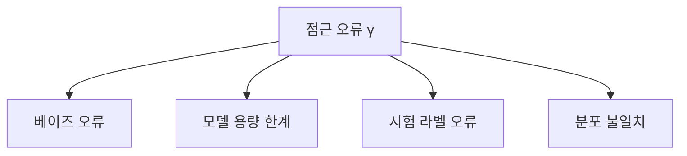

# 점근 오류

> 학습 데이터를 **무한히 늘려도 남는 오류**. 학습 곡선을 ε(m) = a·m^(−β) + γ로 맞출 때 상수 항 **γ**가 점근 오류다. 모델 용량 한계·베이즈 오류·라벨 노이즈가 만드는 바닥이다.

## 쉽게 말하면
공부 시간을 무한히 늘려도 시험 문제에 오타가 5% 있으면 95점이 한계다. 공부(데이터)를 늘릴수록 점수는 오르지만 어느 순간부터 곡선이 눕는다. 그 눕는 높이가 점근 오류다.

## 자세히
(Hestness 외, "Deep Learning Scaling is Predictable, Empirically", arXiv 1712.00409 본문 확인)
- **학습 곡선의 모양**: 일반화 오류 ε는 학습 표본 수 m에 대해 **멱법칙(power law)** ε(m) ∝ α·m^β_g를 따른다. 이론은 β_g = −0.5 또는 −1을 예측하지만, 논문은 실제 응용에서 **β_g가 −0.07~−0.35** 사이로 정착하는 것을 경험적으로 보고한다(이론으로 설명되지 않음).
- **세 영역(논문)**: ① 작은 데이터에서 **best-guessing 영역** ② **멱법칙 영역** ③ 충분히 큰 데이터에서 **베이즈 오류 같은 환원 불가 오류가 지배하는 포화 영역**. 용량이 소진되어 평탄해질 때의 오류가 γ이며 ε(m) ∼ α·m^β_g + γ로 쓴다.
- **논문의 맞춤 예(번역 모델 두 크기)**: ε₂₀₈(m) = 41.2 m^(−0.36) + 0.39, ε₅₁₂(m) = 21.5 m^(−0.30) + 0.32 같은 "멱법칙+상수" 형태로 단일 모델군의 학습 곡선이 잘 표현된다(은닉 노드 208·512, 단위·평가지표는 논문 설정). 최적 모델을 조합한 곡선은 γ 없이 ε = 3.87 m^(−0.13)로 더 긴 멱법칙 영역을 보인다. 언어 모델은 β_g ∈ [−0.09, −0.06]으로 작아 정확도를 크게 올리려면 **훨씬 많은 데이터가 필요**하다. 개선된 모델·최적화는 **절편은 개선하지만 지수는 바꾸지 않는다**.
- **γ를 빼고 맞추면 생기는 오류(직접 계산)**: 진짜 곡선 ε = 2.0·m^(−0.35) + 0.05에서 m = 10³~10⁶ 7점을 뽑았다.
  | 맞춤 | 추정 지수 | m=10⁸ 예측 | 진짜 값(0.0532) 대비 |
  |---|---|---|---|
  | γ 없이 로그-로그 직선 | −0.18 | 0.0261 | 절반으로 **과소 예측**(데이터를 더 모으면 크게 좋아질 것이라는 착시) |
  | γ 포함(격자 탐색) | −0.35, γ=0.05 | 0.0532 | 정확 |
  γ를 무시하면 곡선이 계속 내려갈 것으로 보여 **데이터 추가 효과를 과대평가**한다.
- **점근 오류의 구성(해석, 일반 지식)**: ① 베이즈 오류(입력이 정보 부족) ② 모델 용량·구조 한계 ③ 시험 세트 라벨 오류([라벨 모호함의 상한](#label-ambiguity-ceiling)) ④ 학습·시험 분포 불일치. 
- **쓰임**: 데이터를 더 모으기 전에 γ를 추정해 "더 모아도 의미 있는가"를 판단하고, γ가 사람 수준 오류([사람 수준 정의](#human-level-definition))와 비슷하면 데이터가 아니라 모델·라벨·문제 정의를 본다.
- **한계**: γ 추정은 맞춤에 쓴 구간에 민감하다([맞춤 범위 안정성](#fit-range-stability)). 위 두 곡선 예는 논문의 특정 도메인·모델에서의 값이다.

## 그림으로 보기



## 예시
```python
import numpy as np
from scipy.optimize import curve_fit
f = lambda m, a, b, g: a * m**(-b) + g
(a, b, g), _ = curve_fit(f, sizes, errors, p0=[1, 0.3, 0.05], bounds=([0, 0, 0], [np.inf, 2, 1]))
print("지수 β =", b, "점근 오류 γ =", g)
```
- 학습 데이터 1만→2만→4만 개 오류가 12%→10.5%→9.8%로 줄면 γ를 추정해 8만 개로 늘릴 때의 이득이 γ에 가까워졌는지 판단한다.

## 헷갈리는 것과 비교
| 개념 | 의미 |
|---|---|
| 점근 오류 γ | 데이터 무한대에서의 오류 |
| 지수 β | 곡선의 가파름 |
| 절편 α | 모델 개선이 바꾸는 값 |
| [베이즈 오류](#bayes-error) | γ를 이루는 이론적 하한 성분 |

## 더 읽을거리
- [Deep Learning Scaling is Predictable, Empirically (arXiv 1712.00409)](https://arxiv.org/abs/1712.00409) — 멱법칙 학습 곡선·세 영역·지수 범위(PDF 본문 확인). γ 무시 오류 표는 이 글의 직접 계산.
