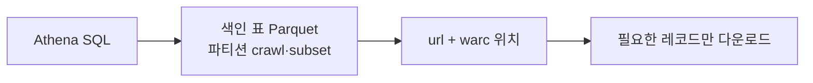
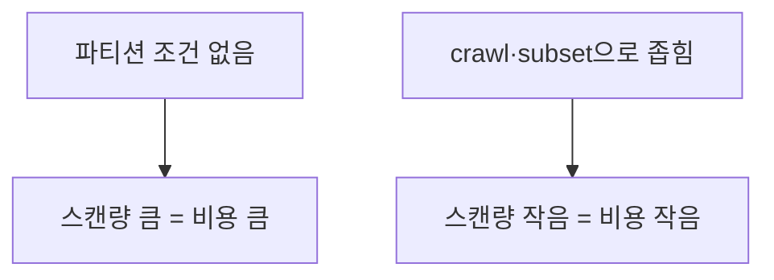

# Athena로 Common Crawl 색인 조회

> AWS Athena에서 **SQL로 Common Crawl의 Parquet 색인 표를 조회**해, 언어·도메인 같은 조건에 맞는 페이지의 WARC 위치(파일·오프셋·길이)만 뽑는 방법. 서버 없이 쓰고 스캔한 데이터 양만큼 요금이 든다.

## 쉽게 말하면
수십억 페이지의 "카드목록"을 SQL로 검색해 "노르웨이 도메인이면서 100쪽 이상인 사이트"처럼 후보만 먼저 추린다. 본문은 그다음에 필요한 것만 내려받는다.

## 자세히
(Common Crawl 블로그 "Index to WARC Files and URLs in Columnar Format"(2018-03)과 GitHub `commoncrawl/cc-index-table` README를 직접 읽음. 블로그는 "Columnar Index"가 "URL Index"로 이름이 바뀌기 전 글이라 스키마가 달라졌을 수 있다.)
- **준비 3단계(README)**: ① `CREATE DATABASE ccindex` 후 선택 ② 표 생성문(flat 또는 nested 스키마)에서 표 이름과 `s3://` 경로를 설정해 실행. 블로그 예시의 경로는 `s3://commoncrawl/cc-index/table/cc-main/warc/` ③ `MSCK REPAIR TABLE ccindex`로 파티션 등록(새 크롤 파티션이 생길 때마다 반복).
- **파티션**: `crawl`(예 CC-MAIN-2024-51)과 `subset`(warc 등). 예시들은 `WHERE crawl = '…' AND subset = 'warc'`로 파티션을 먼저 좁힌다. 파티션 조건 없이 전체를 읽으면 스캔량이 커진다(제안, README가 명시한 권고는 아님).
- **열**: `url_host_name`, `content_languages`, `warc_filename`, `warc_record_offset`, `warc_record_length` 등(블로그 직접 읽음). 마지막 세 열이 레코드 위치다.
- **요금**: Athena는 스캔량 과금이며 블로그 작성 시점에 TiB당 5달러였다. 한 달치 색인이 약 300GB지만 파티션으로 거르면 적게 읽는다. 블로그의 `.no` 도메인 예시는 2.12MB 스캔, 1센트 미만. 현재 요금과 비교는 AWS 문서를 확인해야 한다(미확인).
- **예시 쿼리(블로그·README에 있는 용도)**: 한 크롤에서 `.no` TLD 등록 도메인별 페이지 수(100쪽 이상 도메인), 언어 코드로 필터(README는 아이슬란드어 `isl` 예시 SQL 파일 `get-records-for-language.sql`을 제공).
- **한국어 사례(제안, 직접 실행하지 않음)**: 
  ```sql
  SELECT url, warc_filename, warc_record_offset, warc_record_length
  FROM ccindex
  WHERE crawl = 'CC-MAIN-2024-51' AND subset = 'warc'
    AND content_languages = 'kor'
    AND fetch_status = 200
  LIMIT 1000;
  ```
  열 이름과 값 형식은 현재 스키마에서 확인하고, 작게 `LIMIT`로 먼저 시험한다. `content_languages`는 `kor`처럼 단일 값뿐 아니라 `ell,eng` 같은 목록 값이 있어 `LIKE` 등으로 다뤄야 할 수 있다([색인 언어 판정](#index-language-accuracy)).
- 이 표에서 얻은 위치로 해당 레코드만 받는 방법은 [오프셋으로 레코드 받기](#record-fetch-by-offset)에서 다룬다(블로그 자체에는 이 절차가 없다).

## 그림으로 보기



## 예시
| 조건 | 목적 |
|---|---|
| `.no` 도메인, 한 크롤, 100쪽 이상 | 대형 사이트 목록(블로그 예시, 2.12MB 스캔) |
| `content_languages` = 아이슬란드어 | 언어별 레코드(README 예시) |
| 한국어 + 상태 200 | 한국어 코퍼스 후보(제안) |
- 업무 장면: 교육 실습에서 "한국어 웹 페이지 1,000개의 위치 목록"을 SQL 한 줄로 뽑아 보여 주고, 스캔량 표시를 보며 비용 감각을 익힌다.

## 헷갈리는 것과 비교
| 개념 | 차이 |
|---|---|
| Athena 색인 조회 | SQL로 위치 목록 추출 |
| [열 기반 색인](#columnar-index-parquet) | 조회 대상인 Parquet 표 자체 |
| [오프셋으로 레코드 받기](#record-fetch-by-offset) | 뽑은 위치로 실제 본문 받기 |
| CDX API | URL 단위 조회. 조건 대량 선별에는 SQL이 유리(일반 설명) |

## 더 읽을거리
- [Index to WARC Files and URLs in Columnar Format (Common Crawl 블로그)](https://commoncrawl.org/blog/index-to-warc-files-and-urls-in-columnar-format) — 표 생성·예시 쿼리·요금(직접 읽음).
- [commoncrawl/cc-index-table (GitHub)](https://github.com/commoncrawl/cc-index-table) — 파티션·Athena 사용법(직접 읽음).
