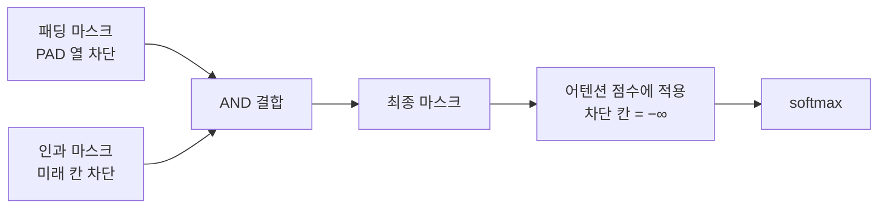

# 마스크 합치기 (패딩 마스크 + 인과 마스크)

> 실제 모델 안에서는 "PAD는 보지 마라"는 패딩 마스크와 "미래 토큰은 보지 마라"는 인과 마스크를 함께 적용해, 어떤 토큰이 어디까지 볼 수 있는지 하나의 규칙으로 만든다.

## 쉽게 말하면
시험장에서 "빈 좌석은 보지 마라"와 "내 뒷자리는 보지 마라"를 동시에 지키는 것이다. 두 금지 조건을 겹쳐 남은 자리만 볼 수 있다.

## 자세히
- **attention mask(패딩 마스크)**: 배치에서 토큰이 실제(1)인지 PAD(0)인지 표시. 모델이 PAD를 참고하지 않게 한다(Hugging Face 용어집, 2026-11 확인).
- **인과 언어 모델링(causal LM)**: 글을 순서대로 읽으며 다음 단어를 예측하고, 모델 내부 마스크로 미래 토큰을 숨긴다(HF 용어집). 디코더 모델이 이것이다.
- **합치기(일반 원리)**: 어텐션 점수 행렬에서 "허용 = 인과 허용 AND 패딩 아님"인 칸만 남기고 나머지는 −∞로 만든 뒤 softmax한다. 두 마스크를 논리곱(또는 점수에 더하기)으로 결합한다. 구현 세부는 라이브러리 버전에 따라 다르다.
- 인코더(양방향 [bidirectional attention](#bidirectional-attention))는 인과 마스크가 없고 패딩 마스크만 쓴다.
- [좌측 패딩](#left-vs-right-padding)과 함께 쓸 때는 위치 id도 PAD를 건너뛰어 계산되어야 한다(일반 구현 주의점).

## 그림으로 보기

## 예시
토큰 3개 + PAD 1개(좌측 패딩)인 문장에서 3번째 실제 토큰은 자기 자신과 앞의 실제 토큰만 볼 수 있고, PAD와 뒤 토큰은 볼 수 없다.

## 헷갈리는 것과 비교
| 개념 | 차이 |
|---|---|
| 패딩 마스크 | 빈칸 무시 |
| 인과 마스크 | 미래 무시(디코더) |
| [양방향 어텐션](#bidirectional-attention) | 인과 마스크 없음(인코더) |
| [masked language modeling](#masked-language-modeling) | 입력 토큰을 가리는 학습 방식 — 어텐션 마스크와 다름 |

## 더 읽을거리
- [Glossary (Hugging Face)](https://huggingface.co/docs/transformers/glossary) — attention mask·causal LM 정의.
