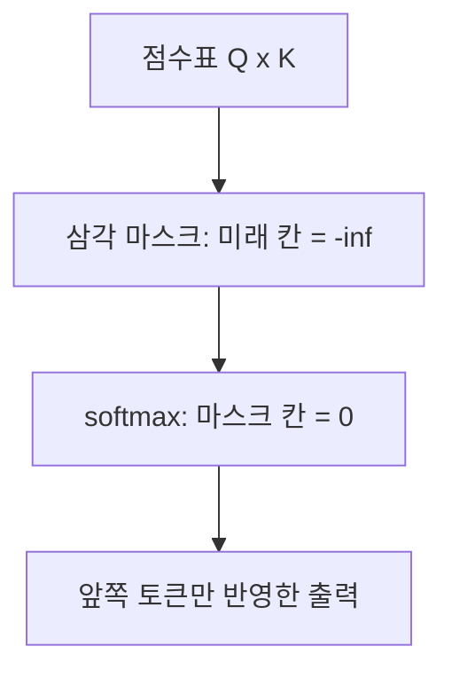
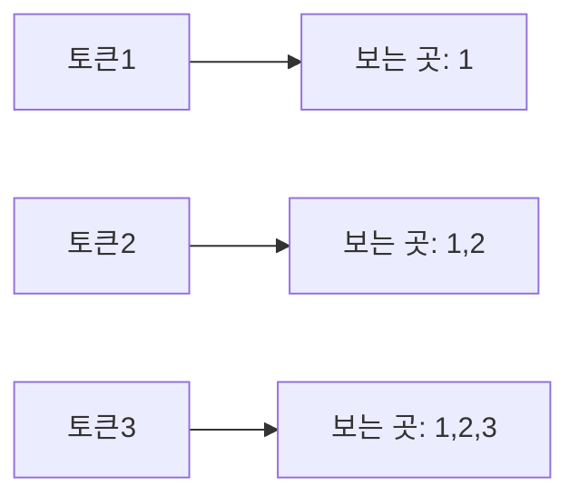

# 어텐션 마스크

> 어텐션 마스크는 셀프 어텐션 점수에서 보면 안 되는 위치(미래 토큰, 패딩)를 가려 가중치를 0으로 만드는 장치다. 생성형 LLM이 "미래를 못 보게" 하는 핵심이다.

## 쉽게 말하면
시험지의 정답 부분을 종이로 가리고 푸는 것이다. 문제를 풀 때(다음 토큰 예측) 뒤에 나올 답을 못 보게 가려야 진짜 실력이 길러진다.

## 자세히
Jay Alammar "Illustrated GPT-2" 설명 기준:
- 셀프 어텐션은 각 토큰의 query와 모든 토큰의 key를 곱해 점수표를 만든다. **마스크드 셀프 어텐션**은 이 점수표에서 자기보다 오른쪽(미래) 칸을 막아 자기와 앞쪽 토큰만 보게 한다.
- 마스크는 보통 **삼각 행렬**이다. 막을 칸에 −∞ 또는 아주 큰 음수(GPT-2는 −10억)를 넣는다. **소프트맥스 이전**에 적용하므로 소프트맥스 후 그 칸의 가중치는 사실상 0이 된다.
- 학습 때는 문장 전체를 한 번에 넣어도 모든 위치의 다음 토큰 예측을 동시에 병렬 학습할 수 있다. 마스크 덕분이다([다음 토큰 예측](#next-token-prediction), [셀프 어텐션](#self-attention)).
- 생성 때는 앞 토큰의 key·value를 저장해 재사용하고 새 토큰만 계산한다([KV 캐시](#kv-cache)).
- 또 다른 마스크: **패딩 마스크**는 길이를 맞추려고 채운 빈 토큰을 무시하게 한다.

## 그림으로 보기

## 예시
"robot must obey"에서 `must` 위치는 robot과 must만 보고 다음 토큰을 예측한다. `obey`는 가려져 있다.

## 헷갈리는 것과 비교
| 개념 | 차이 |
|---|---|
| 인과(미래) 마스크 | 미래 토큰 차단. 생성 모델용 |
| 패딩 마스크 | 채우기 토큰 무시 |
| 양방향 어텐션(BERT류) | 마스크 없이 양쪽 문맥 사용 |

## 더 읽을거리
- [The Illustrated GPT-2](https://jalammar.github.io/illustrated-gpt2/) — 마스크드 셀프 어텐션 그림 설명.
