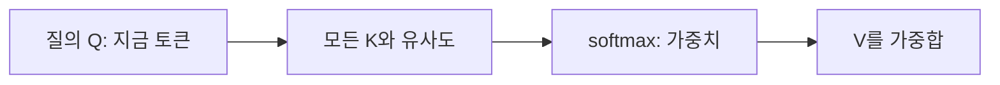
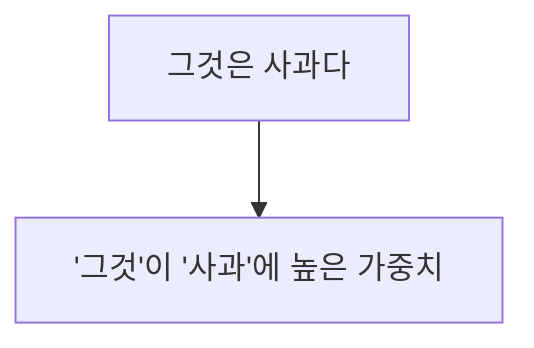

# 어텐션

> 한 토큰이 처리될 때 **문장 안의 다른 토큰들이 얼마나 관련 있는지 점수를 매겨, 관련 높은 정보를 더 많이 섞어 가져오는** 연산. 트랜스포머의 핵심이다.

## 쉽게 말하면
회의록을 읽다가 "그것"이라는 단어가 나오면 앞 문장들을 훑어 "그것"이 가리키는 말에 주의를 더 주는 것과 같다. 모든 단어를 같은 비중으로 보지 않고 관련 있는 곳에 집중한다.

## 자세히
- 논문: Vaswani 외, *Attention Is All You Need*(arXiv 1706.03762, 초록 읽음). 당시 주류였던 순환·합성곱 신경망 기반 시퀀스 변환 모델을 대체해 **순환과 합성곱을 완전히 버리고 어텐션만** 쓰는 트랜스포머를 제안했다.
- 초록의 결과: WMT 2014 영어→독일어 **28.4 BLEU**(앙상블 포함 기존 최고보다 2점 넘게 높음), 영어→프랑스어 단일 모델 **41.8 BLEU**(당시 최고), 학습은 **GPU 8개로 3.5일**로 기존 최고 모델 비용의 일부.
- 핵심 수식(논문 본문의 표준 정의, 이번에는 초록만 열람했으므로 일반 지식으로 표기): `Attention(Q,K,V) = softmax(QKᵀ/√d_k)·V`. 각 토큰이 질의(Q)가 되어 모든 토큰의 키(K)와 비교해 점수를 얻고, 점수를 확률로 바꾼 가중치로 값(V)을 섞는다.
- 의미: 거리가 먼 토큰도 한 번에 연결(순환 모델은 순서대로 전달). 병렬 계산에 유리해 대규모 학습이 가능해졌다(일반 설명).
- 비용: 토큰 수 n에 대해 쌍 비교가 n²로 늘어 긴 문맥에서 계산·메모리가 커진다(일반 설명). 이 때문에 KV 캐시, 긴 컨텍스트 최적화가 중요하다([KV 양자화](#kv-quantization) 참고).

## 그림으로 보기

## 예시
- "은행에 갔다"의 "은행"이 앞뒤 단어("강", "돈")에 따라 다른 문맥 표현을 얻는 것.
- 교육: 표로 4개 토큰의 가중치 행렬을 손으로 그려 보는 활동(실제 모델은 수십~수백 개 헤드).

## 헷갈리는 것과 비교
| 개념 | 차이 |
|---|---|
| 어텐션 | 토큰 간 관련도로 정보를 섞음 |
| 순환 신경망 | 순서대로 상태를 전달 |
| [KV 양자화](#kv-quantization) | 어텐션에 필요한 캐시 메모리를 줄임 |

## 더 읽을거리
- [Attention Is All You Need](https://arxiv.org/abs/1706.03762) — 트랜스포머 원 논문(초록 읽음).
