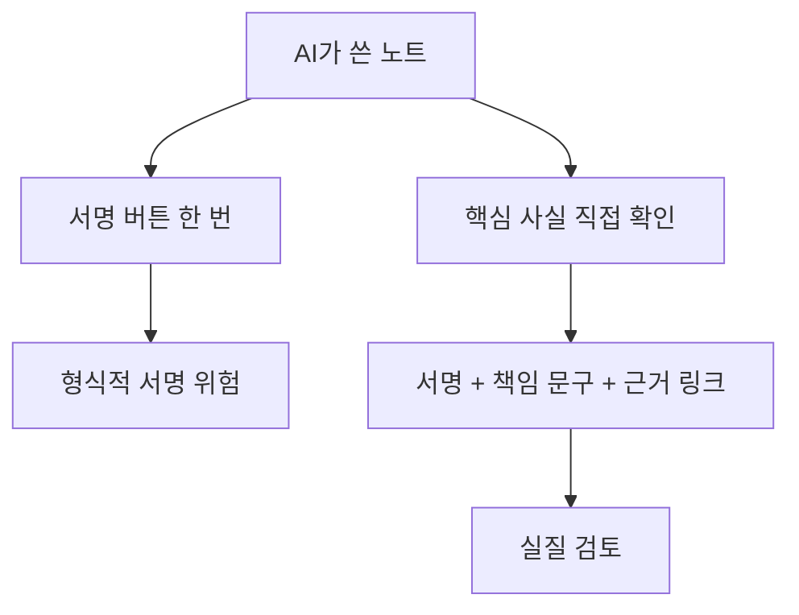
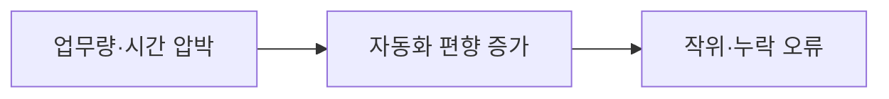

# 한 번 클릭 인증의 약점

> AI가 쓴 기록(진료 노트 등)을 사람이 "검토했음" 버튼 한 번으로 서명하게 하는 설계는, 자동화 편향 때문에 형식적 서명으로 흐르기 쉽다. 검토가 실질적이도록 설계가 필요하다.

## 쉽게 말하면
이용약관의 "동의" 버튼을 읽지 않고 누르는 것과 같다. 버튼 하나로 책임이 이전되는 구조라면 바쁜 사람은 읽지 않고 누르게 된다.

## 자세히
출처는 Goddard·Roudsari·Wyatt의 자동화 편향 체계적 문헌 고찰(JAMIA 2012, PMC3240751, 열람)이다. 이 노드의 "한 번 클릭 인증"에 대한 직접 연구는 이번에 확인하지 못했고, 아래 설계 시사점은 이 고찰의 일반 결과를 적용한 해석이다.
- **자동화 편향(AB) 정의**: 자동화된 조언에 과의존하는 경향. 사용자가 컴퓨터 출력을 덜 경계하며 확인한다. 틀린 조언을 따르는 작위 오류(commission)와 알림이 없을 때 행동하지 않는 누락 오류(omission)를 낳는다.
- **규모**: 5개 데이터베이스에서 13,821편을 찾아 74편이 포함 기준을 충족했다. 비교 가능한 4개 보건의료 연구의 통합 위험비 1.26(95% CI 1.11~1.44)로, 임상 의사결정 지원이 틀린 조언을 줬을 때 의료진은 대조군보다 약 26% 더 자주 틀린 결정을 했다. 별도 4개 연구에서는 임상가의 올바른 답이 조언 뒤 틀린 답으로 바뀐 경우가 6~11%였다.
- **매개 요인**: 사용자 요인(과업·시스템 경험, 인지 양식, 과신 또는 낮은 자기 확신) 그리고 환경 요인(높은 업무량, 과업 복잡도, 시간 압박).
- **완화책**: 교육과 사용자 책임 강조(근거는 혼재, 한 연구는 교육 효과 없음), 설계 면에서 화면에서 조언의 눈에 띄는 정도 낮추기, 조언마다 갱신된 신뢰도 표시, 직접 권고 대신 정보 제공.
- **주의**: AB는 보통 사후 분석에서 부수적으로 보고되었고 포함 연구가 이질적이며, 저자들은 경험적 근거가 아직 명확하지 않다고 설명한다.
- **적용(해석)**: 한 번 클릭 인증을 줄이려면 (1) 서명 전에 AI가 만든 핵심 사실(약물·용량 등)을 사용자가 직접 확인·입력하게 하는 인지 강제, (2) 서명 시 책임 문구와 근거 링크, (3) 업무량이 클 때 검토 시간 확보, (4) 무수정 서명 비율 같은 지표로 형식화를 감시([인지 강제 기능](#cognitive-forcing-function), [수락 후 수정률](#post-acceptance-edit-rate)). 이들 설계의 효과는 이 고찰이 직접 시험한 것이 아니다.

## 그림으로 보기

## 예시
- 약물 용량 항목은 AI 초안을 그대로 승인하지 않고 의사가 값을 확인·입력해야 서명 가능하게 하는 화면(설계 예시).
- 교육 실습: 서명 화면 두 가지(버튼 하나 vs 핵심 항목 확인 후 서명)를 설계해 검토 시간이 어떻게 달라질지 가설을 세운다.

## 헷갈리는 것과 비교
| 개념 | 차이 |
|---|---|
| 한 번 클릭 인증 | 버튼 하나로 서명 |
| 실질 검토 | 핵심 사실을 확인하고 서명 |
| [무수정 서명 비율](#unedited-note-rate) | 형식화를 감지하는 지표 |
| [AI 과소의존](#undertrust-ai) | 반대 방향 오류 |

## 더 읽을거리
- [Goddard 외: Automation bias (PMC3240751)](https://pmc.ncbi.nlm.nih.gov/articles/PMC3240751) — 빈도·매개 요인·완화책(열람)
