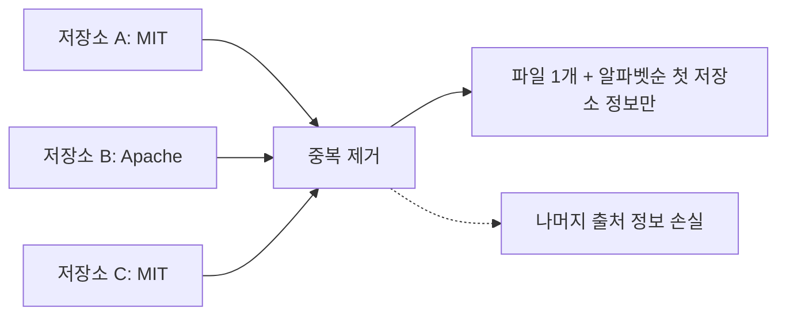
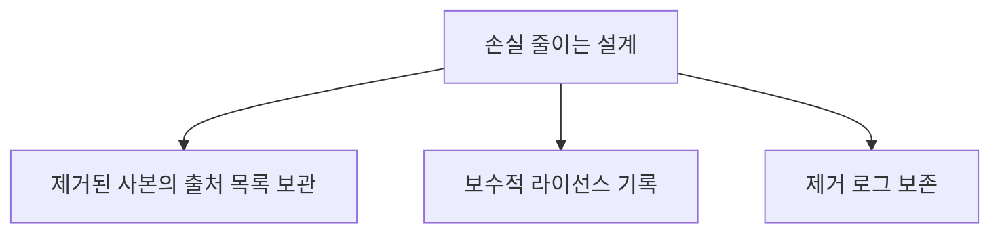

# 중복 제거와 출처 표기 손실

> 같은 파일·문구를 하나만 남기는 중복 제거는 **나머지 복사본에 붙어 있던 출처·저작권·라이선스 정보를 함께 버린다.** 학습 효율에는 이득이지만 출처 표기 의무와 추적성에는 손실이 생긴다.

## 쉽게 말하면
같은 사진이 100곳에 실려 있을 때 한 장만 남기면 용량은 줄지만, "이 사진을 찍은 사람이 누구이고 어디서 가져왔는가"를 알려 주던 99개의 캡션이 사라진다. 남긴 한 장의 캡션이 원작자의 것이 아닐 수도 있다.

## 자세히
- **BigCode의 The Stack(dedup 판) 데이터 카드**(열어 확인): 정확 중복 제거 위에 MinHash(256 순열)·LSH로 자카드 0.85 기준 근접 중복 제거를 했고 허용 라이선스 파일의 약 40%가 (근접) 중복이었다. 카드는 사용자가 "원 라이선스의 조건(해당할 때 출처 표시 포함)을 따라야 한다"고 하며 이를 위해 데이터 점마다 출처 정보(provenance)를 제공한다고 한다.
- **그런데** 같은 파일이 여러 저장소에 있으면 **한 번만 남기고, 그중 알파벳순으로 첫 저장소만** 표시한다고 카드가 밝힌다. 라이선스 필드도 파일이 아니라 저장소 단위(`max_*_repo_licenses`)이며, 표시된 저장소의 정보일 뿐 같은 파일을 가진 모든 저장소의 정보가 아니다. 라이선스 판정 정확도도 GHArchive·go-license-detector에 의존한다고 한다.
- **장난감 시연**(내 계산): 같은 `utils.py`가 `zeta/lib`(MIT), `alpha/app`(Apache-2.0), `mid/tool`(MIT)에 있을 때 알파벳순 첫 저장소 규칙을 쓰면 `alpha/app`(Apache-2.0)만 남고 나머지 두 저장소의 출처는 사라진다. 실제 The Stack의 구현을 재현한 것이 아니라 카드의 설명을 단순화한 예다.
- **텍스트 구간 제거(ExactSubstr)**도 마찬가지로 공유 구간을 지우면 출처 표기 문구가 사라질 수 있다고 Lee 외(2021)가 단점으로 적었다([ExactSubstr vs NearDup](#exactsubstr-vs-neardup)).
- **이중 작용**: BigCode 거버넌스 카드는 허용 라이선스 코드가 다른 저장소로 복제되기 때문에 저작권자가 옵트아웃해도 모든 사본을 없애기 어렵다고 적는다(검색 결과 요약, 원문 전체는 열지 않음). 그리고 커뮤니티에는 출처 표기가 보존되지 않아 라이선스 위반이라고 주장하는 이슈 글이 있다. 이것은 공식 판단이 아닌 사용자 주장이며 법적 판단은 정해지지 않았다.
- **실무 제안**: ① 중복 제거 때 제거된 사본의 출처 목록을 `dups` 필드로 보관 ② 라이선스는 **교집합이 아니라 가장 제한적인 것**을 기준으로 보수적으로 기록 ③ 제거 로그를 남겨 되돌릴 수 있게 ④ 법적 판단은 전문가에게(이 글은 법률 자문이 아님).

## 그림으로 보기

## 예시
- 사내 코드 학습 세트에서 같은 오픈소스 파일이 여러 프로젝트에 있을 때, 중복 제거 후에도 "원 저장소 목록" 컬럼을 유지.
- 교육: 중복 제거를 "효율 vs 투명성" 트레이드오프 사례로 토론.

## 헷갈리는 것과 비교
| 개념 | 차이 |
|---|---|
| 출처 표기(attribution) | 원작자를 밝히는 의무 |
| 출처 정보(provenance) | 데이터가 어디서 왔는지 기록 |
| 옵트아웃 | 작성자가 학습 사용을 거부 |
| [중복과 암기](#memorization-from-duplicates) | 중복 제거의 이점. 이 노드는 그 부작용 |

## 더 읽을거리
- [The Stack dedup 데이터 카드](https://huggingface.co/datasets/bigcode/the-stack-dedup) — 근접 중복 제거, 약 40% 중복, 알파벳순 첫 저장소 규칙(열어 확인).
- [BigCode Governance Card](https://arxiv.org/html/2312.03872v1) — 출처 표기·옵트아웃 논의(검색 결과 요약만 확인).
- [Deduplicating Training Data Makes Language Models Better](https://ar5iv.labs.arxiv.org/html/2107.06499) — 구간 제거의 출처 표기 손실 언급(열어 확인).
