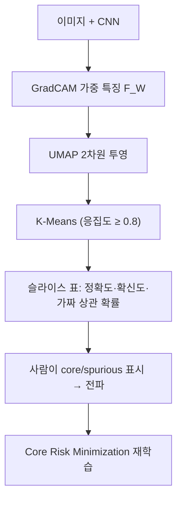
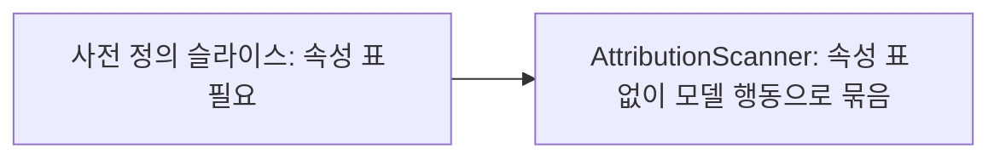

# AttributionScanner

> 메타데이터(속성 표) 없이도 **이미지 분류 모델이 어떤 부분에 주목하는지(어트리뷰션)를 바탕으로 비슷하게 행동하는 샘플 묶음(슬라이스)을 찾아** 모델의 약점·가짜 상관·라벨 오류를 사람이 검토하게 돕는 시각 분석 시스템이다(arXiv 2401.06462).

## 쉽게 말하면
학생들의 시험지에 "누가 어느 부분을 보고 답을 골랐는지" 형광펜 표시를 남겨 두고, 비슷한 형광펜 패턴끼리 묶어 보면 "물 배경만 보고 물새라고 답한 묶음" 같은 편법이 눈에 띈다. 사람이 그 묶음을 보고 진짜 근거인지 편법인지 표시한다.

## 자세히
(논문 HTML v3의 시스템 설계 부분을 열어 확인. 앞 약 10만 자를 읽었고 나머지 약 1.3만 자는 미확인)
- **풀려는 문제**: 기존 슬라이스 찾기는 메타데이터나 특성 설명이 필요하지만 이미지 같은 비정형 데이터에는 구하기 비싸다. 이 시스템은 메타데이터와 사전학습 비전-언어 모델 없이 해석 가능한 슬라이스를 찾는다.
- **어트리뷰션 가중 특징**: CNN(합성곱 층 + 완전연결 층)을 가정한다. 이미지마다 특징 맵 F와 합이 1로 정규화된 GradCAM 가중 행렬 W를 구해 `F_W = Σ F_ij·W_ij`를 만들어 "이미지에 무엇이 있는지 + 모델이 어디를 봤는지"를 함께 담은 벡터를 얻는다.
- **슬라이스 찾기**: UMAP으로 2차원 어트리뷰션 공간에 투영한 뒤 K-Means를 돌리고, 각 슬라이스 안 샘플의 벡터와 중심의 평균 코사인 유사도(응집도)가 임계값(기본 0.8)에 도달하도록 군집 수를 늘린다.
- **슬라이스 표**: 슬라이스별 정확도, 평균 예측 확신도, **가짜 상관 확률(spuriousness)**을 보여 준다(후자는 사용자가 표시한 주석을 Label Spreading으로 전파해 추정, 논문은 오류율을 따로 정의하지 않음).
- **사용자 상호작용**: 정확도·가짜 상관 순 정렬 또는 **Attribution Mosaic**(볼록 껍질 안에 Feature Inversion 이미지) 시각 탐색 → 슬라이스 상세 보기에서 개별 이미지와 어트리뷰션 히트맵 확인 → 슬라이스를 "core"(진짜 근거) 또는 "spurious"(가짜 근거)로 표시 → 표시를 다른 슬라이스로 전파 → 주석을 내보내 **Core Risk Minimization**으로 가짜 영역에 노이즈를 넣고 재학습.
- **사례(논문 보고)**: CelebA 머리색 분류(ResNet50, 정확도 98.03%)에서 전문가가 흰머리 core 슬라이스, 입·눈·배경에 의존하는 spurious 슬라이스, 라벨 오류 이미지를 찾았다. Waterbirds 새 종류 분류(정확도 85.74%)에서는 물/땅 **배경 편향**을 발견했다. "정확도는 낮은데 어트리뷰션은 올바른" 경우를 라벨 오류 신호로 사용했다. 주석된 슬라이스로 재학습하면 깨끗한·core·spurious 정확도와 RCS 점수가 개선됐다. 전문가 10명의 사용자 연구는 대체로 긍정적이었다.
- **한계(논문)**: 전파는 spurious와 core 슬라이스가 어트리뷰션 공간에서 멀다고 가정하므로 세분화 클래스에서는 실패할 수 있다. GradCAM·Feature Inversion의 신뢰성에 한계가 있어 사람 검토가 필수다. 평가는 두 벤치마크·한 모델 계열·전문가 10명 규모. CNN 구조를 가정한다.
- 이 글의 수치는 논문이 보고한 값이며 직접 재현하지 않았다.

## 그림으로 보기

## 예시
- 물새 분류기가 "물 배경이면 물새"로 판단하는 배경 편향을 슬라이스로 발견하고 배경 영역에 노이즈를 넣어 재학습.
- 교육: "정확도가 높아도 이유가 틀릴 수 있다(설명가능성으로 점검)"를 보여 주는 사례.

## 헷갈리는 것과 비교
| 개념 | 차이 |
|---|---|
| AttributionScanner | 메타데이터 없이 모델 행동·어트리뷰션으로 슬라이스 발견 |
| [사전 정의 슬라이스 평가](#predefined-slice-evaluation) | 미리 정한 속성으로 나눔 |
| 가짜 상관(spurious correlation) | 정답과 상관 있지만 인과가 아닌 단서 |
| GradCAM | 모델이 주목한 영역을 히트맵으로 |

## 더 읽을거리
- [AttributionScanner (arXiv 2401.06462)](https://arxiv.org/abs/2401.06462) — 초록과 시스템 개요.
- [논문 HTML v3](https://arxiv.org/html/2401.06462v3) — 시스템 설계·사례·한계(앞부분 확인).
