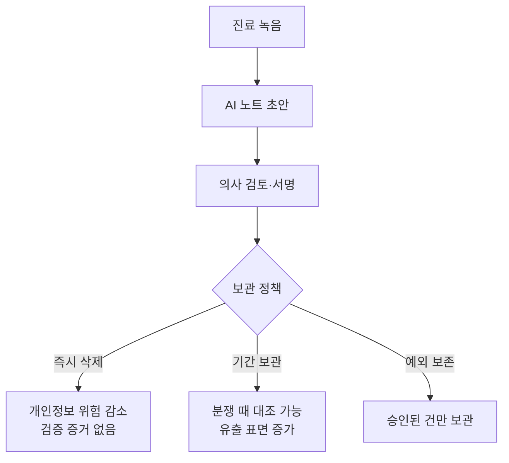
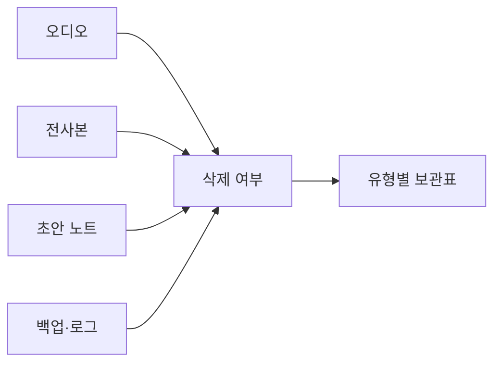

# 원본 오디오 보관 딜레마

> AI 서기(ambient scribe)가 녹음한 진료 음성을 지울지 남길지의 문제. 지우면 개인정보 위험이 줄지만 노트가 틀렸을 때 확인할 증거도 사라진다.

## 쉽게 말하면
회의 녹음 파일을 회의록 확정 뒤 바로 지우면 안전하지만, 나중에 "그런 말 안 했다"는 분쟁이 생기면 확인할 방법이 없다. 반대로 전부 보관하면 민감한 말이 담긴 파일이 쌓인다. 어느 한쪽 기본값만으로는 곤란하다.

## 자세히
- **법적 고정 기간은 없다**: 검색한 HIPAA 가이드들은 정해진 일수가 없다고 하고, 흔한 관행은 의사가 서명한 뒤 원본 오디오와 중간 전사본을 지우는 것이라고 설명한다(업체·컨설팅 블로그라 규제가 아닌 업계 관행).
- **삭제 주장**: 녹음에는 노트보다 훨씬 많은 민감 정보(제3자 포함)가 있고, 승인된 기록이 있으면 보관 목적이 불분명하다. 영국 ICO의 저장 제한 원칙은 고정 기간이 아니라 정당화된 접근을 요구한다(iatroX 글 인용).
- **보관 주장**: 환자가 발언을 다투거나 사고 조사가 필요할 때 증거가 된다. 지워도 노트가 정확한지는 해결되지 않는다.
- **NHS 지침(iatroX 글 인용)**: 요약이 정확하다고 승인되면 녹음·전사본을 지울 수 있으나 안전·정확성 때문에 더 보관할 수도 있다.
- **전사본은 별도 위험**: 오디오를 지워도 전사본이 품질 검토·모델 개선용으로 남을 수 있어 따로 물어야 한다.
- **제품 예**: Athelas는 사이트별 보관 일수(최소 1일)를 설정하고 야간 정리에서 오디오·전사본을 영구 삭제하며, 비워 두면 아무것도 지우지 않는다(공식 문서 확인). Freed는 노트 생성 직후 녹음을 자동 삭제한다고 홍보(주장, 미검증).
- **실무 절차(iatroX 제안)**: 모든 사본 지도 그리기 → 자료 유형별 보관 표 → 예외 보존 승인 절차(범위·검토 시점) → 삭제와 정정 분리 → "삭제"가 백업까지 지우는지 시험.

## 그림으로 보기

## 예시
- 보관표 예: 원본 오디오 = 서명 후 1~7일 삭제, 전사본 = 같은 기간, 승인 노트 = 의무기록 보존 기간, 안전 사건 = 예외 승인 시 보존.
- 도입 질문: "삭제를 증명하는 확인서를 줍니까? 전사본·백업·하청업체 사본도 지워집니까?"

## 헷갈리는 것과 비교
| 개념 | 차이 |
|---|---|
| [전사 오류](#transcription-error) | 오디오 보관은 이 오류를 사후 검증할 수 있게 해 줌 |
| [누락과 환각 구분](#omission-vs-hallucination) | 누락은 원본이 있어야 판별 쉬움 |
| 삭제 vs 정정 | 정정은 원래 기록을 남기는 것이 원칙일 수 있음 |

## 더 읽을거리
- [Delete everything or keep an audit trail? (iatroX)](https://www.iatrox.com/blog/delete-everything-or-keep-an-audit-trail-healthcare-ais-retention-dilemma) — 양쪽 논거와 보관표 절차
- [Scribe retention policy (Athelas docs)](https://docs.athelas.com/air_admin/manage_your_practice/scribe_retention_policy) — 보관 일수 설정과 영구 삭제 방식
