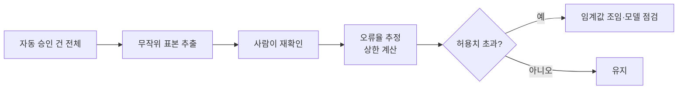
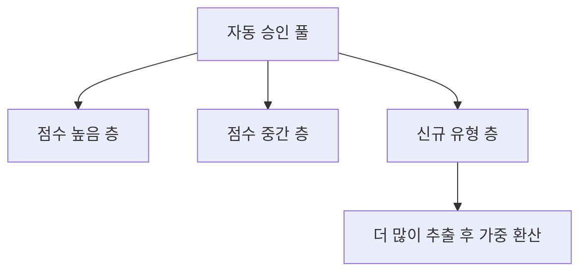

# 자동 승인 표본 감사

> 자동 승인 표본 감사는 AI가 사람 검토 없이 통과시킨 건 중 일부를 무작위로 뽑아 사후에 사람이 다시 확인하는 것이다. 보이지 않는 곳에서 오류율이 오르거나(드리프트) 임계값이 잘못 잡혔는지 감시하는 안전장치다.

## 쉽게 말하면
공장에서 합격 판정된 제품을 전부 다시 검사하진 않지만 상자마다 몇 개를 뽑아 확인한다. 뽑힌 표본에서 불량이 나오면 그 라인이 잘못되고 있다는 신호다. 자동 승인은 검토 큐가 아예 안 보는 구간이라 이 표본이 유일한 눈이다.

## 자세히
- **왜 필요한가**: [2단계 분류](#two-stage-triage)나 [이중 임계값 정책](#double-threshold-policy)은 확신이 높은 건을 자동 통과시킨다. 사람이 안 보므로 통과시킨 건의 실제 오류율을 알 수 없다. 표본이 그 값을 추정한다. Google 조정 연구(arXiv 2406.12800)도 걸러 낸 건의 재현율을 지켜야 한다고 강조한다.
- **표본에 오류가 하나도 없을 때(Wikipedia, 이항 비율 신뢰구간, 열람)**: 관찰된 오류가 0이어도 오류율이 0이라는 뜻이 아니다. "3의 법칙"에 따라 95% 신뢰구간 상한이 약 3/n이다. 이 식으로 계산하면(직접 계산) 오류율이 1% 이하라고 95% 확신하려면 무오류 표본이 약 300건 필요하고, 0.5%면 약 600건이다. 정확한 식으로 ln(0.05)/ln(1−허용 오류율)을 쓰면 각각 298·598건이다.
- **구간 계산**: 오류가 있을 때는 Wilson 구간이 정규근사의 폭 0 문제를 피한다고 같은 문서가 설명한다.
- **감사 표본 설계 일반론(EU 감사 기관용 표본 안내서 등, 검색 결과만 확인하고 본문은 열지 않음)**: 신뢰수준, 정밀도, 예상 오류율, 단순 무작위 추출 같은 용어와 오류율의 상한을 결론으로 삼는 방식을 다룬다.
- **설계 요령(해석, 출처 없음)**: ① 확신 점수 구간·유형·시기별로 층화해 드문 고위험 구간을 놓치지 않는다 ② 고위험 층은 더 뽑고 전체로 가중해 환산 ③ 같은 표본 추출을 주기적으로 반복해 창별 오류율을 비교하고, 반복 확인으로 늘어나는 오경보는 관리도 같은 순차 검정으로 다룬다 ④ 감사자끼리 판단이 갈리면 측정 오류율에 사람 잡음이 섞이므로 라벨 기준을 정한다.
- **연결**: 표본에서 발견한 오류는 [확신 분포 모양](#confidence-distribution-shape) 점검과 임계값 조정의 근거가 된다.

## 그림으로 보기

## 예시
- 보험 청구 자동 승인: 매주 자동 승인 건에서 300건을 무작위로 뽑아 전수 검토한다. 오류가 0건이면 오류율 상한은 약 1%(3/300). 1건이면 정확한 구간을 계산한다.
- 교육 활용: "오류를 못 찾았다 = 오류가 없다"가 아님을 3의 법칙으로 실습한다.

## 헷갈리는 것과 비교
| 개념 | 차이 |
| --- | --- |
| [검토 큐 설계](#review-queue-design) | 사람에게 넘긴 건 처리. 표본 감사는 넘기지 않은 건을 점검 |
| [오류 심기 시험](#seeded-error-test) | 검토자가 오류를 잡는지 시험. 표본 감사는 자동 통과분의 오류율 추정 |
| 전수 검사 | 비용 과다. 표본은 상한을 통계적으로 추정 |

## 더 읽을거리
- [Wikipedia: Binomial proportion confidence interval](https://en.wikipedia.org/wiki/Binomial_proportion_confidence_interval) — 3의 법칙·Wilson 구간
- [EU 감사 기관용 표본 안내서 (EGESIF_16-0014-01)](https://ec.europa.eu/regional_policy/sources/guidance/guidance_sampling_method_en.pdf) — 감사 표본 용어(본문 미열람)
