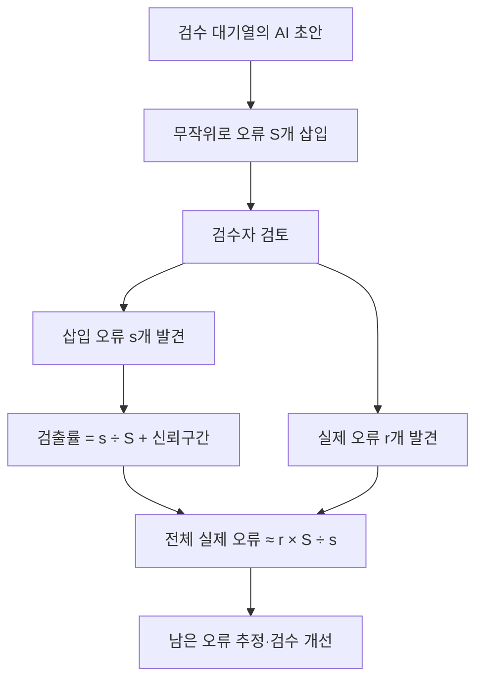

# 오류 삽입 감사 (Audit with Seeded Errors)

> 검수 단계에 **정답을 아는 오류를 몰래 섞어** 넣고, 그중 몇 %를 잡아내는지로 검수 품질을 감사하는 방법. 한 걸음 더 나가면 "삽입 오류 대비 실제 오류 발견 비율"로 **아직 못 찾은 실제 오류가 몇 개일지 대략 추정**할 수도 있다.

## 쉽게 말하면
숨은그림찾기에 일부러 그림 20개를 더 숨겨 두고, 14개를 찾았다면 찾는 사람의 실력이 약 70%라고 본다. 같은 실력으로 원래 숨어 있던 그림도 찾았을 것이므로, 원래 그림이 몇 개였을지 거꾸로 추정할 수 있다.

## 자세히
출처: Wikipedia "Bebugging"(본문 확인: 1970년대 오류 삽입 기법, Weinberg 용어, 현실성 한계)과 [오류 삽입 테스트](#seeded-error-testing) 노드의 TIP 사례. 아래 추정식과 수치는 **일반적인 오류 삽입 추정식에 대한 직접 계산**이며 해당 위키 페이지에는 식이 적혀 있지 않았다(페이지는 식이 없다고 명시).
- **개념(Wikipedia)**: 알려진 오류를 무작위로 삽입하고 검사자가 찾게 한다. 못 찾은 삽입 오류의 비율이 실제 오류가 얼마나 남았는지를 시사한다는 가정에 기댄다. 이 용어는 Gerald Weinberg(1970)에서 왔고, 원래는 프로그래머를 훈련·동기부여·평가하는 방법으로 제시됐다.
- **검출률 추정**: 삽입 S개 중 s개를 찾으면 검출률 ≈ s/S. 표본이 작으면 불확실하다. 직접 계산: 14/20이면 윌슨 95% 구간이 약 48%~86%, 70/100이면 약 60%~78%. 삽입 개수를 늘릴수록 구간이 좁아진다([단계별 최소 표본](#minimum-sample-size)).
- **남은 실제 오류 추정(일반 추정식)**: 실제 오류 r개를 발견했다면 전체 실제 오류 ≈ r × S/s. 예: 삽입 20개 중 14개 발견, 실제 오류 21개 발견 → 전체 약 30개, 약 9개가 남았을 것. 검출률 불확실성(48~86%)을 반영하면 전체 약 25~44개로 폭이 크다(직접 계산).
- **전제**: 삽입 오류가 실제 오류와 비슷하게 발견되기 쉬워야 한다. Weinberg의 말처럼 "진짜 오류를 모사하는 것은 진짜 항공기를 모사하는 것만큼 어렵다"(페이지 인용). 삽입 오류가 더 눈에 띄면 검출률이 부풀려져 남은 오류를 과소 추정한다.
- **AI 검수에 적용(제안)**: ①AI 초안에 사실·숫자·정책 오류를 무작위로 일부 삽입(실제 고객에게는 나가지 않게, 검수 대기열에서만) ②오류 유형을 현실 오류 분포에 맞춘다(금액, 날짜, 부정어, 정책 인용) ③검출률을 검수자·시간대·업무별로 본다 ④삽입 사실을 사전에 공지하되 개별 건은 알리지 않는 운영 규칙 ⑤검출률이 낮으면 인터페이스·업무량·교육을 점검.
- **운영·윤리 주의**: 개인 징계가 아니라 시스템 개선에 쓴다는 합의. 삽입 오류가 실제 고객에게 전달되지 않도록 통제.
- **한계**: 삽입 비율이 높으면 검수자가 오류가 있으리라 예상해 평소보다 꼼꼼해진다(실제 행동과 달라짐). 빈도를 낮게 유지하면 표본이 쌓이는 데 오래 걸린다.

## 그림으로 보기


## 예시
```python
S, s, r = 20, 14, 21
detect = s / S                  # 0.70
total_real_est = r * S / s      # 약 30
remaining_est = total_real_est - r   # 약 9
```
교육 활용: 직무 교육에서 "AI 결과를 사람이 검수하니 안전하다"는 주장에 대해 검출률을 어떻게 측정하고 오차 범위를 어떻게 말할지 토론한다.

## 헷갈리는 것과 비교
| 개념 | 차이 |
|---|---|
| 오류 삽입 감사 | 검수 품질과 남은 오류를 추정 |
| [오류 삽입 테스트](#seeded-error-testing) | 주의 유지·성과 측정의 기본 기법 |
| [형식적 승인 신호](#blind-approval-signal) | 로그만으로 읽지 않는 승인을 의심 |
| 포획-재포획 추정 | 서로 다른 검수자의 중복 발견으로 총수 추정 |

## 더 읽을거리
- [Wikipedia: Bebugging](https://en.wikipedia.org/wiki/Bebugging) — 오류 삽입 기법의 기원과 한계
- [오류 삽입 테스트](#seeded-error-testing) — 공항 TIP 사례와 현실성 문제
