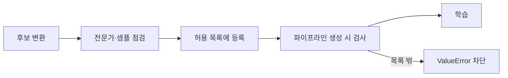
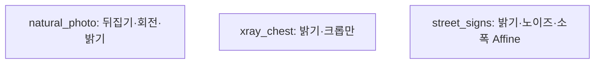

# 증강 허용 목록

> 데이터 종류(도메인)마다 **"라벨을 바꾸지 않는다고 확인된 증강만" 목록으로 정해 두고, 목록에 없는 변환은 코드에서 막는** 관리 방식이다. 증강 도구에 변환이 수십 개 있어도 도메인에 안전한 것은 일부뿐이다.

## 쉽게 말하면
병원 약장에 "소아용으로 승인된 약" 목록을 붙여 두는 것과 같다. 약이 약국에 있다고 아무 환자에게 쓰지 않는다. 승인 목록에 있는 것만 꺼내 쓰게 하면 실수가 줄어든다.

## 자세히
- 왜 필요한가: 어떤 증강이 안전한지는 **데이터와 라벨의 의미**가 정한다. 흉부 X선은 촬영이 표준화돼 뒤집기·회전이 현실에 없는 영상을 만들 수 있고 우심증·엽성 병변 같은 예외가 있어 전문가 검토가 권고된다([의료 뒤집기](#medical-flip-hazard), arXiv 2012.08333). 같은 논리가 간판 글자(좌우 반전 시 글자가 뒤집힘)·방향이 의미인 화살표·좌우가 라벨인 문제에도 적용된다.
- 구성(제안): ① 도메인별 허용 변환 이름 목록(+ 허용 강도 범위) ② 파이프라인을 만드는 함수에서 목록 밖 변환을 **예외로 차단** ③ 목록 변경은 도메인 전문가 검토 후 코드 리뷰로만 ④ 목록과 근거(문서·실험)를 같은 저장소에 기록.
- 직접 실행한 간단한 구현(Albumentations 2.0.8): 도메인 3개의 허용 목록을 사전으로 두고, 파이프라인 생성 시 변환 클래스 이름이 목록에 없으면 `ValueError`를 낸다. 결과: `natural_photo`에 HorizontalFlip·Rotate → 통과, `xray_chest`에 HorizontalFlip → **차단**, `street_signs`에 HorizontalFlip → **차단**(허용 목록에는 Affine만).
- 한계: 이름만 보면 변환의 **강도**(회전 각도 등)까지는 못 막는다. 강도는 별도로 제한한다. 목록은 경험적 판단이라 새 데이터에서는 샘플 점검([증강 샘플 점검](#augmentation-sample-review))으로 계속 검증한다.
- 목록을 넓히는 법: 새 변환을 후보로 올리고 샘플 50장 눈 점검 + 통계 점검 + 작은 실험(검증 점수) 통과 시 승인.

## 그림으로 보기



## 예시
```python
ALLOW = {"xray_chest": {"RandomBrightnessContrast", "RandomResizedCrop"}}
def build(domain, transforms):
    bad = [t.__class__.__name__ for t in transforms
           if t.__class__.__name__ not in ALLOW[domain]]
    if bad: raise ValueError(f"{domain}: not allowed {bad}")
    return A.Compose(transforms)
```
- 교육: "도구가 지원한다 ≠ 내 데이터에 안전하다."

## 헷갈리는 것과 비교
| 개념 | 차이 |
|---|---|
| 허용 목록(allowlist) | 허용된 것만 사용, 기본이 차단 |
| 차단 목록(denylist) | 금지된 것만 막음, 새 변환이 새 구멍이 됨 |
| [라벨 보존 변환](#label-preserving-transform) | 목록에 넣을지 판단하는 기준 |

## 더 읽을거리
- [Checklist for responsible deep learning modeling of medical images (arXiv 2012.08333)](https://arxiv.org/abs/2012.08333) — 증강의 의료적 안전성과 전문가 상의 권고(PDF 본문 읽음).
