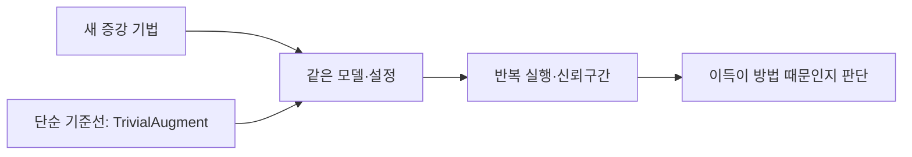
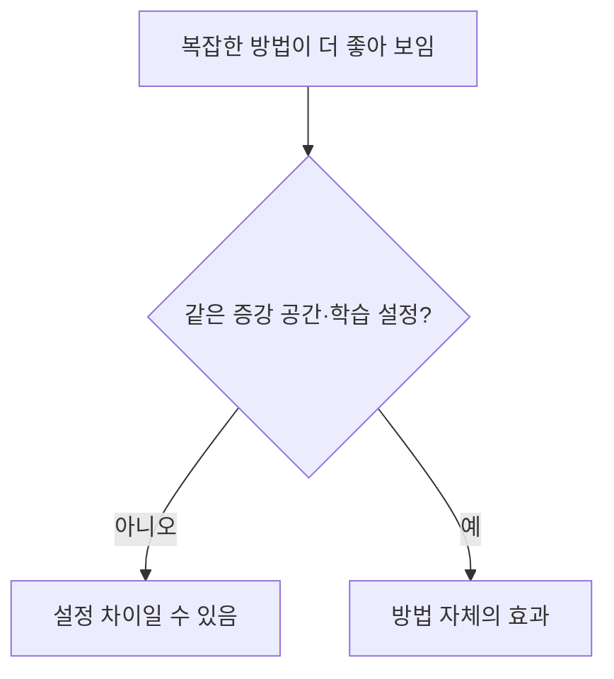

# 증강 기준선 관행

> 새 데이터 증강 기법을 내놓을 때는 **TrivialAugment 같은 튜닝 없는 단순 방법과 같은 조건에서 비교**해야 한다는 관행이다. 복잡한 방법의 이득이 방법 자체인지, 학습 설정·튜닝 노력 차이인지 가르기 위해서다.

## 쉽게 말하면
달리기 신기록을 주장하려면 같은 트랙·같은 신발로 비교해야 한다. 새 방법은 좋은 신발에 전문 코치까지 붙이고, 비교 대상은 맨발로 뛰게 하면 이긴 이유를 알 수 없다.

## 자세히
- TrivialAugment 논문(Müller & Hutter, arXiv 2103.10158)은 기여 세 가지 중 하나로 **같은 코드베이스에서 다른 방법을 직접 재현**해 비교한 것을 든다. 논문 속 비교는 세 가지 설정이다: ① 기존 논문이 발표한 결과와 비교 ② 자기 코드베이스로 재현한 방법과 비교 ③ 탐색·학습을 합친 총 계산 비용 대비 정확도 비교.
- 증강 탐색 공간을 같게 맞춘 재현 실험(논문 Table 9, 평균±표준편차): CIFAR-100에서 RA 공간 기준 기존 방법 83.1±.32, TA 83.54±.12. CIFAR-10 AA 공간에서도 97.31 → 97.55로 TA가 앞서거나 비슷했다. 즉 **증강 공간이 같으면 방법 간 차이가 크게 줄어든다.**
- 관찰: 논문은 RandAugment가 SVHN에서 보고값을 자기 파이프라인으로 재현하지 못했다고 쓴다. 발표 수치와 재현 수치의 차이가 비교를 흐릴 수 있다는 뜻이다.
- 실무 관행(논문 제안을 요약): ① 같은 모델·학습 설정 ② 탐색 비용을 정확도와 함께 보고 ③ 여러 번(논문은 10회) 돌려 신뢰구간 ④ 최소한 균등 무작위 기준선과 비교.
- 한계: 이미지 분류 중심이며, 텍스트·표 데이터에 같은 결론이 성립한다는 근거는 이 논문에 없다(주의).

## 그림으로 보기

## 예시
- 새 증강 논문을 읽을 때 "TrivialAugment 대비 얼마나 좋은가?"를 먼저 찾는다.
- 교육: 데이터 팀에 "복잡한 파이프라인을 도입하기 전에 한 줄짜리 기준선부터 돌려라"고 가르치는 사례.

## 헷갈리는 것과 비교
| 개념 | 차이 |
|---|---|
| 기준선(baseline) | 비교의 출발점이 되는 단순 방법 |
| [TrivialAugment vs RandAugment](#trivialaugment-vs-randaugment) | 두 방법 자체의 차이 |
| [TrivialAugment](#trivialaugment) | 방법 설명 |

## 더 읽을거리
- [TrivialAugment 논문 (arXiv 2103.10158)](https://arxiv.org/abs/2103.10158) — 본문·부록(Table 9) PDF로 읽음.
