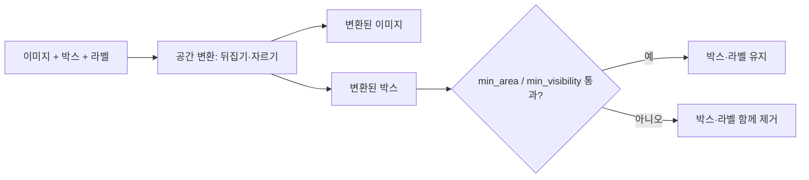
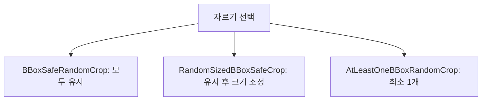

# 탐지용 증강(박스 동시 변환)

> 객체 탐지·세분화 데이터를 증강할 때는 이미지만 바꾸면 안 되고, 정답인 박스·마스크도 같은 변환을 받아야 한다. 뒤집거나 자르면 박스 좌표가 바뀌고, 일부는 잘려 사라질 수도 있다.

## 쉽게 말하면
사진 위에 투명 필름으로 동그라미를 그려 놓았다면, 사진을 뒤집을 때 필름도 같이 뒤집어야 동그라미가 제자리에 있다. 사진만 뒤집으면 정답 동그라미가 엉뚱한 곳을 가리킨다.

## 자세히
(Albumentations 공식 문서를 직접 열어 확인하고, 설치한 버전으로 직접 실행해 검증.)
- **좌표 형식 5가지(문서)**: `pascal_voc`[x_min,y_min,x_max,y_max] 픽셀, `albumentations` 0~1 정규화 모서리, `coco`[x_min,y_min,너비,높이], `yolo`[x_center,y_center,너비,높이] 정규화, `cxcywh` 중심·크기 픽셀. 문서는 "형식을 틀리는 것이 가장 흔한 박스 버그"라고 경고한다 — 파이프라인은 돌지만 박스가 엉뚱한 영역을 가리킨다.
- **구성**: `A.Compose([...], bbox_params=A.BboxParams(...))`. 박스는 `(박스 수, 4)` 배열, 라벨은 `label_fields` 이름과 같은 키워드 인자로 넘긴다. 밝기 같은 픽셀 변환은 박스를 안 바꾸고, 공간 변환(뒤집기·자르기·회전)은 박스를 갱신한다.
- **label_fields**: 박스가 버려지면 모든 라벨 필드에서 해당 항목도 같이 제거돼 정렬이 유지된다.
- **필터 옵션**: `min_area`(절대 면적이 너무 작으면 제거), `min_visibility`(원래 면적 대비 남은 비율이 낮으면 제거), `min_width`/`min_height`, `clip_bboxes_on_input`, `filter_invalid_bboxes`, `max_accept_ratio`, `bbox_type`('hbb' 기본, 'obb').
- **안전한 자르기**: `BBoxSafeRandomCrop`(모든 박스 유지), `RandomSizedBBoxSafeCrop`(모든 박스를 지키는 무작위 영역을 자른 뒤 크기 조정, 문서가 탐지 학습에서 가장 흔한 선택이라 소개), `AtLeastOneBBoxRandomCrop`(최소 한 박스만 보장).
- **직접 실행(albumentations 2.0.8, 100×100 이미지)**: `HorizontalFlip`을 적용하면 박스 [10,20,40,60]이 [60,20,90,60]으로 바뀌고 라벨 'cat'이 유지됐다. x 0~30 영역으로 자른 뒤 `min_visibility=0.8`이면 일부(10~40이 10~30으로 잘려 약 67% 남은) 박스 'a'가 라벨과 함께 사라지고 온전한 'b'만 남았다.
- **버전 주의(직접 확인)**: 최신 문서는 `BboxParams(coord_format=...)`이지만 설치된 2.0.8에서는 `format=...`이며 `coord_format`은 오류(TypeError)였다. 문서와 설치 버전을 맞춰 확인한다.
- 흔한 실수(문서): 모든 박스가 필터링돼 빈 배열이 나오는 경우를 로더가 처리하지 않음, 정규화/픽셀 좌표 혼용, 박스 미지원 변환 사용, `A.Normalize` 뒤에 시각화.
- 세분화 마스크는 같은 공간 변환을 마스크에 함께 적용(최근접 보간). 증강은 학습 세트에만([증강본 그룹 누수](#augmentation-group-leak)).

## 그림으로 보기



## 예시
```python
import albumentations as A
tf = A.Compose(
    [A.HorizontalFlip(p=0.5), A.RandomSizedBBoxSafeCrop(height=640, width=640)],
    bbox_params=A.BboxParams(format="pascal_voc", label_fields=["labels"],
                             min_visibility=0.3),   # 새 버전은 coord_format
)
out = tf(image=img, bboxes=boxes, labels=labels)
```
- 공장 불량 위치 탐지: 불량 부위가 잘려 거의 안 보이는 박스를 `min_visibility`로 제거해 "안 보이는데 불량"이라는 잘못된 정답을 막는다.

## 헷갈리는 것과 비교
| 개념 | 차이 |
|---|---|
| 박스 동시 변환 | 이미지와 박스·마스크를 같은 변환으로 |
| 이미지 분류 증강 | 라벨이 이미지 한 장당 하나라 좌표 갱신 불필요 |
| [라벨 보존 변환](#label-preserving-transform) | 정답이 바뀌지 않는 변형 원칙 |
| [RandAugment·AutoAugment](#randaugment-autoaugment) | 변환 정책 선택. 탐지에서는 박스 지원 변환이어야 함 |

## 더 읽을거리
- [Albumentations: Bounding Box Augmentation](https://albumentations.ai/docs/3-basic-usage/bounding-boxes-augmentations/) — 좌표 형식·BboxParams·안전 자르기(열어 확인).
