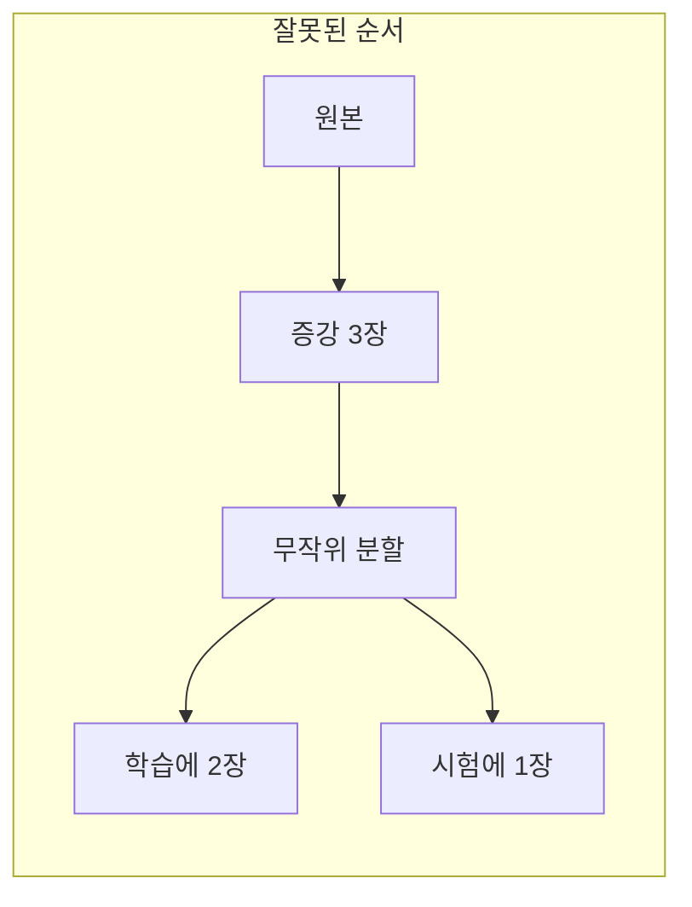
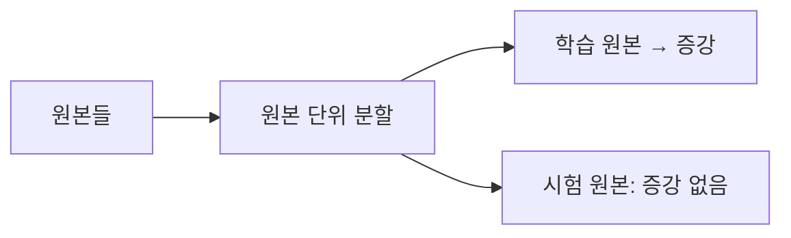

# 증강본 그룹 누수

> 데이터 증강(회전·반전·잡음 추가 등)을 분할 전에 하면 같은 원본에서 나온 증강본이 학습과 시험에 나뉘어 들어가 시험 점수가 부풀려지는 누수다. 원본 하나와 그 증강본들은 한 그룹으로 묶어야 한다.

## 쉽게 말하면
수학 문제집의 문제 하나에 숫자만 바꾼 쌍둥이 문제 3개를 만들어 섞은 뒤 무작위로 연습/시험으로 나누면, 시험에서 연습한 문제의 쌍둥이를 만난다. 사실상 답을 본 것이다. 먼저 원본 문제로 연습/시험을 나누고, 쌍둥이는 연습 쪽에서만 만들어야 한다.

## 자세히
- **원인**: 증강 → 분할 순서(늦은 분할, late split). 알츠하이머 MRI 분류 연구는 증강·특징 선택·오토인코더 사전학습처럼 데이터를 변형하는 절차는 **분할 이후** 학습 데이터에만 적용해야 하고, 그렇지 않으면 같은 원본에서 만든 이미지가 양쪽에 있을 수 있다고 지적한다(검색 결과 인용, 원문 미열람).
- **규모 사례(논문 초록 직접 확인)**: 항공 영상 데이터 누수 탐지 논문(arXiv 2304.02296)은 INRIA·SpaceNet 2·AICrowd를 분석했다. AICrowd 학습 분할의 약 90%(약 25만 장)에 동일 사본이 있었고, 검증 분할 6만 장 중 약 5.6만 장(93%)이 학습 분할에도 있었다. 지각 해시(perceptual hashing)로 탐지. 이 수치는 증강뿐 아니라 정확한 중복을 포함한다.
- **탐지**: 증강 변형(90·180·270도 회전, 반전)까지 고려한 지각 해시로 학습-시험 간 중복을 센다. 근접 중복 일반론은 [근접 중복 탐지](#near-duplicate-detection).
- **올바른 순서**: ① 원본 단위(환자·촬영 원본·동영상)로 분할 → ② 학습 부분에만 증강 → ③ 검증·시험은 원본 그대로. 이 규칙이 [그룹 단위 분할](#group-wise-split)의 특수 경우다.
- 텍스트·LLM에서도: 문장을 바꿔 쓴 합성 데이터([합성 데이터](#synthetic-data))를 만든 뒤 섞어 나누면 같은 문제가 생긴다(제안).

## 그림으로 보기

## 예시
- 불량품 사진 500장을 회전·밝기 변형으로 5배(2,500장) 늘린 뒤 8:2로 나누면 시험 정확도가 99%로 나오지만 현장에서는 85%. 원본 500장을 먼저 400/100으로 나누고 400장만 증강하면 현실적인 점수가 나온다.
- 점검 코드 아이디어: 시험 이미지와 학습 이미지의 지각 해시 거리가 작은 쌍 수를 센다.

## 헷갈리는 것과 비교
| 개념 | 차이 |
|---|---|
| 증강본 그룹 누수 | 같은 원본의 변형이 양쪽에 들어감 |
| [데이터 누수](#data-leakage) | 시험 정보가 학습에 새는 모든 경우 |
| [문서 단위 분할](#document-level-split) | 같은 문서의 문단·질문이 양쪽에 들어감(구조는 동일) |
| [데이터 증강](#data-augmentation) | 학습 데이터를 늘리는 기법(분할 후엔 안전) |

## 더 읽을거리
- [Data Leakage Detection and De-duplication in Large Scale Geospatial Image Datasets (arXiv 2304.02296)](https://arxiv.org/abs/2304.02296) — 지각 해시로 학습-검증 중복 탐지(초록 확인).
- [How to avoid machine learning pitfalls (arXiv 2108.02497)](https://arxiv.org/abs/2108.02497) — 초록만 확인, 증강 절 본문은 못 열어 봄.
