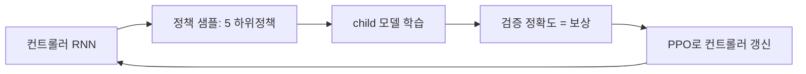
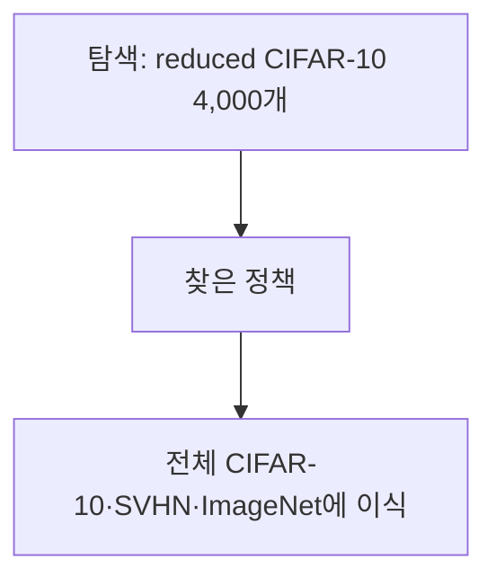

# 증강 정책 탐색

> AutoAugment처럼 **"어떤 데이터 증강을 어떤 강도·확률로 쓸지"를 사람이 아니라 탐색 알고리즘이 검증 정확도를 보상으로 삼아 찾는 방법**이다. 성능은 좋지만 탐색 비용이 커서 이후 RandAugment 같은 단순화가 나왔다.

## 쉽게 말하면
요리사(컨트롤러)가 양념 조합을 수천 번 바꿔 가며 시식 점수(검증 정확도)를 받아, 점수가 높은 조합을 점점 더 많이 시도해 최종 레시피를 찾는다. 레시피는 찾은 뒤 다른 요리에도 재사용한다.

## 자세히
(Cubuk 외 2018 AutoAugment, arXiv 1805.09501 PDF 본문을 직접 읽음)
- 탐색 공간: 정책 하나는 **5개의 하위 정책(sub-policy)**, 하위 정책은 **2개 연산**, 연산마다 (종류, 적용 확률, 강도)를 가진다. 연산 16종(ShearX/Y, TranslateX/Y, Rotate, AutoContrast, Invert, Equalize, Solarize, Posterize, Contrast, Color, Brightness, Sharpness, Cutout, SamplePairing). 강도는 10단계, 확률은 11단계로 이산화해 하위 정책 하나가 (16×10×11)² 가지, 5개면 약 2.9×10³²가지다.
- 적용: 미니배치의 이미지마다 하위 정책 하나를 무작위로 고르고, 각 연산은 확률에 따라 적용하되 적용되면 고정 강도로 한다.
- 탐색 알고리즘: **강화학습**. 1층 LSTM(은닉 100) 컨트롤러가 정책을 샘플링(30개 softmax 예측: 5×2연산×(종류·강도·확률)), 정책으로 학습한 child 모델의 **검증 정확도**가 보상이 되어 PPO로 컨트롤러를 갱신한다. 데이터셋마다 약 **15,000개 정책**을 샘플링했다.
- 비용 절감: 탐색은 전체 데이터가 아니라 **reduced CIFAR-10(무작위 4,000개)**과 작은 Wide-ResNet(120 에폭)으로 하고, 찾은 정책을 CIFAR-10 전체·다른 데이터셋·큰 모델에 이식한다. 그러나 RandAugment 논문은 이런 대리 과제가 큰 모델·큰 데이터에 최적이 아닐 수 있다고 지적한다([RandAugment 강도 튜닝](#randaugment-magnitude-tuning)).
- 의의: 증강 정책도 "탐색 가능한 설계 대상"이라는 관점을 열었고, 이후 PBA 등 효율적 탐색과 RandAugment 같은 탐색 없는 단순화로 이어졌다.

## 그림으로 보기

## 예시
- 내 데이터에 적용하려면 직접 15,000회 탐색은 부담이다. 공개된 AutoAugment 정책(torchvision `AutoAugment`)을 쓰거나, 탐색 없는 RandAugment로 시작한다(제안).
- 교육: "하이퍼파라미터 탐색을 증강에 적용한 사례"로 설명.

## 헷갈리는 것과 비교
| 개념 | 차이 |
|---|---|
| AutoAugment | 강화학습으로 정책 탐색, 비용 큼 |
| RandAugment | 탐색 없이 N·M 두 값만 격자 탐색 |
| 수작업 증강 | 사람이 직관으로 선택 |
| [Cutout](#cutout) | 탐색 공간의 연산 중 하나로 포함 |

## 더 읽을거리
- [AutoAugment (arXiv 1805.09501)](https://arxiv.org/abs/1805.09501) — 탐색 공간·RL 컨트롤러·reduced CIFAR-10(PDF 본문 읽음).
