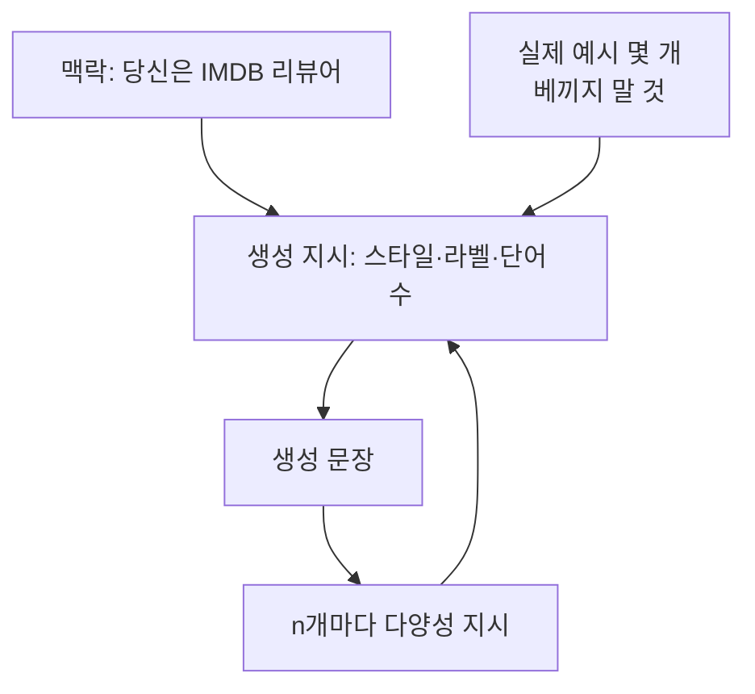
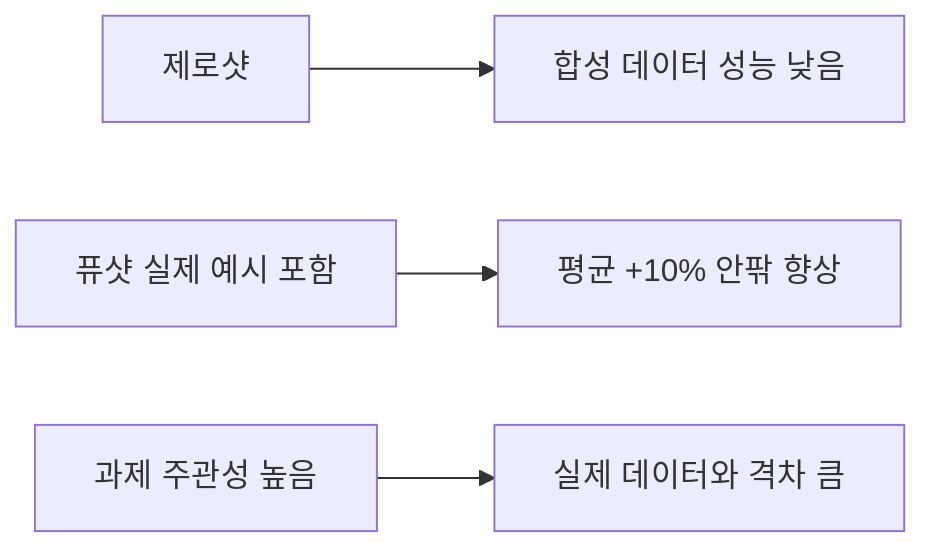

# 증강 프롬프트 설계

> LLM에게 학습 데이터를 만들게 할 때 **역할(맥락)·스타일·라벨·글자 수·예시·다양성 지시를 어떻게 프롬프트에 넣느냐**의 설계. 같은 모델도 프롬프트에 따라 데이터의 질과 다양성이 크게 달라진다.

## 쉽게 말하면
작가에게 "리뷰 좀 써 줘"라고만 하면 비슷한 글이 나온다. "당신은 영화 리뷰 사이트 사용자입니다, 긍정 리뷰를 30단어 이내로, 아래 실제 예시를 흉내 내되 베끼지는 마세요, 지난번과 다르게"라고 구체적으로 주문하면 쓸 만한 데이터가 나온다.

## 자세히
(Li 외, "Synthetic Data Generation with Large Language Models for Text Classification: Potential and Limitations", EMNLP 2023, arXiv 2310.07849의 PDF 본문 3절·결과를 직접 읽음. 모델은 GPT-3.5-Turbo.)
- **제로샷 생성 프롬프트 구조**: ① **맥락(context) 프롬프트**: "Imagine you are a movie reviewer on the IMDB platform"처럼 도메인 설정 ② **데이터 생성 프롬프트**: 원하는 스타일(영화 리뷰)·라벨(긍정/부정)·단어 수 제한 지정 ③ **다양성 프롬프트**: n개 생성할 때마다 "이전 데이터보다 더 다양한 것을 줄 수 있나요?" 추가(짧은 글은 n=10, 긴 문단은 n=1).
- **퓨샷 생성**: 매번 실제 예시(텍스트+라벨) 몇 개를 무작위로 뽑아 프롬프트에 넣고, "예시를 흉내 내되 단순히 고쳐 쓰거나 다시 쓰지는 말라"는 제약을 더한다.
- **효과(논문 10개 과제)**: RoBERTa 기준 실제 데이터로 학습한 모델이 제로샷 합성 데이터 모델을 Macro-F1 평균 16.9%, 퓨샷 합성 데이터 모델을 6.7% 앞섰다. 즉 합성 데이터는 실제 데이터에 못 미친다. **퓨샷이 제로샷보다 낫다**: BERT는 평균 Macro-F1 +10.6%·정확도 +8.8%, RoBERTa는 +10.3%·+8.9%.
- **주관성이 격차를 키운다**: 뉴스 주제·관계 분류·IMDB 리뷰·스팸 같은 덜 주관적인 과제에서는 합성 데이터와 실제 데이터의 차이가 매우 작았지만, 주관성이 높은 과제(초록: 과제·인스턴스 수준 모두 성능과 음의 연관)에서는 격차가 컸다.
- **프롬프트 설계 체크리스트(제안)**: 역할 → 라벨과 정의 → 스타일·길이 → 실제 예시 2~5개 → "베끼지 말 것" → 주기적 다양성 지시 → 출력 형식(JSON). 생성 후 분류기·사람 표본으로 라벨 일관성을 확인한다([라벨 조건부 생성 증강](#conditional-text-generation-augmentation)).
- **한계**: 논문은 2023년 GPT-3.5 기준이고 영어 분류 과제다. 다양성 지시가 다양성을 얼마나 높이는지의 수치는 이번에 직접 읽은 범위에서 확인하지 못했다. 최근 연구는 DPO 같은 학습이 프롬프트 지시보다 다양성을 더 높였다고 보고한다([패러프레이즈 다양성 쏠림](#paraphrase-diversity-collapse)).

## 그림으로 보기



## 예시
```text
[맥락] 당신은 온라인 쇼핑몰의 고객입니다.
[생성] 라벨이 '환불 문의'인 고객 메시지를 30단어 이내로 1개 작성하세요.
[예시] (실제 메시지 3개와 라벨)
[제약] 예시를 흉내 내되 그대로 고쳐 쓰지 마세요.
10개마다: 이전보다 더 다양한 메시지를 써 주세요.
```
| 설정 | 평균 향상(BERT, 10개 과제) |
|---|---|
| 제로샷→퓨샷 | Macro-F1 +10.6%, 정확도 +8.8% |
- 업무 장면: 교육 챗봇 학습용 질문 데이터를 만들 때 위 구조로 만든 뒤 사람이 50개씩 검수한다.

## 헷갈리는 것과 비교
| 개념 | 차이 |
|---|---|
| 증강 프롬프트 설계 | 지시형 LLM에 주는 생성 지시 구성 |
| [라벨 조건부 생성 증강](#conditional-text-generation-augmentation) | 미세조정으로 라벨 조건 생성 |
| [LLM 패러프레이즈 증강](#llm-paraphrase-augmentation) | 기존 문장을 다시 쓰는 방식 |
| [패러프레이즈 다양성 쏠림](#paraphrase-diversity-collapse) | 프롬프트로도 해결 안 되는 다양성 문제 |

## 더 읽을거리
- [Synthetic Data Generation with LLMs for Text Classification (arXiv 2310.07849)](https://arxiv.org/abs/2310.07849) — 제로샷·퓨샷 프롬프트와 주관성 분석(PDF 직접 읽음).
