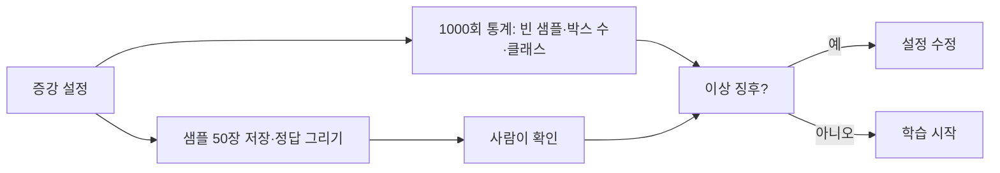
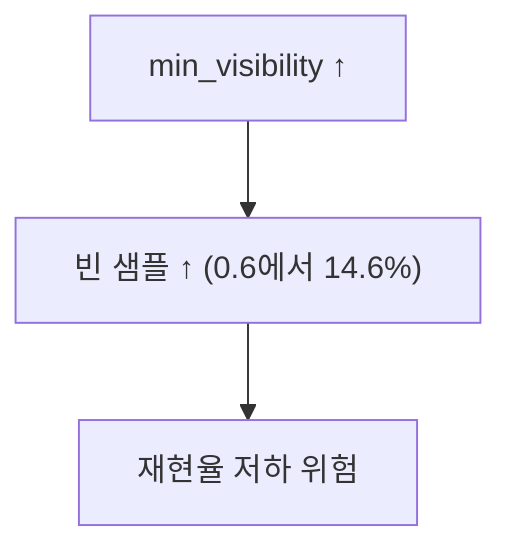

# 증강 샘플 사람 점검

> 증강을 학습에 넣기 전에 **변형된 샘플 몇십 장을 직접 눈으로 보고, 숫자로 요약 통계도 내서** 라벨이 여전히 맞는지 확인하는 절차다. 증강 코드는 오류 없이 돌아도 정답을 망가뜨릴 수 있기 때문이다.

## 쉽게 말하면
인쇄소에서 대량 인쇄 전에 시험 인쇄 몇 장을 뽑아 색과 글자가 맞는지 보는 것과 같다. 한 장만 봐도 잘못된 설정을 잡아낼 수 있고, 수천 장을 인쇄한 뒤 발견하면 전부 버려야 한다.

## 자세히
- **눈으로 보기**(제안): 무작위 증강 20~50장을 저장해 정답(박스·마스크·클래스)을 그려 넣고 확인한다. 보는 질문은 ① 정답이 물체에 맞는가 ② 물체가 사라지거나 일부만 남지 않았는가 ③ 현실에 없는 영상이 아닌가([의료 뒤집기](#medical-flip-hazard)) ④ 마스크에 가짜 클래스가 없는가([마스크 최근접 보간](#mask-augmentation-nearest)).
- **숫자로 보기**: 눈으로는 드문 문제를 놓치므로 증강을 1,000번 돌려 요약 통계를 낸다. 직접 실험(Albumentations 2.0.8, 640×480 이미지, 박스 3개, `RandomCrop(240,320)` + 뒤집기 + 밝기·대비, 시행 1,000회)에서 **한 장에 남은 박스 수의 분포**는 다음과 같았다.

| min_visibility | 박스 0개 | 1개 | 2개 | 3개 |
|---|---|---|---|---|
| 0.0 | 0 | 458 | 542 | 0 |
| 0.3 | 19 (1.9%) | 713 | 268 | 0 |
| 0.6 | 146 (14.6%) | 767 | 87 | 0 |
- 해석: min_visibility를 0.6으로 올리자 **정답이 하나도 없는 학습 샘플이 14.6%**가 됐다. 이런 샘플은 "물체 없음"을 가르쳐 재현율을 깎을 수 있다. 눈으로 몇 장만 보면 놓치기 쉽지만 통계로는 바로 드러난다([min_visibility 필터](#min-visibility-filter)).
- 점검 목록(제안): 샘플 이미지 저장 → 정답 시각화 → 정답 수·크기 분포 통계 → 빈 샘플 비율 → 클래스 값 집합 → 사람(도메인 전문가)이 몇 장 확인 → 문제가 있으면 변환 목록·강도를 수정.
- 고정 시드로 같은 샘플을 재현하면 수정 전후를 비교하기 쉽다.

## 그림으로 보기

## 예시
- 증강 파이프라인을 바꿀 때마다 `python check_aug.py`로 샘플 이미지 30장을 폴더에 저장하고 빈 샘플 비율을 출력.
- 교육: "코드가 돌아가는 것과 데이터가 맞는 것은 다르다."

## 헷갈리는 것과 비교
| 개념 | 차이 |
|---|---|
| 눈으로 점검 | 의미 오류(위치·현실성) 발견 |
| 통계 점검 | 드문 문제(빈 샘플·분포 변화) 발견 |
| 검증 정확도 | 학습 뒤의 결과, 늦게 알려 줌 |
| [라벨 보존 변환](#label-preserving-transform) | 점검의 기준 개념 |

## 더 읽을거리
- [Albumentations 문서](https://albumentations.ai/docs/) — 변환별 동작과 BboxParams 옵션(설치해 확인·실행).
