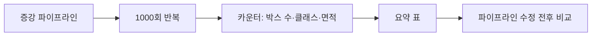
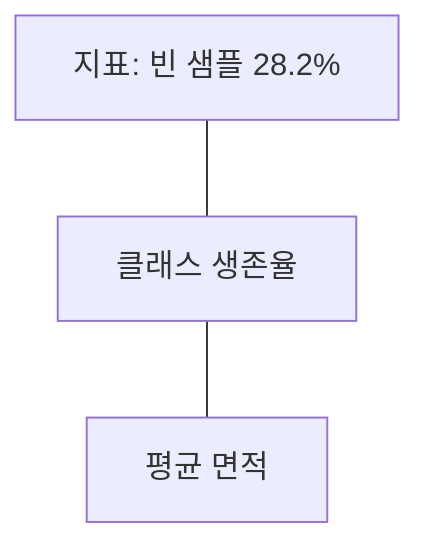

# 증강 통계 스크립트

> 증강 파이프라인을 **같은 샘플에 1,000번쯤 돌려 결과를 숫자로 요약하는 짧은 스크립트**다. 빈 샘플 비율, 샘플당 박스 수, 클래스별 생존율, 평균 박스 면적을 한 번에 보면 "눈으로 몇 장 본 것"의 한계를 보완한다.

## 쉽게 말하면
요리 맛을 한 숟갈로만 평가하지 않고, 같은 레시피로 1,000접시를 구워 "탄 접시 몇 %인지" 세어 보는 일이다. 가끔 생기는 문제도 비율로 드러난다.

## 자세히
- 스크립트(17줄, 실제 실행한 것)의 핵심: 변환을 `n`번 적용하며 ① 샘플당 박스 수 분포 ② 클래스별 생존율(남은 횟수 ÷ n) ③ 남은 박스의 평균 면적을 센다.
- 직접 실행 결과(Albumentations 2.0.8, 640×480 이미지, 박스 4개, `RandomCrop(224)`+`HorizontalFlip`, `min_visibility=0.3`, 시드 0, n=1000):
  - `empty` = 0.282(빈 샘플 28.2%)
  - `per_sample` = {0개: 282, 1개: 701, 2개: 17}
  - `survival` = {클래스0: 0.08, 클래스1: 0.55, 클래스2: 0.07, 클래스3: 0.04}
  - `area_mean` = 5,530(남은 박스의 평균 면적, 픽셀²)
- 읽는 법: 클래스 1은 가운데 큰 박스라 55%가 남지만 구석의 작은 박스(클래스 3)는 4%뿐이다 — 이 불균형이 학습에 반영된다. 파이프라인을 바꿀 때(크롭 크기·`min_visibility`·`erosion_rate`) 이 숫자가 어떻게 변하는지 전후를 비교한다([빈 샘플 비율](#empty-sample-rate)).
- 확장(제안): 변환 적용 횟수(`save_applied_params`), 마스크 클래스 면적 분포, 실행 시간, 극단 샘플(박스 0개·최대 크기)의 이미지를 저장해 눈으로 확인([시드 고정 증강 디버깅](#seeded-augmentation-debug)).
- 한계: 입력이 한 장짜리 합성 예제다. 실제로는 데이터셋 표본 수백 장에 대해 돌려 분포를 요약하고, 시드를 바꿔 반복해 오차 범위를 본다.

## 그림으로 보기



## 예시
```python
stats = aug_stats(make_pipeline, img, boxes, labels, n=1000)
assert stats["empty"] < 0.05, stats        # 기준 위반 시 CI에서 실패
```
- 교육: "증강도 측정하고 기준을 둔다"를 보여 주는 실습.

## 헷갈리는 것과 비교
| 개념 | 차이 |
|---|---|
| 통계 스크립트 | 많은 샘플의 분포 요약 |
| [박스 그려 보기 점검](#draw-bbox-sanity-check) | 소수 샘플을 눈으로 확인 |
| [증강 단위 테스트](#augmentation-unit-test) | 개별 규칙(박스·라벨 일치)을 단언 |

## 더 읽을거리
- [Albumentations: What Is Image Augmentation?](https://albumentations.ai/docs/1-introduction/what-are-image-augmentations/) — 증강 점검 권고(읽음).
- 직접 실행: 17줄 통계 스크립트, n=1000.
