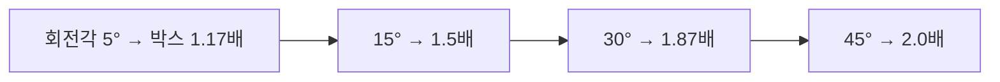
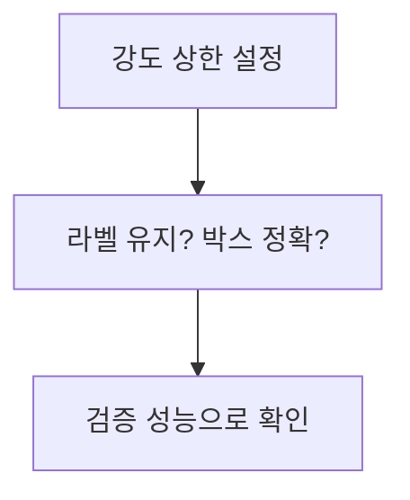

# 증강 강도 제한

> 증강은 "무엇을 쓰는가"만큼 **"얼마나 세게 쓰는가"(각도·밝기·확대 범위)**가 중요하다. 강도가 커지면 라벨이 틀려지거나 정보가 사라지므로, 도메인과 과제에 맞춰 **허용 범위의 상한**을 정한다.

## 쉽게 말하면
사진을 살짝 기울이면 같은 사진이지만 90도로 눕히면 "6"이 "9"처럼 보일 수 있다. 기울기에도 "여기까지는 같은 정답"이라는 한계선이 있다.

## 자세히
- 직접 실행(Albumentations 2.0.8, 400×400 이미지, 100×100 박스 하나, `Rotate(limit=(각도,각도), p=1)` 후 박스 변환):
  | 회전각 | 변환 후 박스(축 정렬) | 면적 비율 | 이론값 (cos+sin)² |
  |---|---|---|---|
  | 5° | [145.8, 145.8, 254.2, 254.2] | 1.17 | 1.17 |
  | 15° | [138.8, 138.8, 261.2, 261.2] | 1.50 | 1.50 |
  | 30° | [131.7, 131.7, 268.3, 268.3] | 1.87 | 1.87 |
  | 45° | [129.3, 129.3, 270.7, 270.7] | 2.00 | 2.00 |
- 해석: 회전하면 라이브러리는 회전한 네모를 **다시 축 정렬 박스로 감싼다.** 정사각형 물체는 15°에서 박스 면적이 1.5배, 45°에서 2배가 되어 박스가 물체에서 멀어진다(라벨 노이즈, [증강이 만드는 라벨 노이즈](#label-noise-from-augmentation)). 즉 **각도 상한은 박스 정확도에 직접 영향**을 준다. 정사각이 아닌 얇고 긴 물체는 더 심할 수 있다(추정, 이 실험은 정사각 박스만).
- 강도 범위를 정하는 질문(제안): ① 사람이 보아도 같은 라벨인가(Albumentations 문서의 기준: 같은 라벨을 달 것인가) ② 실제 배포 환경의 변동 폭은 어느 정도인가(카메라 흔들림은 ±5° 등) ③ 박스·마스크 정확도가 허용하는가 ④ 도메인 전문가가 허용하는가([도메인 전문가 증강 검토](#domain-expert-augmentation-review)).
- 흔한 범위 예시(일반 관행 수준, 이 문서에서 검증하지 않음): 문서·표지판은 회전 ±5~10°, 위성영상은 방향 불문이라 90° 회전 허용, 의료 영상은 밝기·대비 작게.
- 큰 강도는 "스트레스 증강"으로 일부러 쓸 수 있지만 라벨이 분명히 유지될 때만이다. 같은 설정으로 강도를 단계적으로 늘려 검증 성능이 꺾이는 지점을 찾는다([증강 기준선 관행](#augmentation-baseline-practice)).

## 그림으로 보기



## 예시
```python
A.Rotate(limit=10, p=0.5)            # 각도 ±10°로 제한
A.RandomBrightnessContrast(brightness_limit=0.1, contrast_limit=0.1)
```
- 교육: 슬라이더로 강도를 바꾸며 라벨·박스가 어떻게 어긋나는지 보여 주는 시각 실습.

## 헷갈리는 것과 비교
| 개념 | 차이 |
|---|---|
| 강도 제한 | 변환 매개변수 범위의 상한 |
| 확률 p | 변환이 적용되는 빈도 |
| [허용 목록](#augmentation-allowlist) | 어떤 변환을 쓰는지 |

## 더 읽을거리
- [Albumentations: What Is Image Augmentation?](https://albumentations.ai/docs/1-introduction/what-are-image-augmentations/) — 라벨 보존 기준(읽음).
- 직접 실행: Rotate 각도별 박스 면적 비율.
