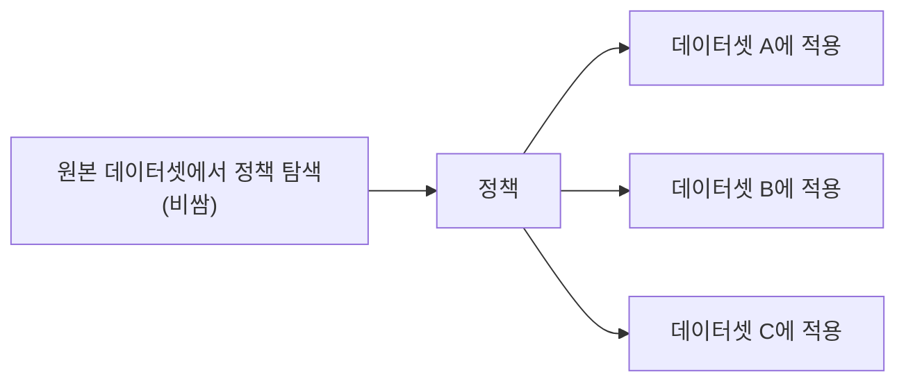
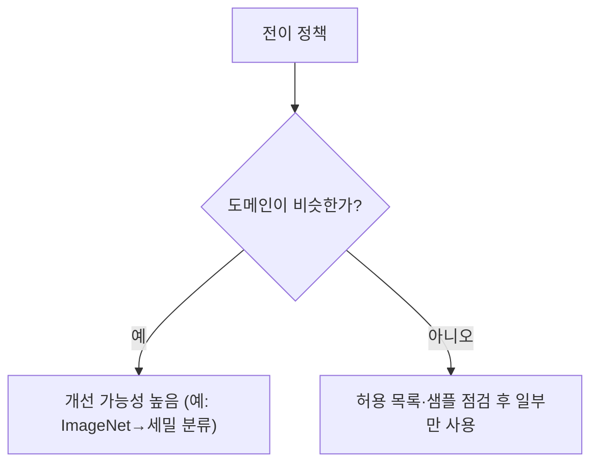

# 증강 정책 전이

> 한 데이터셋에서 힘들게 찾은 증강 정책을 **다른 데이터셋에 그대로 가져다 쓰는 것**이다. 정책 탐색 비용을 한 번만 내고 여러 데이터셋에서 재사용한다. AutoAugment는 ImageNet 정책이 다른 세밀 분류 데이터셋에도 잘 전이된다고 보고했다.

## 쉽게 말하면
한 학교에서 효과가 검증된 공부법을 다른 학교에도 써 보는 것이다. 맞는 경우가 많지만 학교마다 사정이 달라서 어떤 방법(예: 거울 보기)은 어느 학교에서는 도움이 되고 다른 곳에서는 해가 된다.

## 자세히
(Cubuk 외 2018 AutoAugment, arXiv 1805.09501 PDF 본문을 직접 읽음)
- **전이가 필요한 이유**: 직접 탐색(AutoAugment-direct)은 데이터셋마다 수천 개 정책을 샘플링해야 해서 비싸다. 대안이 **AutoAugment-transfer**: 한 과제에서 찾은 정책을 다른 모델·데이터셋에 적용한다.
- **전이가 항상 되는 것은 아니다**: 논문 서론은 증강의 효과가 데이터셋 사이에 잘 안 옮겨 간다고 지적한다. 예: **수평 뒤집기는 CIFAR-10에는 효과적이지만 MNIST에는 아니다**(데이터의 대칭성이 다르기 때문).
- **보고된 전이 결과**: ImageNet에서 찾은 정책으로 Oxford Flowers, Caltech-101, Oxford-IIIT Pets, FGVC Aircraft, Stanford Cars에서 유의미한 개선을 얻었다. ImageNet 사전학습 가중치를 미세조정해도 도움이 별로 없는 Stanford Cars·FGVC Aircraft에서도 ImageNet 정책으로 테스트 오류가 각각 **1.2%p, 1.8%p** 줄었다(논문). 저자는 정책 전이가 가중치 전이학습의 대안이 될 수 있다고 해석한다.
- 직접 탐색 결과 참고: CIFAR-10 오류율 1.5%(이전 최고보다 0.6%p 낮음), ImageNet Top-1 83.5%(2018년 기준).
- **한계와 주의**(제안/후속 연구 인용): RandAugment 논문은 작은 대리 과제에서 찾은 정책이 큰 모델·큰 데이터에 최적이 아닐 수 있다고 한다([RandAugment 강도 튜닝](#randaugment-magnitude-tuning)). 도메인이 크게 다르면(의료·위성 등) 전이한 정책이 라벨을 훼손할 수 있어 허용 목록 검사와 샘플 점검이 필요하다([증강 허용 목록](#augmentation-allowlist)).
- 실무 순서(제안): ① 공개된 정책(ImageNet 정책 등)으로 시작 ② 샘플 점검 ③ 검증 점수로 기준선과 비교 ④ 도메인에 맞지 않는 변환을 제거.

## 그림으로 보기

## 예시
- 새 자동차 부품 분류 데이터에서 공개 AutoAugment ImageNet 정책으로 학습해 기준선과 비교.
- 교육: "한 번 배운 비법을 어디까지 써도 되는가"를 토론.

## 헷갈리는 것과 비교
| 개념 | 차이 |
|---|---|
| AutoAugment-direct | 대상 데이터셋에서 직접 정책 탐색 |
| AutoAugment-transfer | 다른 데이터셋에서 찾은 정책 재사용 |
| 가중치 전이학습 | 모델 가중치를 옮김 |
| [증강 정책 탐색](#augmentation-policy-search) | 정책을 찾는 단계 |

## 더 읽을거리
- [AutoAugment (arXiv 1805.09501)](https://arxiv.org/abs/1805.09501) — 전이 결과와 뒤집기 예(PDF 본문 읽음).
