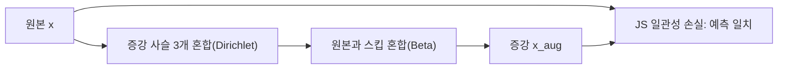
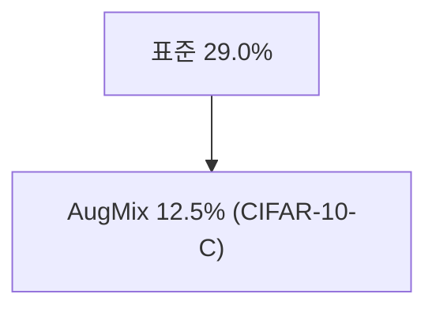

# AugMix

> 여러 증강 연산 사슬을 무작위로 섞고 원본과 한 번 더 섞은 뒤, 원본·증강 두 결과의 예측이 일치하도록(Jensen-Shannon 일관성 손실) 학습해 데이터 변형에 대한 견고성과 불확실성 보정을 높이는 증강 방법이다.

## 쉽게 말하면
사진을 여러 방식으로 살짝 바꿔(회전·색 변화 등) 섞은 버전과 원본을 보여 주고 "두 사진에 대한 답은 같아야 한다"고 가르친다.

## 자세히
(Hendrycks 외 AugMix arXiv 1912.02781을 하위 에이전트가 원문으로 읽은 노트 기준.)
- **방법**: AutoAugment 연산 1~3개로 이뤄진 사슬 k=3개(ImageNet-C와 겹치는 연산은 제외)를 Dirichlet(α) 가중으로 섞고, 원본과 Beta(α)로 스킵 혼합. 손실 = L + λ·JS(p_orig; p_aug1; p_aug2), M은 세 분포의 평균. λ 값은 읽은 범위에서 확인하지 못했다(미확인).
- **결과**

| 벤치마크 | 표준 | AugMix |
|---|---|---|
| CIFAR-10-C 평균 오류 | 29.0% | 12.5% |
| CIFAR-100-C 평균 오류 | 55.6% | 38.3% |
| ImageNet-C mCE(ResNet-50) | 80.6 | 68.4 |
| ImageNet-P mFR | 57.2 | 37.4 |

- **불일치**: 초록은 CIFAR-10-C 오류 28.4%→12.4%로 적어 표 1 평균과 약간 다르다. AugMix+SIN은 표 2가 64.9, 본문이 64.1. 표준 ResNet-50 mCE는 AugMix 논문 80.6, Hendrycks & Dietterich 76.7로 학습 설정에 따라 다르다.
- **적대적 견고성과의 관계**: AugMix 표 1에서 적대적 학습은 CIFAR-10-C 오류 27.2%(표준 29.0%)로 도움이 적었다([흔한 손상 vs 적대적](#common-vs-adversarial-robustness)).

## 그림으로 보기

## 예시
- CIFAR 분류기 학습 코드에 AugMix를 추가하고 CIFAR-10-C 평가.
- 교육 활용: "데이터를 바꿔도 같은 답"을 학습 목표로 삼는 일관성 개념.

## 헷갈리는 것과 비교
| 개념 | 차이 |
|---|---|
| AugMix | 흔한 손상·불확실성 보정에 강함 |
| [적대적 학습](#adversarial-training) | 최악 공격에 대비 |
| 일반 증강 | 단일 변형 위주 |

## 더 읽을거리
- [AugMix (arXiv 1912.02781)](https://arxiv.org/abs/1912.02781) — 방법·표 1~2.
