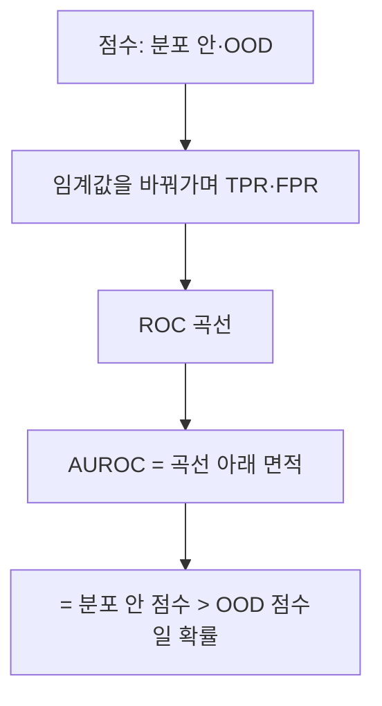
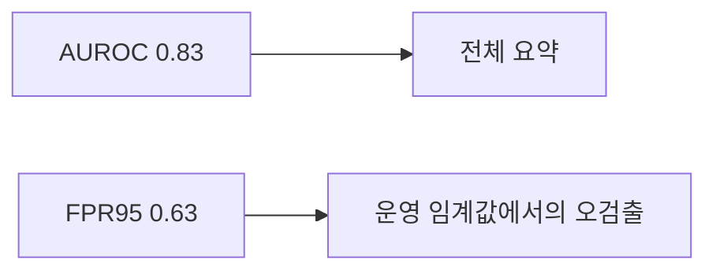

# OOD 탐지 AUROC

> OOD(분포 밖) 탐지 점수가 **분포 안 입력과 분포 밖 입력을 얼마나 잘 갈라놓는지를 임계값을 하나로 정하지 않고 전체 범위에서 재는** 지표다. "분포 안 입력 하나와 분포 밖 입력 하나를 무작위로 뽑았을 때 분포 안 쪽 점수가 더 높을 확률"과 같다.

## 쉽게 말하면
진짜 지폐와 위조지폐를 한 장씩 뽑아 검사기에 넣었을 때, 검사기가 진짜 지폐에 더 높은 점수를 줄 확률이다. 0.5면 동전 던지기, 1.0이면 항상 맞춘다. 어느 점수에서 합격시킬지는 따로 정한다.

## 자세히
(scikit-learn `roc_auc_score` 문서를 직접 열어 확인하고, 아래 수치는 작은 MLP로 직접 실험. ODIN 논문이 쓰는 지표 FPR@95%TPR은 [ODIN](#odin-ood-detection)에서 설명.)
- **계산**: 점수를 임계값별로 바꿔 가며 진양성률(TPR)과 오검출률(FPR)을 그린 ROC 곡선의 아래 면적. `roc_auc_score`는 확률 추정값이나 임곗값 없는 결정 값을 받으므로 분류 임계값을 정할 필요가 없다고 문서가 설명한다. 문서는 확률적 해석을 직접 적지 않지만 **AUC = 무작위 양성이 무작위 음성보다 높은 점수를 받을 확률(동점은 절반)**이라는 표준 해석이 있고, 문서는 지니 계수 G=2×AUC−1 관계도 언급한다.
- **직접 검증(digits MLP, 분포 안=테스트 숫자, OOD=좌우 반전 숫자, 최대 softmax 점수)**: AUROC **0.8279**이고 모든 (분포 안, OOD) 쌍을 비교한 확률도 **0.8279**로 일치했다. 점수에 단조 변환(제곱근)을 해도 AUROC는 변하지 않았다(순위만 본다).
- **FPR95와의 차이**: 같은 점수에서 FPR@TPR95는 **0.627**(분포 안 95%를 받아들이는 임계값에서 OOD의 62.7%가 통과). AUROC가 0.83이어도 **운영 지점에서는 오검출이 크다.** AUROC는 전체 요약이고 FPR95는 한 점을 본다. 서비스 임계값에 해당하는 영역(예: FPR이 낮은 구간)을 별도로 확인한다.
- **클래스 비율에 대한 민감도(직접 계산, OOD를 양성으로 둠)**
  | OOD 비율 | AUROC | AUPR(OOD 양성) | 무작위 AUPR |
  |---|---|---|---|
  | 50% | 0.828 | 0.826 | 0.500 |
  | 약 10% | 0.801 | 0.416 | 0.099 |
  | 약 1% | 0.813 | 0.355 | 0.010 |
  AUROC는 OOD 비율이 바뀌어도 거의 같지만(0.80~0.83, 표본 추출 변동 포함), AUPR은 비율에 크게 좌우된다. 서비스에서 OOD가 드물다면 **AUPR이나 특정 FPR에서의 재현율**을 함께 본다(OOD를 양성으로 두는 정의에 주의).
- **주의(제안)**: ① OOD 시험 세트의 종류에 따라 값이 크게 다르므로 여러 OOD 세트로 평가 ② 분포 안·밖 데이터 생성 방식(가까운 OOD 대 먼 OOD)을 명시 ③ AUROC만으로 모델을 고르지 않고 운영 임계값의 오검출·놓침 비용으로 결정 ④ 양성 정의(분포 안을 양성으로 할지 OOD를 양성으로 할지)를 표기.

## 그림으로 보기

## 예시
- 상품 사진 분류기의 "분류 불가" 점수를 비교할 때 두 점수의 AUROC가 0.91 대 0.93이면 큰 차이가 아닐 수 있으니 서비스 임계값 근처의 FPR과 비교하고 구간 추정치를 함께 본다.
- 교육 소재: "AUROC 0.83이면 무슨 뜻?"을 카드 뽑기(쌍 비교)로 체험.

## 헷갈리는 것과 비교
| 개념 | 차이 |
|---|---|
| OOD 탐지 AUROC | 임계값 전체에서 분리 능력 |
| FPR@TPR95 | 한 운영 지점의 오검출률 |
| AUPR | 비율에 민감한 정밀도-재현율 곡선 면적 |
| [신경망의 과신](#overconfidence-neural-nets) | AUROC가 낮아지는 원인 중 하나 |

## 더 읽을거리
- [scikit-learn: roc_auc_score](https://scikit-learn.org/stable/modules/generated/sklearn.metrics.roc_auc_score.html) — 계산 방법, 다중 클래스 옵션, 지니 계수(직접 확인).
- [ODIN (arXiv 1706.02690)](https://arxiv.org/abs/1706.02690) — FPR@TPR95를 쓰는 OOD 평가(PDF 직접 확인).
