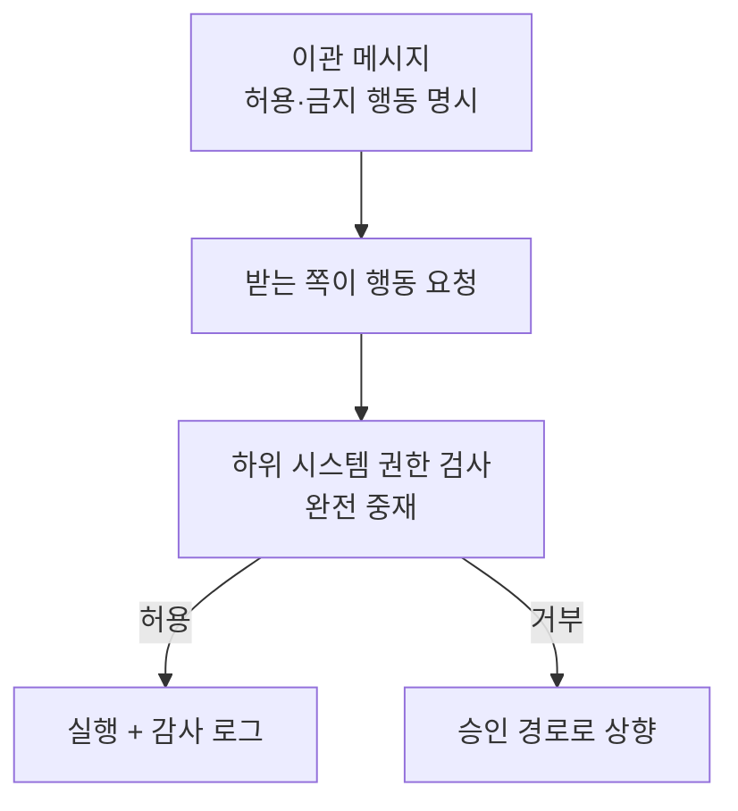

# 권한 범위 명시 (Authorization Scope)

> 이관·위임 메시지에 **받는 쪽(사람 또는 다른 에이전트)이 무엇을 할 수 있고 무엇은 할 수 없는지**를 적어 두는 것. 권한은 문구로 부탁하는 것이 아니라 실제 시스템 권한으로 강제한다.

## 쉽게 말하면
인수인계 메모에 "환불은 10만 원까지 승인 가능, 그 이상은 팀장 확인"이라고 적어 두면 받는 사람이 헷갈리지 않는다. 그 한도는 메모뿐 아니라 시스템에서도 막혀 있어야 한다.

## 자세히
출처: OWASP GenAI "LLM06:2025 Excessive Agency"(본문 확인, [읽기 전용 vs 행동 문의](#read-only-vs-action-intents)에서 정리). 이관 메시지에 권한 필드를 넣는 설계는 제안이다.
- **과도한 행위 능력의 세 원인(OWASP)**: 과도한 기능, 과도한 권한, 과도한 자율성. 완화로 확장 최소화, 권한 최소화, 사용자 승인 요구, **완전 중재**(권한 검사를 LLM이 아니라 하위 시스템에서 강제)를 든다.
- **이관 메시지에 담을 것(제안)**: ①허용 행동 목록(조회, 초안 작성, 환불 승인 한도) ②금지·승인 필요 행동 ③유효 기간·세션 범위 ④요청자와 책임자 ⑤근거(정책 문서 ID).
- **강제의 위치**: 메시지의 권한 표시는 안내이고, 실제 실행 가능 여부는 호출되는 API·계정 권한이 결정한다. 메시지에 "승인됨"이라고 써도 시스템이 검사하지 않으면 위조·오류에 취약하다(해석).
- **프롬프트 주입 대비**: 악성 입력이 메시지의 권한 필드를 바꿔도 하위 시스템이 독립적으로 거부해야 한다.
- **감사**: 권한이 사용된 기록(누가·무엇을·어떤 근거로)을 남긴다. OWASP는 로깅·모니터링·속도 제한이 예방은 못 하지만 피해를 줄인다고 한다.
- **한계**: 권한을 너무 세밀하게 쪼개면 운영이 복잡해진다. 위험 등급별로 몇 단계만 둔다([승급 조건](#intent-promotion-criteria)).

## 그림으로 보기


## 예시
```json
{"allowed": ["lookup_order", "draft_reply", "approve_refund<=100000"],
 "requires_approval": ["approve_refund>100000", "change_address"],
 "expires_at": "2026-11-18T18:00:00+09:00"}
```
교육 활용: 자사 이관 유형별로 "받는 쪽이 해도 되는 일/안 되는 일"을 표로 만들어 보는 실습.

## 헷갈리는 것과 비교
| 개념 | 차이 |
|---|---|
| 권한 범위 명시 | 이관 메시지에 허용 행동을 기록 |
| 완전 중재 | 시스템이 권한을 강제하는 원칙 |
| [읽기 전용 vs 행동 문의](#read-only-vs-action-intents) | 문의 위험 등급 분류 |
| [이관 경계 검증](#handoff-boundary-validation) | 형식·허용값 검사 |

## 더 읽을거리
- [OWASP LLM06:2025 Excessive Agency](https://genai.owasp.org/llmrisk/llm062025-excessive-agency/) — 원인과 예방 전략
