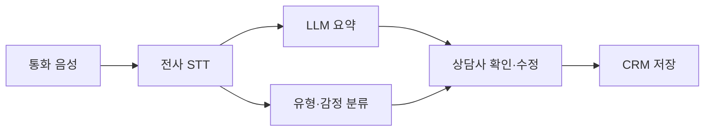

# 통화 자동 요약·분류

> 상담이 끝난 뒤 사람이 하던 요약 작성·티켓 분류·후속 조치 기록을 AI가 초안으로 채워 주는 기능.

## 쉽게 말하면
회의가 끝나면 회의록을 쓰는 막내가 있다. 그 막내를 AI로 바꾸되, 제출 전에 상담사가 한 번 훑어 서명하는 방식이다.

## 자세히
- **후처리 시간(ACW, after-call work)**: 통화 후 기록하는 시간. 업계 추정으로 상담사 근무시간의 6~12%(통제된 연구가 아닌 추정).
- **파이프라인**: 음성 → 전사(STT) → LLM 요약 → 분류(문의 유형·감정·해결 여부) → CRM 기록 → 상담사 확인.
- **효과 주장(벤더 자료)**: Metrigy 추정 약 35% ACW 감소, Observe.AI 사례(Accolade) 50% 이상, Uniphore 사례(통신사) 약 30%. 독립적인 대조군 실험은 찾지 못했으므로 마케팅 수치로 본다.
- **위험**: 전사 오류가 요약·CRM·코칭 점수·컴플라이언스 기록까지 전파된다. 사람 확인 단계를 두고 [수정률](#suggestion-acceptance-rate)을 모니터링한다.

## 그림으로 보기

## 예시
- 3분 걸리던 기록을 AI 초안 + 30초 확인으로 줄인다.
- 분류 결과로 "환불 불만" 급증을 일 단위로 탐지한다.

## 헷갈리는 것과 비교
| 개념 | 차이 |
|---|---|
| 자동 요약 | 통화 후, 기록용 |
| [에이전트 어시스트](#agent-assist) | 통화 중 실시간 제안 |
| 회의록 AI | 같은 기술, 정형 필드·CRM 연동이 상담 특화 |

## 더 읽을거리
- [Computer-Talk: AI call summaries reduce ACW](https://www.computer-talk.com/blogs/how-ai-call-summaries-reduce-after-call-work-in-contact-centers) — 개요(벤더)
- [CX Today: 2026 평가 가이드](https://www.cxtoday.com/ai-automation-in-cx/how-to-improve-contact-center-agent-efficiency-evaluation-guide-2026/) — 벤치마크 표
