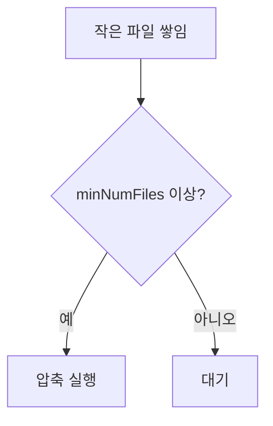

# Auto compaction

> Delta Lake에서 **쓰기가 성공한 직후 자동으로** 아직 압축되지 않은 작은 파일들을 합쳐 주는 기능이다. 사람이 `OPTIMIZE`를 따로 돌리지 않아도 작은 파일이 쌓이는 것을 줄인다.

## 쉽게 말하면
설거지를 식사 직후 바로 하는 습관이다. 쌓아 뒀다가 한꺼번에 하는 `OPTIMIZE`보다 부엌이 덜 어질러진다. 대신 식사(쓰기)가 끝난 뒤 설거지(압축) 시간만큼 쓰기 작업이 조금 더 걸린다.

## 자세히
(Delta Lake 공식 문서 "Optimizations" 페이지를 직접 읽었다. Delta Lake 3.1.0 이상 기준이며 Databricks 전용 환경의 동작과는 설정 이름·기본값이 다를 수 있다.)
- **동작(문서)**: 쓰기가 **성공한 뒤 동기적으로** 실행되고, **이전에 압축되지 않은 파일만** 대상으로 한다(Delta Lake 3.1.0+).
- **목표 크기(문서)**: "기본적으로 **128MB**를 목표 파일 크기로 쓴다." 이는 Auto compaction의 기본이며 `OPTIMIZE` bin-packing의 기본 목표 크기가 아니다(그 값은 읽은 문서에 없음).
- **켜는 법(문서)**: 테이블 속성 `delta.autoOptimize.autoCompact` 또는 세션 설정 `spark.databricks.delta.autoCompact.enabled`.
- **튜닝(문서)**: `spark.databricks.delta.autoCompact.maxFileSize`(출력 파일 크기), `spark.databricks.delta.autoCompact.minNumFiles`(압축을 일으키는 최소 작은 파일 수). 문서는 이 둘의 기본값을 적지 않았다.
- **의미(해석)**: 동기 실행이므로 쓰기 지연이 늘 수 있고, 쓰기 쪽에서 이미 큰 파일을 만든다면 효과가 작다. 스트리밍처럼 잦은 소량 쓰기에서 작은 파일 누적을 막는 데 쓸모가 있다(일반 원칙, 이 문서의 주장 아님).
- **다른 도구와의 관계(Databricks 문서)**: Auto compaction은 `OPTIMIZE`와 별개 기능이고, Unity Catalog 관리형 테이블에서는 예측 최적화가 `OPTIMIZE`를 자동 실행한다.
- **주의**: 이 글은 오픈소스 Delta 문서 기준이며 Databricks 런타임의 자동 최적화 속성 이름이나 기본값은 직접 확인하지 않았다.

## 그림으로 보기



## 예시
```sql
ALTER TABLE events SET TBLPROPERTIES ('delta.autoOptimize.autoCompact' = 'true');
```
- 교육 소재: 쓰기 직후 청소 vs 몰아서 청소의 장단점.

## 헷갈리는 것과 비교
| 개념 | 차이 |
|---|---|
| Auto compaction | 쓰기 직후 자동 압축, 기본 128MB 목표 |
| [OPTIMIZE](#delta-optimize-compaction) | 수동·예약 압축 |
| [Optimized Write](#optimized-write) | 쓰는 순간 파일 수를 줄임 |
| [작은 파일 폭증 문제](#too-many-small-files) | 해결 대상 문제 |

## 더 읽을거리
- [Optimizations (Delta Lake docs)](https://docs.delta.io/latest/optimizations-oss.html) — Auto compaction 동작·설정(직접 읽음).
- [OPTIMIZE (Databricks)](https://docs.databricks.com/aws/en/delta/optimize) — Auto compaction은 별도 기능이라는 설명(직접 읽음).
