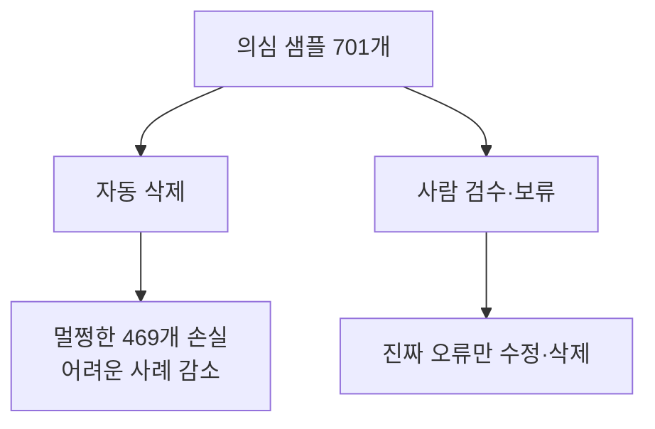
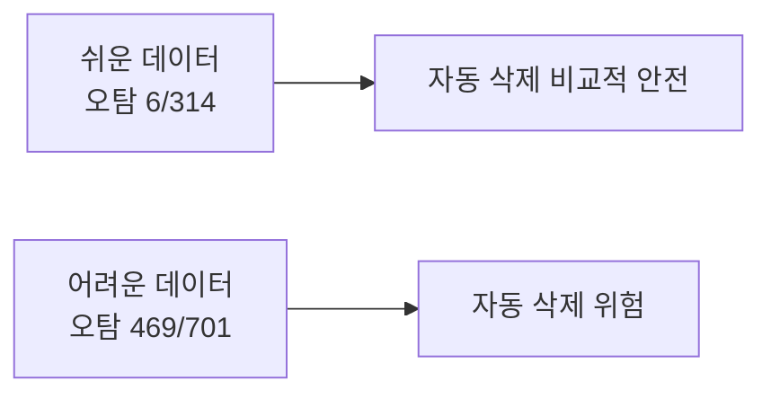

# 자동 삭제의 위험

> 라벨 오류로 의심된 샘플을 **사람 확인 없이 자동으로 지우면**, 데이터가 어려울수록 멀쩡한 샘플(오탐)을 많이 잃고 정작 성능은 거의 안 오른다. 의심은 "삭제 대상"이 아니라 "검토 대상"이다.

## 쉽게 말하면
스팸 필터가 의심 메일을 곧바로 삭제해 버리면 중요한 메일도 사라진다. 격리함에 두고 사람이 확인해야 안전하다. 라벨 정리도 같다.

## 자세히
(cleanlab 2.9.0 `find_label_issues`, 3클래스 합성 3,000개, 학습 라벨의 15%를 무작위 오염, 시드 5개 평균, 테스트는 깨끗한 라벨. 직접 실험이며 일반화하지 않는다.)
| 조건 | 정확도: 오염 그대로 | 의심 자동 삭제 후 | 정답 라벨(오라클) | 의심 샘플 | 그중 멀쩡한 것(오탐) | 진짜 오류 |
|---|---|---|---|---|---|---|
| 쉬운 데이터(class_sep 2.0) | 0.990 | 0.989 | 0.994 | 314 | **6** | 308 / 324 |
| 보통 난이도(class_sep 0.8) | 0.814 | 0.825 | 0.821 | 431 | **170** | 262 / 324 |
| 어려운 데이터(class_sep 0.8, 클러스터 2개) | 0.636 | 0.642 | 0.640 | 701 | **469** | 232 / 324 |
- **쉬운 데이터**: 의심의 98%가 진짜 오류라 자동 삭제가 거의 안전하다. 그러나 모델이 이미 99%라 정리 이득도 작다.
- **어려운 데이터**: 의심 701개 중 **67%(469개)가 멀쩡한 라벨**이고 진짜 오류의 28%(92개)는 못 잡았다. 삭제해도 정확도가 0.636→0.642 정도로 오염을 안 지운 것과 비슷하다.
- **왜 오탐이 느나**: 모델이 약하면 맞는 라벨도 "틀렸을 것 같다"고 본다. 어렵거나 드문 샘플은 낮은 점수를 받아 **하드 샘플(학습에 가장 도움이 되는 경계 사례)**을 우선 지우게 된다.
- **위험 요약**
  1. 오탐 삭제 → 어려운 사례·소수 클래스·소수 집단 데이터가 줄어 편향·공정성 문제.
  2. 삭제 후 클래스 분포 변화.
  3. 삭제는 되돌리기 어렵다(원본 보존 필요).
  4. 평가셋을 같은 방식으로 정리하면 점수가 인위적으로 좋아진다.
- **안전한 절차**: 의심을 점수 순으로 사람이 검수([검수 순서](#human-relabel-triage)), 삭제 대신 보류 태그, 원본 보존, 정리 전후 성능·클래스 분포를 비교, 자동 삭제는 오탐률을 측정한 쉬운 구간(점수 극단 하위)에만 허용.

## 그림으로 보기

## 예시
- 고객 문의 분류 모델 정확도가 70%인데 라벨 정리 도구가 의심 30%를 표시 → 이 중 과반이 멀쩡할 수 있으니 하위 수백 개만 사람이 보고 나머지는 보류.
- 교육: "자동화 도구의 출력은 후보이지 결론이 아니다"의 예시.

## 헷갈리는 것과 비교
| 개념 | 차이 |
|---|---|
| 자동 삭제 | 사람 확인 없이 제거 |
| 사람 검수 후 수정 | 오탐을 걸러 내고 라벨도 고침 |
| 보류(quarantine) | 삭제하지 않고 학습에서 제외 |
| [라벨 품질 점수](#cleanlab-label-quality-score) | 의심 순위를 주는 도구 |

## 더 읽을거리
- [cleanlab 튜토리얼](https://docs.cleanlab.ai/stable/tutorials/indepth_overview.html) — `find_label_issues`와 `filter_by` 옵션.
- [Confident Learning (arXiv 1911.00068)](https://arxiv.org/abs/1911.00068) — 정리 후 학습이 평균적으로 개선된다는 보고(초록 확인).
