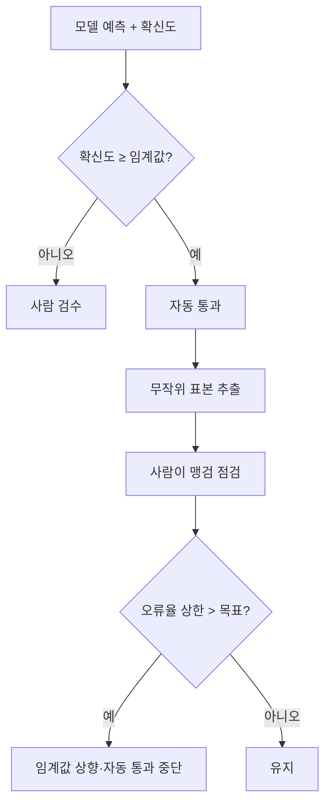
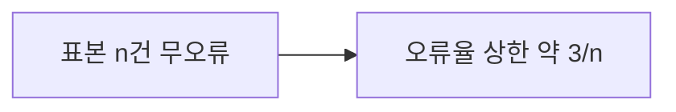

# 자동 통과분 표본 점검

> 확신도가 높아 사람 검수 없이 자동으로 통과시킨 항목들 중에서도 **일부를 무작위로 뽑아 사람이 확인**해, 자동 통과분의 실제 오류율을 계속 재는 절차다. 안 보는 영역이라 오류가 쌓여도 모를 수 있기 때문이다.

## 쉽게 말하면
공장에서 자동 검사기가 "합격"으로 통과시킨 제품도 가끔 몇 개를 꺼내 사람이 다시 검사하는 것과 같다. 한 번도 안 열어 보면 검사기가 고장 나도 모른다.

## 자세히
(rule of three는 위키백과 문서와 그 참고문헌 목록(Hanley & Lippman-Hand 1983)을 직접 열어 확인하고, 표본 수 계산은 직접 실행.)
- **왜 필요한가**: [확신도 기반 검수 분배](#confidence-routed-review)는 확신도가 임계값 이상이면 자동 통과시킨다. 그런데 모델이 과신하거나 데이터 분포가 바뀌면 자동 통과분의 오류율이 조용히 올라간다. 사람이 안 보니 알 길이 없다.
- **표본 크기와 한계 오류율(rule of three)**: 표본 n개를 점검해 오류가 **0개**였다면 실제 오류율의 95% 신뢰 구간 상한은 약 **3/n**이다(n>30에서 좋은 근사, 정확히는 −ln(0.05)/n, 99%는 4.61/n). 표본 50개 무오류면 상한 6%, 100개 3%, 300개 1%, 1,000개 0.3%.
- **직접 계산: 오류율 e인 자동 통과분에서 95% 확률로 오류를 최소 하나 찾으려면**
  | 실제 오류율 | 95% 확률로 1개 이상 찾는 표본 수 | 99% 확률 |
  |---|---|---|
  | 5% | 59 | 90 |
  | 2% | 149 | 228 |
  | 1% | 299 | 459 |
  | 0.5% | 598 | 919 |
  (공식: ⌈ln(1−확률)/ln(1−e)⌉.) 오류율이 낮을수록 **오류를 한 건 보려면 점검량이 많이 든다**. 임계값을 0.95로 두어 자동 통과분 오류가 1% 안팎이라면 최소 300건 점검이 필요하다.
- **설계(제안)**: ① 자동 통과분에서 일정 비율(예 1~5%)을 **무작위**로 뽑는다(확신도 높은 쪽만 뽑지 않기) ② 확신도 구간별로 층화(0.95~0.99, 0.99 이상)해 구간별 오류율을 추정 ③ 점검한 항목은 사전 라벨을 가리거나 맹검으로([사전 라벨 맹검 대조](#blind-sample-prelabel-audit)) ④ 오류율 상한이 목표를 넘으면 임계값을 올리거나 자동 통과를 일시 중지 ⑤ 모델·데이터가 바뀔 때마다 점검 비율을 일시적으로 높임 ⑥ 점검에서 나온 오류는 학습 데이터 개선에도 쓴다.
- **한계**: 표본 점검은 평균 오류율을 알려 줄 뿐 특정 하위 집단(예: 드문 클래스)의 오류는 놓칠 수 있다 → 층화·클래스별 점검이 필요하다. 오류가 0이어도 "오류율 0"이 아니라 "3/n 이하"라는 뜻이다.

## 그림으로 보기

## 예시
- 상담 문의 자동 분류에서 확신도 0.95 이상 3만 건이 자동 통과. 매주 300건을 맹검 점검해 오류 0건이면 "오류율 1% 이하(95% 신뢰)"로 기록, 1건이라도 나오면 구간별로 원인 분석.
- 교육 소재: "AI가 확신하는 답도 일부는 사람이 확인해야 한다"를 표 하나로 설명.

## 헷갈리는 것과 비교
| 개념 | 차이 |
|---|---|
| 자동 통과분 표본 점검 | 통과된 것 중 일부를 사람이 확인 |
| [확신도 기반 검수 분배](#confidence-routed-review) | 확신도로 사람·자동 분기 |
| [합친 라벨 검증](#label-model-validation) | 약한 라벨 결과를 개발 세트로 점검 |
| [사전 라벨 자동화 편향](#automation-bias-prelabel) | 점검자가 모델에 끌리는 위험(맹검으로 완화) |

## 더 읽을거리
- [Rule of three (statistics) — 위키백과](https://en.wikipedia.org/wiki/Rule_of_three_(statistics)) — 무오류 표본의 신뢰 구간 상한 3/n과 일반식(직접 확인).
- [Hanley & Lippman-Hand 1983, JAMA](https://doi.org/10.1001/jama.1983.03330370053031) — rule of three 원전(참고문헌 목록으로만 확인, 본문은 열어 보지 않음).
