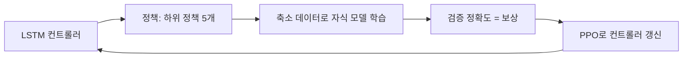
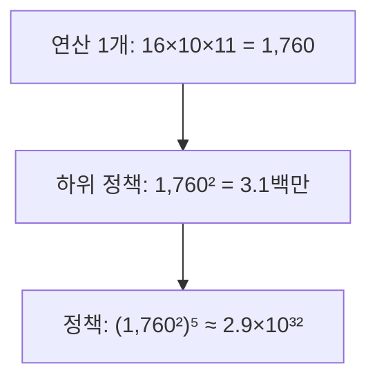

# AutoAugment 탐색 공간

> AutoAugment는 증강 "정책"을 직접 탐색한다. 정책 하나는 **하위 정책 5개**이고, 하위 정책은 **연산 2개(연산 종류·적용 확률·강도)**로 이루어져 탐색 공간이 약 2.9×10³²개로 거대하다. 그래서 강화학습 컨트롤러로 탐색한다.

## 쉽게 말하면
요리 레시피 대회에서 "재료 두 가지를 각각 몇 퍼센트 확률로, 얼마나 세게 쓸지"를 다섯 세트 정해야 한다고 하자. 선택지가 너무 많아 일일이 시험할 수 없으니, 시험 결과를 보고 점점 나은 레시피를 제안하는 조수(컨트롤러)를 훈련시킨다.

## 자세히
- **구성**(Cubuk 외 2018, arXiv 1805.09501 ar5iv 확인): 연산 16종(PIL 함수 + Cutout + SamplePairing), 강도는 10단계, 적용 확률은 11단계로 이산화. 하위 정책 = 연산 두 개를 순서대로, 정책 = 하위 정책 5개이며 미니배치의 이미지마다 하위 정책 하나를 무작위로 고른다.
- **크기 계산**(직접 계산): 연산 하나의 선택지 16×10×11 = 1,760, 하위 정책 하나는 1,760² = 3,097,600, 정책 전체는 (1,760²)⁵ ≈ **2.85×10³²**. 논문은 이를 약 2.9×10³²로 적었다.
- **탐색 방법**(논문): 100 은닉 단위 1층 LSTM 컨트롤러가 30개의 softmax 예측(5개 하위 정책 × 연산 2개 × [종류·강도·확률])을 내고, PPO(학습률 0.00035)로 학습한다. 축소 CIFAR-10(학습 4,000장)에서 정책 약 15,000개를 시험했고 각 자식 모델은 Wide-ResNet-40-2를 120 에폭 학습했다. 축소 ImageNet은 120개 클래스 부분집합에 Wide-ResNet-40-2를 200 에폭 학습했다(표본 수는 본문에서 6,000과 5,000이 함께 나와 불확실).
- **비교**: RandAugment는 연산을 무작위로 뽑고 강도를 하나로 통일해 탐색 변수를 N·M 두 개로 줄였다. 직접 세면 14연산·N∈{1,2,3}·M 31값이면 격자가 93칸이다([격자 탐색](#randaugment-grid-search)). 15,000개 정책을 학습하는 AutoAugment와 비용이 크게 다르다.
- **한계(해석)**: 탐색 비용이 크고, 축소 데이터·작은 모델에서 찾은 정책이 큰 모델·다른 데이터에 맞는지는 별도 문제다([대리 과제 함정](#proxy-task-pitfall), [정책 이식](#policy-transfer)).

## 그림으로 보기

## 예시
- 대규모 연구에서 이미 찾은 CIFAR-10 정책을 불러 쓰는 것이 현실적이며, 새 데이터에서 직접 탐색하려면 막대한 GPU가 든다.
- 교육: 선택지 수를 곱셈으로 계산해 보며 "왜 완전 탐색이 불가능한가"를 체험.

## 헷갈리는 것과 비교
| 개념 | 차이 |
|---|---|
| AutoAugment | 정책 전체를 RL로 탐색, 공간 2.9×10³² |
| [RandAugment](#torchvision-randaugment) | 무작위 연산+공통 강도, 변수 2개 |
| 하위 정책 | 연산 2개의 묶음 |
| 정책 | 하위 정책 5개(이미지마다 1개 선택) |

## 더 읽을거리
- [AutoAugment 논문 — ar5iv](https://ar5iv.labs.arxiv.org/html/1805.09501) — 탐색 공간, 컨트롤러, 축소 탐색(열어 확인).
