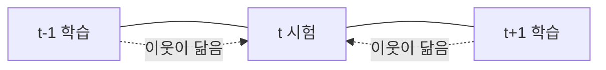
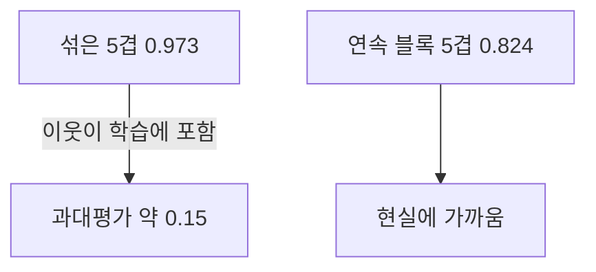

# 자기상관

> 자기상관은 시간(또는 순서)상 이웃한 관측값끼리 서로 닮아 있는 현상이다. 표본이 서로 독립이라는 i.i.d. 가정이 깨지므로, 데이터를 무작위로 섞어 나누면 시험 표본의 바로 옆 표본이 학습에 들어가 점수가 부풀려진다.

## 쉽게 말하면
어제 기온이 높았으면 오늘 기온도 높기 쉽다. 일주일치 기온에서 무작위로 하루를 가려 맞히라고 하면, 가린 날의 전날과 다음 날 기온이 보이므로 쉽게 맞힌다. 진짜 시험은 앞으로 올 날을 미리 모르는 채 맞히는 것이다.

## 자세히
- **직접 해 본 실험(합성 시계열 1,000개, 라벨은 랜덤워크의 부호라 인접 라벨이 매우 닮음, 라벨의 1차 자기상관 0.925, 시간 위치를 특성에 포함, 랜덤 포레스트)**: 데이터를 섞어서 나눈 5겹 정확도는 0.973, 시간 순서를 지킨 연속 블록 5겹 정확도는 0.824였다. 섞은 평가는 이웃 표본이 학습에 들어가 약 0.15 높게 나왔다. 합성 데이터의 한 사례다. 시간 위치를 특성으로 쓴 것은 이웃 표본의 정보를 모델이 활용하기 쉽게 만든 의도적 설정이다.
- **원인(해석)**: 이웃 표본이 거의 같은 정보를 가지므로 시험 표본마다 학습에 거의 복제본이 있는 셈이다([샘플 단위 vs 그룹 단위 분할](#sample-vs-group-split)과 같은 누수 구조). 폴드 점수도 서로 상관이 커져 불확실성이 과소평가된다([점수 비독립성](#score-non-independence)).
- **대처(해석)**: ① 시간 순서를 지키는 분할(연속 블록, `TimeSeriesSplit`, [시간을 그룹으로 쓰기](#time-as-group)) ② 학습과 시험 사이에 공백(gap)을 둬 이웃 표본이 양쪽에 걸치지 않게 ③ 자기상관 크기를 먼저 측정(래그별 상관)해 필요한 공백 길이를 정한다 ④ 사람·기기 단위의 반복 측정도 같은 문제이므로 그룹 분할.
- **주의**: 라벨이 자기상관을 갖는지, 특성이 갖는지에 따라 영향이 다르다. 자기상관이 없는 데이터에는 이 문제가 없다.

## 그림으로 보기

## 예시
- 코드: `KFold(5)`(섞지 않음) 또는 `TimeSeriesSplit(5, gap=24)`처럼 학습·시험 사이에 24시간 공백을 둔다.
- 교육 활용: 랜덤워크 데이터로 섞은 분할과 블록 분할의 점수 차이를 직접 비교한다.

## 헷갈리는 것과 비교
| 개념 | 차이 |
| --- | --- |
| 자기상관 | 이웃 관측이 닮음 |
| 개념 이동 | 시간에 따라 규칙 자체가 변함 |
| [시간을 그룹으로 쓰기](#time-as-group) | 시간 구간을 그룹으로 분할 |
| [점수 비독립성](#score-non-independence) | 폴드 점수가 서로 닮는 문제 |

## 더 읽을거리
- [scikit-learn: Cross-validation of time series data](https://scikit-learn.org/stable/modules/cross_validation.html) — TimeSeriesSplit과 gap
