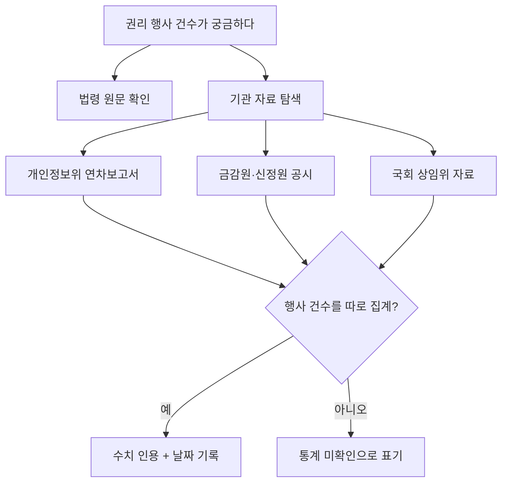
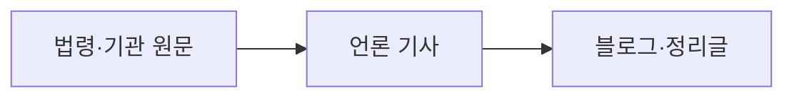

# 공식 통계 출처

> 자동화된 결정에 대한 설명요구·이의제기가 실제로 얼마나 쓰이는지 알려면 어느 기관의 어떤 자료를 봐야 하는지 정리한 노드다. 2026-11 조사 시점에 이 권리만 따로 집계한 공식 통계는 찾지 못했다.

## 쉽게 말하면
"우리 동네 도서관 이용자가 몇 명인가"를 알려면 도서관 통계를 찾아야 한다. 권리 행사 건수도 마찬가지로, 누가 그 숫자를 세는지부터 알아야 한다. 집계 주체가 없으면 숫자 자체가 없다.

## 자세히
- **법 근거**: 개인정보 보호법 제37조의2가 완전 자동화 결정에 대한 거부권·설명요구권·인적 개입 재처리 요구를 규정한다(법률신문 해설 기준). 거부권은 동의·법률 규정·계약 체결·이행에 필요한 경우엔 쓸 수 없고, 결정 자체를 금지하지는 않는다. 시행일은 Pebblous 정리글에 2024.3.15로 적혀 있으나 이 글은 2차 자료이므로 국가법령정보센터 원문으로 확인한다.
- **어디에 통계가 있을 수 있나(확인 경로)**
  - 개인정보보호위원회: 연차보고서·침해 신고·분쟁조정 통계. 권리 행사 건수를 따로 공개하는지는 미확인.
  - 금융감독원·신용정보원: 신용정보법상 자동화평가 설명요구 관련 공시·연차보고서. 금융사 민원 통계는 일반 민원 집계라 이 권리를 분리하지 않을 가능성이 크다.
  - 국회 상임위 자료: Pebblous 글은 "공공기관 AI 채용검사 탈락자 351명(최근 2년, 17개 시·도)"을 국회 행안위 자료로 소개하지만 직접 링크가 없어 **주장 수준**으로만 쓴다.
- **출처 신뢰도 순서**: 법령 원문·기관 보도자료 > 기관 연차보고서 > 언론 기사 > 블로그 정리글. 블로그는 시행일이 서로 다른 경우가 있었다(2024.3.15 vs 2026.9.11 등).
- **한계**: "통계 없음"은 "이용 없음"이 아니다. 집계 체계가 없다는 뜻일 수 있다.

## 그림으로 보기

## 예시
- 교육 자료에 "설명요구권 이용률이 낮다"고 쓰고 싶을 때: 출처가 없으면 "공식 통계는 확인되지 않았다"로 쓴다.
- 확인 절차: ① 법조문 번호 ② 시행일을 국가법령정보센터에서 ③ 기관 보고서 PDF에서 키워드 검색 ④ 찾은 날짜·쪽수 기록.

## 헷갈리는 것과 비교
| 개념 | 차이 |
|---|---|
| 권리 존재 | 법 조문이 있음 |
| 권리 이용 통계 | 실제 행사 건수 집계(현재 미확인) |
| [설명요구 이용 현황](#explanation-request-trend) | 이용이 저조할 수 있는 제도 요인 |
| 일반 민원 통계 | 권리별로 분리되지 않음 |

## 더 읽을거리
- [법률신문 해설](https://www.lawtimes.co.kr/news/articleView.html?idxno=194236) — 제37조의2의 내용과 한계(통계 언급 없음).
- [Pebblous: AI 결정 설명요구권](https://blog.pebblous.ai/blog/ai-decision-explanation-right/ko/) — 한국·EU 법령 비교와 수치 인용(출처 불완전 항목 있음).
