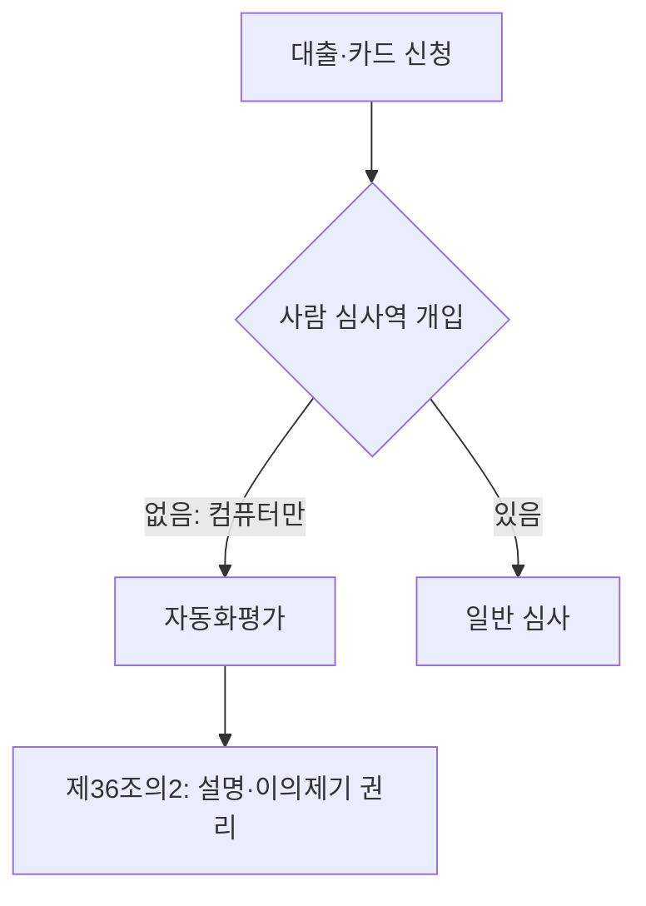
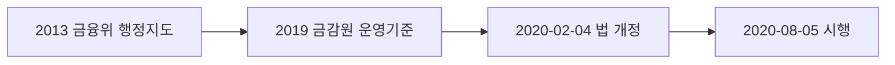

# 자동화평가

> 한국 신용정보법이 규율하는 개념으로, 금융회사 직원이 심사에 관여하지 않고 컴퓨터 등 정보처리장치만으로 개인신용정보와 그 밖의 정보를 처리해 개인을 평가하는 것. 이렇게 평가된 신용정보주체는 제36조의2에 따라 결과의 설명과 이의제기를 요구할 수 있다. (법률 자문 아님)

## 쉽게 말하면
대출 신청 후 사람 심사역이 서류를 보고 판단하는 것이 아니라, 점수 시스템이 알아서 "한도 500만 원, 금리 12%"를 계산해 내는 방식이다. 이때 신청자는 "어떤 기준으로 그렇게 나왔느냐"를 물을 권리가 있다. 법은 이 "사람 없이 컴퓨터만으로 하는 평가"를 자동화평가라고 부르고, 그 결과에 대한 설명·이의제기 권리를 정해 놓았다.

## 자세히
출처: 국회입법조사처 소식지(신용정보법 제도 연혁, PDF 직접 읽음), 금융사 안내와 해설 블로그 요약(2차 출처). **제2조의 자동화평가 정의 조문 원문과 시행령은 이번에 열지 못했다.** 아래 정의는 금융사 안내 요약이다.
- **정의(실무 안내 요약)**: 금융회사 임직원이 심사에 관여하지 않고 컴퓨터 등 정보처리장치로만 개인신용정보와 그 밖의 정보를 처리해 개인을 평가하는 것. 법적 정의는 신용정보법 제2조 정의 규정(제38호의2로 안내됨, 미확인)을 직접 확인해야 한다.
- **제도 연혁(국회입법조사처)**
  - 개인신용평가 결과가 대출 한도·금리를 정하는 데 중요한데도 결정 과정과 이유가 불투명하다는 지적에 따라 금융위원회가 **2013년부터 행정지도**로 설명요구·이의제기를 도입.
  - 기존 신용정보법 제36조는 거래가 거절·중지된 고객이 신용정보의 정확성 확인을 요청하는 권리만 인정했다. 2019년 금융감독원 행정지도 「개인신용평가 결과에 대한 대응권 운영기준」으로 **거절 여부와 상관없이** 설명을 요구하고 오류 정정·삭제, 재산출을 요구할 수 있게 보완.
  - **2020년 2월 4일 개정**으로 제36조의2(소식지 표기: 자동화평가 결과에 대한 설명 및 이의제기 등)가 신설되어 **2020년 8월 5일** 시행.
- **대상 기관**: 개인신용평가회사 외에 시행령이 정한 신용정보제공·이용자(금융위원회 설치법 제38조 각 호의 기관: 은행·보험회사·신용카드사 등). 은행 등이 포함된 이유는 개인신용평가를 그대로 쓰지 않고 참고해 자체 평가를 하기 때문이라고 소식지가 설명한다.
- **요구할 수 있는 것(해설 블로그와 소식지)**: 평가 결과, 주요 기준, 이용된 기초정보의 개요에 대한 설명. 또 유리한 정보 제출, 부정확한 기초정보의 정정·삭제, 평가 결과의 재산출.
- **별개 제도와 구분**: 제36조의 대출 거절 사유 고지는 거절 근거가 된 정보를 알려 주는 제도이며, 제36조의2의 설명 요구와 다르다.
- **AI 서비스에의 시사점(이 글의 정리)**: 사람이 최종 승인하는 구조라면 자동화평가에 해당하지 않을 수 있지만, 사람이 형식적으로 승인만 하는 경우의 판단은 이번에 확인하지 못했다. 점수 모델에서 설명 가능한 "주요 기준" 산출 체계를 준비해야 한다([이유 코드](#reason-codes) 참고).

## 그림으로 보기

## 예시
- 인터넷은행이 사람 심사 없이 한도를 산출한 경우 신청자가 설명요구서를 내면 결과·주요 기준·기초정보 개요를 안내받는다.
- 신청자가 오래된 연체 기록을 정정하고 재산출을 요구해 한도가 바뀌는 흐름([결과 재산출 요구](#recalculation-request)).

## 헷갈리는 것과 비교
| 개념 | 차이 |
|---|---|
| 자동화평가 | 사람 개입 없이 컴퓨터로만 하는 평가 |
| 개인신용평점 | 신용평가회사가 산출한 점수 |
| 제36조 | 거래 거절 시 근거 정보 고지 |
| [신용정보법 제36조의2](#credit-info-act-36-2) | 자동화평가 설명·이의제기 조항 |

## 더 읽을거리
- [국회입법조사처 소식지: 개인신용평가 관련 권리(PDF)](http://www.shinkim.com/newsletter/2022/GA/2022_vol164/links/2022_vol164_403.pdf) — 제도 연혁(직접 읽음)
- [자동화평가 설명요구 해설 (how-toai)](https://www.how-toai.com/blog/automated-credit-evaluation-explanation-request-forms-refusal-2026) — 절차·거부 사유 요약(2차 출처)
- [국가법령정보센터 신용정보법](https://www.law.go.kr/lsRvsRsnListP.do?lsId=001540) — 법령 원문(이번에 열지 못함)
