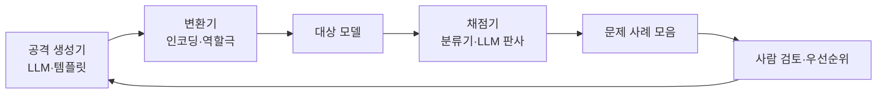

# 자동 레드팀

> 사람 대신(또는 사람과 함께) **AI·스크립트가 공격 프롬프트를 대량으로 만들고 대상 모델에 던져 문제 응답을 찾아내는** 점검 방식. 사람 레드팀이 못 닿는 넓은 범위를 훑지만, 사람의 판단을 대체하지는 못한다.

## 쉽게 말하면
은행 금고 보안을 점검할 때 전문가 몇 명이 직접 시도하는 것(수동)과, 자동 기계가 수만 가지 열쇠 조합을 밤새 끼워 보는 것(자동)을 합치는 것과 같다. 기계는 넓고 빠르지만, "어떤 시도가 진짜 위험한가"는 사람이 판단한다.

## 자세히
- **원형 연구**(Perez et al., 2022, "Red Teaming Language Models with Language Models", arXiv 2202.03286): 한 언어모델이 **테스트 질문을 생성**하고, 공격 대상 모델의 답을 **유해성 분류기**가 채점한다. 제로샷 생성부터 강화학습까지 비교해 테스트의 다양성과 난이도 사이의 균형을 보았다. 2800억 파라미터 챗봇에서 수만 건의 공격적 응답, 가상의 연락처(전화번호) 지어내기, 학습 데이터 유출, 다중 턴에서만 나타나는 해악 등을 찾았다고 보고한다.
- **오픈소스 도구**(검색 결과로 확인한 설명):
  - **PyRIT**(Microsoft): 프롬프트 데이터셋, 변환기(인코딩 등), 자동 공격 전략(TAP·PAIR·Crescendo 등)을 갖춘 프레임워크. Microsoft는 사람 레드팀의 **대체가 아니라 보강**이라고 못박는다.
  - **garak**(NVIDIA): LLM 취약점 스캐너. 설정에 따라 probe가 프롬프트를 던지고 detector가 응답을 채점. 프롬프트 주입·탈옥·데이터 유출·독성·환각 등을 다룬다.
- **Microsoft의 교훈 논문**(arXiv 2501.07238, 100개 이상 생성형 AI 제품 경험): 자동화는 위험 영역을 더 넓게 커버하게 하지만(교훈 4), **사람의 판단은 필수**(교훈 5), 레드팀은 안전 벤치마크와 다르며(교훈 3), 보안은 끝이 없는 지속 과정(교훈 8)이라고 정리한다.
- **구성 요소**: ① 공격 생성기(LLM·템플릿), ② 변환기(인코딩·역할극·다국어), ③ 대상 시스템, ④ 채점기(분류기·LLM 판사), ⑤ 결과 분류·사람 검토.
- 한계: 채점기가 틀리면 결과도 틀린다(오탐·미탐). 자동 점검 통과가 안전을 보증하지 않는다. 보고 수치는 각 논문의 설정에 한정된다.

## 그림으로 보기


## 예시
```bash
# garak 예시(명령은 버전에 따라 다를 수 있음)
pip install garak
python -m garak --model_type openai --model_name <모델명> --probes promptinject
```
- 사내 챗봇 출시 전, 금지 주제 프롬프트 1만 건을 자동 생성해 돌리고 걸린 100건을 사람이 검토.

## 헷갈리는 것과 비교
| 개념 | 차이 |
|---|---|
| 자동 레드팀 | 기계가 대량 공격·채점, 넓은 커버리지 |
| [레드팀](#red-teaming) | 사람 중심의 창의적 공격 점검 포함 상위 개념 |
| 안전 벤치마크 | 고정 문제집으로 점수 비교(공격 적응 없음) |
| [탈옥](#jailbreak) | 안전 장치를 우회하는 공격 기법 자체 |

## 더 읽을거리
- [Perez et al., Red Teaming Language Models with Language Models (arXiv 2202.03286)](https://arxiv.org/abs/2202.03286) — LM으로 테스트 질문을 생성하는 원형 연구.
- [Lessons From Red Teaming 100 Generative AI Products (arXiv 2501.07238)](https://arxiv.org/abs/2501.07238) — Microsoft의 8가지 교훈.
- [PyRIT 논문 (arXiv 2410.02828)](https://arxiv.org/abs/2410.02828) — 자동화 프레임워크 설명.
