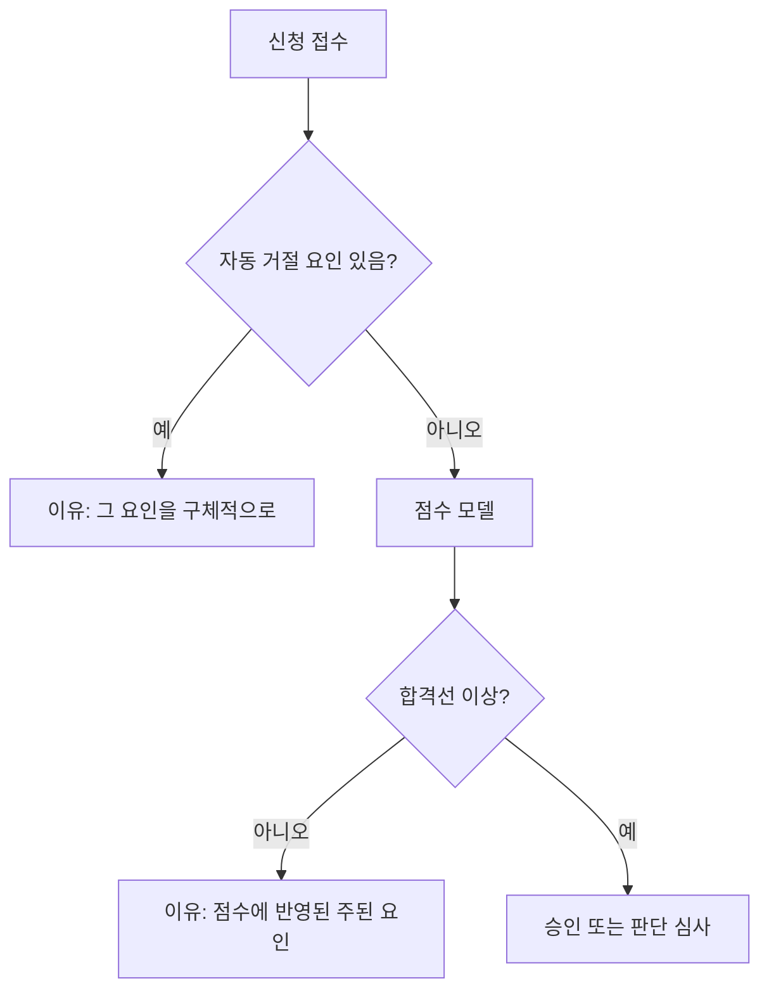
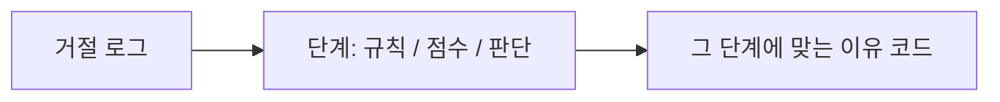

# 자동 거절 요인

> 신용 심사에서 점수와 무관하게 "이것이 있으면 무조건 거절"로 정해 둔 조건(예: 파산, 미성년자, 과거 자사와의 불량 거래). Regulation B는 거절이 이 요인 때문이면 그 요인을 이유로 **구체적으로** 밝히라고 요구한다. (법률 자문 아님)

## 쉽게 말하면
시험에서 "컨닝하면 총점과 상관없이 0점"이라는 규칙과 같다. 점수가 높아도 이 조건에 걸리면 탈락한다. 그런데 성적표에 "총점 부족"이라고 쓰면 거짓이다. 진짜 이유인 "컨닝"을 적어야 한다. AI가 점수 모델 앞뒤에 이런 규칙 필터를 붙이는 경우가 많아서, 이유 코드를 모델 기여도에서만 뽑으면 이 규칙이 빠질 위험이 있다.

## 자세히
출처: CFPB Regulation B 공식 해설(Supplement I) §1002.9(b)(2) 페이지(직접 열어 읽음, 2026-11-17).
- **코멘트 9(b)(2)-8**: 거절이 자동 거절 요인에 근거하면 신용 제공자는 **그 요인을 구체적으로 밝혀야 한다**. 해설이 드는 예: 자사와의 과거 불량 신용 이력, 파산, 신청자가 미성년자인 것.
- **점수 시스템과의 관계(코멘트 -4)**: 밝히는 이유는 "실제로 점수에 반영된 요인"과만 관련돼야 한다. 주된 요인을 빼면 안 되고, 신청자가 신용도와 무관해 보인다고 느껴도 실제 이유를 밝혀야 한다.
- **이유 선택 방법(코멘트 -5)**: 하나로 정해진 방법은 없다. 예시로 신청자의 점수가 (최저 합격선 근처 신청자 평균 또는 전체 신청자 평균)보다 가장 많이 떨어진 요인을 고르는 방법이 있다.
- **혼합 시스템(코멘트 -7)**: 점수와 판단이 섞인 경우 이유는 신청자가 **탈락한 구성요소**에서 나와야 한다. 점수로 탈락 → 점수 요인, 점수 통과 후 판단 심사로 탈락 → 판단 요인, 회색 구간이면 둘 다. 합쳐서도 4개 이하가 도움이 된다.
- **AI 적용**: 규칙 엔진(자동 거절) + ML 모델의 이중 구조에서 거절 원인을 기록하는 필드가 필요하다. 거절 건마다 "어느 단계에서 탈락했나"를 로그로 남겨야 올바른 이유를 낼 수 있다. 사후 설명 기법(SHAP 등)은 모델 안의 요인만 설명하므로 규칙으로 걸린 거절에는 쓸 수 없다(해설 문구는 아니고 이 글의 추론).

## 그림으로 보기

## 예시
- 점수 모델은 통과 점수인데 신청자가 과거 자사 대출을 파산 처리한 이력 → 이유는 "자사와의 과거 불량 신용 이력".
- 미성년자 신청 → "신청자가 법정 연령 미만".
- 점수 미달만 "내부 기준 미달"로 쓰는 것은 불충분(§1002.9(b)(2)).

## 헷갈리는 것과 비교
| 개념 | 차이 |
|---|---|
| 자동 거절 요인 | 점수와 무관한 즉시 거절 규칙. 그 요인을 이유로 밝힘 |
| [이유 코드](#reason-codes) | 이유를 표준 항목으로 매핑하는 도구 |
| [통지 시한](#adverse-action-timing) | 통지 시점 규칙 |
| [이유 4개 권고](#four-reason-guideline) | 개수 관련 해설 |

## 더 읽을거리
- [Reg B 공식 해설 §1002.9 (CFPB)](https://www.consumerfinance.gov/rules-policy/regulations/1002/interp-9/) — 코멘트 9(b)(2)-1~8
- [Reg B §1002.9 조문 (CFPB)](https://www.consumerfinance.gov/rules-policy/regulations/1002/9/) — 통지·이유 요건
