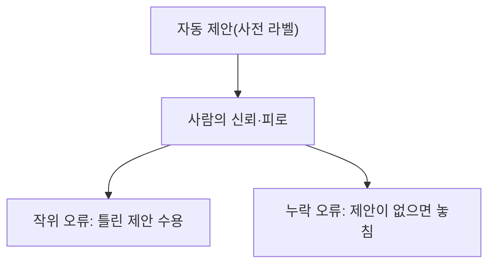
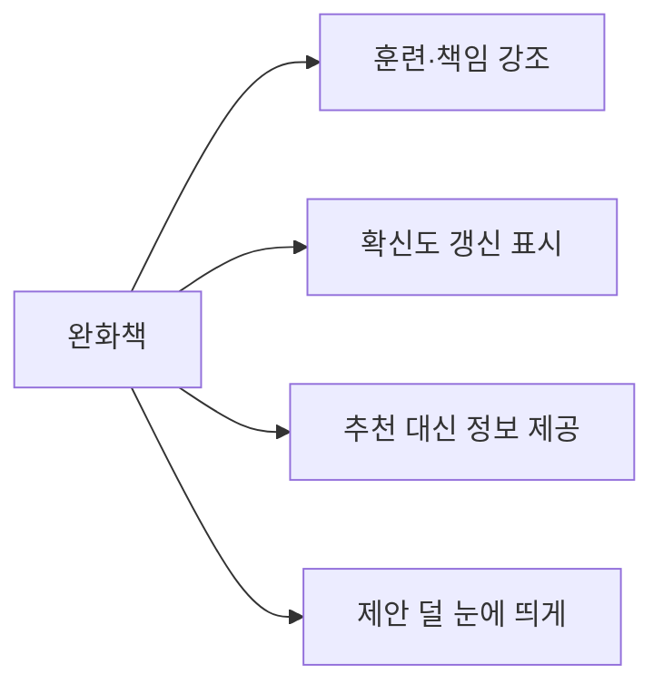

# 주석 자동화 편향

> 자동 제안(모델의 사전 라벨)이 있을 때 사람이 그것을 충분히 검증하지 않고 받아들이는 경향이다. 틀린 제안을 따라가는 "작위 오류"와, 시스템이 알려 주지 않아 놓치는 "누락 오류"로 나타난다.

## 쉽게 말하면
계산기가 알려 준 값을 "기계가 계산했으니 맞겠지" 하고 옮겨 적었는데 계산기에 입력이 잘못 들어간 경우다. 사람은 편해지면 확인을 건너뛴다. 사전 라벨이 정확할수록 오히려 가끔 있는 오류를 더 놓치기 쉽다.

## 자세히
(Goddard 등의 체계적 고찰(JAMIA 2012) 본문을 PMC에서 직접 열어 확인.)
- **정의**: 자동 조언에 과의존하는 경향. **작위 오류**(틀린 조언을 따름)와 **누락 오류**(시스템이 행동을 재촉하지 않아 하지 않음)로 나타난다. 자동화 안주(complacency, 자동 출력에 대한 모니터링 부족)와 밀접하다. 연구는 임상 의사결정 지원이 중심이며 라벨링 과제에 직접 적용한 것은 아니다(주석 과제로의 적용은 제안).
- **규모**: 13,821편에서 **74편**이 포함 기준을 충족. 대부분 항공과 일반 인간-컴퓨터 상호작용 연구이고 의료 분야는 컴퓨터 보조 검출·심전도 판독이 중심.
- **빈도·효과(본문)**
  - 텍스트 기반·비방해형 의사결정 지원 시스템(CDSS) 4개 연구의 합동 분석: 조언이 **틀렸을 때** 대조군보다 따를 위험이 커서 **위험비 1.26(95% CI 1.11~1.44)** — 틀린 결정 위험이 26% 높다.
  - 올바른 결정이 틀린 결정으로 바뀐 "부정적 상담"이 전향 연구에서 **6~11%**.
  - 대부분의 시스템이 **80~90% 정확**했는데도 가끔의 오류가 해를 낳을 수 있다.
  - 항공 연구에서는 작위·누락 비율이 연구마다 달랐다(예: 한 연구는 누락 55%, 작위 0%).
- **매개 요인**: 사용자(인지 스타일, 과제 경험, 자신감, 시스템 신뢰의 **보정 불량**), 환경(과중한 업무, 과제 복잡성, 시간 압박이 인지 자원을 압박해 휴리스틱 의존을 부름).
- **완화 요인**: 구현 측면 — 훈련과 책임 강조(**내적 책임감**이 외부 강제보다 일관되게 편향을 줄임). 설계 측면 — 조언의 화면상 **눈에 덜 띄는 배치**, 추천마다 **갱신된 확신도 표시**, **직접 추천 대신 정보를 제공**.
- **한계(저자)**: 자동화 편향은 사후 분석에서 부수적으로 보고되는 경우가 많고, 증거가 이질적이며, 안주 개념과 겹쳐 제한적 메타분석만 가능했다.
- **주석 워크플로에 적용(제안)**: 확신도를 라벨과 함께 보여 주고, 일부 샘플은 제안을 숨기며([제안 비노출 대조 표본](#suggestion-hidden-control-sample)), 라벨러가 오류를 직접 발견하도록 책임을 분명히 하고, 시간 압박을 줄인다. 관련 실험은 [회의적 검수자 효과](#skeptical-reviewer-effect), 전체 구조는 [모델 보조 사전 라벨링](#model-assisted-prelabeling).

## 그림으로 보기

## 예시
- 사전 라벨 정확도가 90%인 문의 분류: 라벨러가 90%를 그냥 승인하는 습관이 생기면 나머지 10% 오류가 최종 라벨에 남는다. 일부 항목을 제안 없이 독립 라벨링해 승인 습관을 점검.
- 교육 활용: AI 결과 검증 습관, 책임 소재를 다루는 업무 교육.

## 헷갈리는 것과 비교
| 개념 | 차이 |
|---|---|
| 자동화 편향 | 자동 제안에 과의존 |
| 자동화 안주 | 자동 출력의 모니터링 부족 |
| 앵커링 | 첫 값에 판단이 끌림 |
| [회의적 검수자 효과](#skeptical-reviewer-effect) | 회의적일수록 오류 포착 우수 |

## 더 읽을거리
- [Automation bias: a systematic review of frequency, effect mediators, and mitigators (JAMIA 2012, PMC)](https://pmc.ncbi.nlm.nih.gov/articles/PMC3240751) — 74편·위험비 1.26·완화 요인(열어 확인).
