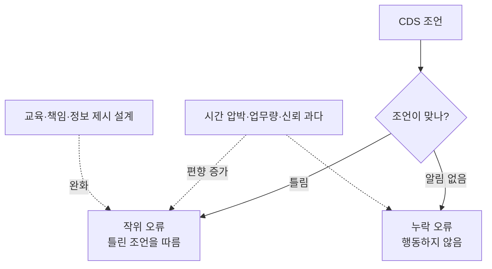

# CDS의 자동화 편향

> 임상 의사결정 지원(CDS)이 내놓은 조언을 의료진이 검증 없이 따르는 경향. 잘못된 조언을 따르는 **작위 오류(commission)**와, 시스템이 알려 주지 않아 해야 할 행동을 안 하는 **누락 오류(omission)**로 나타나며, 시간이 촉박할수록 커진다.

## 쉽게 말하면
내비게이션이 "직진"이라고 해서 막다른 길로 들어서거나, 경보가 안 울려서 위험을 못 알아채는 것과 같다. 기계를 믿는 마음이 내 눈으로 확인하는 일을 대신하게 된다.

## 자세히
출처: Goddard·Roudsari·Wyatt, JAMIA 2012;19(1):121–127(PMC 원문을 열어서 읽음), FDA CDS 지침 2026-01-29판(PDF 직접 읽음).
- **정의(논문)**: 자동 조언에 과의존하는 경향. 사용자가 컴퓨터 출력을 "경계하며 정보를 찾고 처리하는 일의 휴리스틱 대체"로 받아들인다.
- **연구 범위**: 5개 데이터베이스에서 13,821편을 찾아 74편이 기준을 충족했고, 이 중 의료 연구는 15편뿐이며 나머지는 항공·인간-컴퓨터 상호작용이다.
- **빈도와 효과(논문)**:
  - Friedman 등: 맞았던 답이 조언 후 틀린 답으로 바뀐 "부정적 상담"이 6%. 다른 의료 연구는 7~11%.
  - 의료 연구 4편 통합 분석: 조언이 **틀렸을 때** 결정지원을 쓰면 오답 위험이 쓰지 않을 때보다 **26% 높았다**(위험비 1.26, 95% CI 1.11~1.44).
  - 항공 연구는 누락 오류 55%·작위 0%인 연구도, 작위가 더 흔한 연구도 있어 결과가 엇갈린다.
- **영향 요인**: 경험이 적을수록 취약(그러나 도움도 가장 크게 받음), 시스템에 대한 신뢰가 자기 판단에 대한 확신보다 클 때와 신뢰가 실제 신뢰도와 어긋날 때, 업무량·복잡도·시간 압박.
- **완화 요인**: 교육과 개인 책임 강조(내적 책임), 조언을 덜 눈에 띄게 배치, 추천마다 최신 신뢰 수준 표시, 화면 복잡도 감소, 명령이 아닌 **정보 제시**.
- **한계(논문)**: 자동화 편향이 사후 분석에서 부수적으로 보고되는 경우가 많고, 자동화 안일(automation complacency)과 정의가 겹치며 연구 이질성 때문에 메타분석은 4편에 그쳤다.
- **규제와의 연결(FDA 지침)**: FDA는 같은 두 오류를 정의하고, 긴급한 상황에서 자동화 편향이 커진다고 설명한다. 이 이해가 [조건 4](#cds-criterion-4) 해석, 곧 시간이 촉박한 결정용 기능을 CDS 제외에서 빼는 근거가 된다.

## 그림으로 보기

## 예시
- 약물 상호작용 경고 시스템이 틀린 "문제없음"을 표시 → 의료진이 처방 진행(작위·누락이 겹침).
- 완화 설계: 추천과 함께 근거·확신 수준을 보여 주고, 명령형 문구 대신 정보형 문구를 쓴다.

## 헷갈리는 것과 비교
| 개념 | 차이 |
|---|---|
| 자동화 편향 | 자동 조언에 과의존, 작위·누락 두 오류 |
| 자동화 안일(complacency) | 감시를 소홀히 하는 경향, 정의가 겹침 |
| [사용자 과의존](#user-overreliance) | 일반 AI 사용에서의 넓은 개념 |
| [조건 4: 근거 제시](#cds-criterion-4) | 편향을 줄이는 설계 요구 |

## 더 읽을거리
- [Automation bias: a systematic review (JAMIA 2012, PMC)](https://pmc.ncbi.nlm.nih.gov/articles/PMC3240751) — 빈도·요인·완화책(열어서 확인)
- [Clinical Decision Support Software (FDA 지침 PDF, 2026-01-29)](https://www.fda.gov/media/109618/download) — 긴급 상황과 자동화 편향 설명(내려받아 확인)
