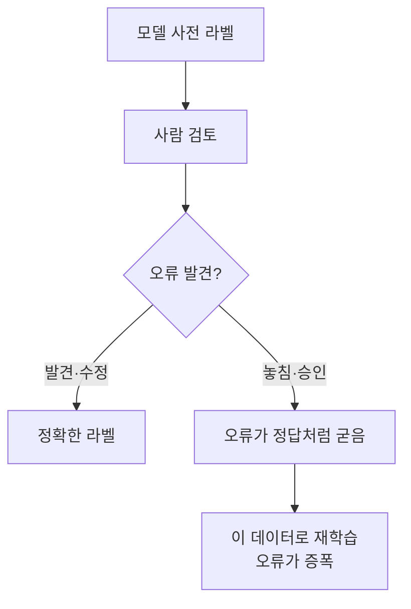
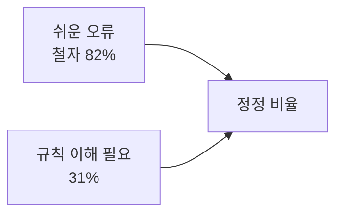

# 사전 라벨 자동화 편향

> 모델이 미리 달아 둔 라벨(사전 라벨, pre-annotation)을 사람이 **검토하다가 틀린 것도 그대로 승인하는 경향**이다. 라벨링 속도는 빨라지지만 사람의 판단이 모델 예측 쪽으로 끌려가 "정답 데이터"가 모델 오류를 품을 수 있다.

## 쉽게 말하면
시험 채점 보조원이 정답 칸에 미리 연필로 답을 써 두면, 채점자는 틀린 답도 "맞겠지" 하고 넘기기 쉽다. 특히 틀린 걸 고치려면 새 답을 직접 써야 하거나 규칙을 깊이 알아야 할 때 더 그렇다.

## 자세히
(Berzak 등 2016 논문 arXiv 1605.04481과 Beck 등 2025 논문 arXiv 2509.08514의 PDF를 직접 내려받아 확인.)
- **용어**: 앵커링(anchoring)은 판단이 이미 주어진 값 쪽으로 끌리는 인지 편향, 자동화 편향(automation bias)은 자동 제안에 과도하게 의존하는 경향이다.
- **고전 연구(EMNLP 2016, 품사 태깅·의존 구문 주석)**: 태거·파서 출력을 사람이 고치는 표준 방식에서 **뚜렷한 앵커링 효과**("parser bias")를 보였다. 결과: ① 특정 도구의 출력 쪽으로 편향돼 그 도구의 성능이 과대평가되고 ② 사람이 처음부터 단 주석보다 **주석 품질이 낮아질 수 있다**. 편향을 통제한 사람 간 일치도는 품사 95.65, 의존 94.17.
- **2025 실험(참가자 2,784명, 배출량 표 주석 과제)**: AI가 낸 사전 라벨에 의도적으로 오류를 넣고 사람의 반응을 봤다.
  - **오류를 고치려면 정정 값을 직접 입력해야 하는 설계**가 주석자의 개입을 줄이고 틀린 제안을 받아들이는 경향을 키웠다. 전체 정확도는 정정이 필수일 때 68%, 아닐 때 66%(p=0.028)로 오히려 약간 높았지만, 저자들은 작업량을 줄이려고 오류를 덜 보고하는 약한 경향이 있다고 적는다.
  - **초반 3건의 AI 정확도**는 이후 7건의 처리에 의미 있는 영향을 주지 않았다(저자들은 이 가설이 지지되지 않았다고 정리).
  - **AI에 대한 태도**가 성능의 가장 강한 예측 변수였다. AI에 회의적인 참가자가 오류를 더 잘 찾았고, 호의적인 참가자는 과신했다. 금전 인센티브는 일관된 효과가 없었다.
  - **오류 유형별 정정 비율**: 철자 오류 82%, 값은 있으나 다른 칸에 있는 오류 약 77%, **규칙 이해가 필요한 오류 31%**. 기술적으로 맞는 사전 라벨을 알아보려면 시장 기반/위치 기반 Scope 2 배출량 지식이 필요했던 표에서는 정확도가 21%까지 떨어졌다. 즉 **판단이 어려울수록** 사전 라벨을 따라간다.
- **한계**: 위 2025 실험은 특정 과제(기업 배출량 표) 결과라 다른 도메인에 그대로 일반화하기는 어렵다.
- **완화(제안, 위 근거에서 도출)**: ① 일부 표본은 **예측을 가리고** 라벨링해 정확도 측정(맹검 대조) ② 어려운 규칙이 필요한 항목은 사전 라벨을 숨기거나 전문가에게 ③ 정정이 번거롭지 않게 UI 설계 ④ 승인 시간·승인율이 비정상적으로 높은 라벨러를 점검 ⑤ 검토자 선발 때 AI 태도 점검 ⑥ 골드 문항에 일부러 틀린 사전 라벨을 섞어 검출률 측정([골드 문항 품질](#worker-quality-gold-questions)).

## 그림으로 보기

## 예시
- Label Studio ML 백엔드로 사전 라벨을 켠 뒤, 전체의 10%는 사전 라벨 없이 별도 라벨러가 달게 하고 두 결과의 일치율을 비교해 검토자가 모델에 끌려가는지 측정.
- 교육 소재: "AI 초안은 검토자가 가장 놓치기 쉬운 곳에서 틀린다"를 31%, 21% 수치로 설명(업무 자동화 교육의 승인 단계 설계).

## 헷갈리는 것과 비교
| 개념 | 차이 |
|---|---|
| 사전 라벨 자동화 편향 | 검토자가 모델 제안을 과신 |
| [Label Studio ML 백엔드](#label-studio-ml-backend) | 사전 라벨을 만들어 붙이는 도구 |
| [골드 문항 품질](#worker-quality-gold-questions) | 정답을 아는 문항으로 라벨러 품질 측정 |
| 확증 편향 | 기존 믿음을 확인하는 정보만 찾음(앵커링은 첫 값에 끌림) |

## 더 읽을거리
- [Anchoring and Agreement in Syntactic Annotations (arXiv 1605.04481)](https://arxiv.org/abs/1605.04481) — 사전 태깅의 앵커링 효과 고전 연구(PDF 직접 확인).
- [Bias in the Loop: How Humans Evaluate AI-Generated Suggestions (arXiv 2509.08514)](https://arxiv.org/abs/2509.08514) — 정정 필수 설계, AI 태도, 오류 유형별 정정률(PDF 직접 확인).
