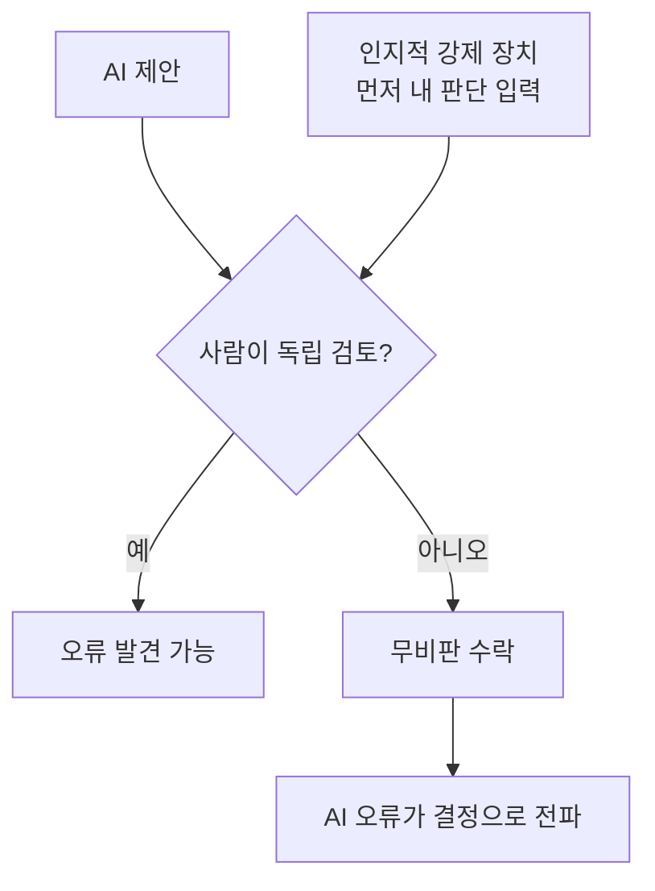

# 자동화 편향

> 사람이 자동화된 시스템의 제안이 틀렸을 때도 무비판적으로 따르는 경향.

## 쉽게 말하면
내비게이션이 "우회전"이라고 하면 눈앞의 막힌 길을 보면서도 따라가는 것과 같다. 시스템이 보통 맞으니, 사람이 스스로 확인하는 일을 줄여 버린다.

## 자세히
- **영상의학 연구**: 220명의 영상의학과 의사 등을 대상으로 한 Radiology 연구에서, 흉부 X선의 특정 부위를 짚어 주는 AI 조언은 정답이든 오답이든 더 빨리 수용되게 했다(공저자는 양날의 검이라 표현).
- 유방촬영·뇌동맥류 연구에서도 잘못된 AI 제안에 영향을 받는 경향이 보고됐다(소규모·프리프린트).
- 2025년 medRxiv 무작위 시험(의사 44명, AI 리터러시 20시간 교육): LLM 권고에 오류가 섞일 때 편향을 검토. 별도 리뷰는 전문가에게도 교육만으로 완전히 사라지지 않는다고 지적.
- 완화 아이디어: 인지적 강제 장치 — AI 답을 보기 전에 자기 판단을 먼저 쓰게 한다. 반응이 없으면 효과 증거가 일관되지 않다(파일럿 연구).
- 연관 우려: 숙련도 저하(deskilling), 법적 책임.
- 주의: 연구 다수가 소규모·프리프린트라 효과 크기는 다양하다.

## 그림으로 보기

## 예시
- 상담 어시스트가 틀린 환불 규정을 제안했는데 신입이 그대로 안내.
- 방지: 제안을 보여 주기 전 상담원이 먼저 의도를 선택, 근거 링크를 함께 표시, 수정률을 지표로 모니터링.

## 헷갈리는 것과 비교
| 개념 | 차이 |
| --- | --- |
| 자동화 편향 | 틀린 제안을 따르는 문제 |
| 자동화 불신 | 맞는 제안도 거부 |
| [사람 개입 라우팅](#human-in-the-loop-routing) | 사람 검토 구조, 형식만 있으면 편향 때문에 무력해짐 |
| [제안 수락률](#suggestion-acceptance-rate) | 편향의 간접 신호 |

## 더 읽을거리
- [RSNA: Incorrect AI Advice Influences Diagnostic Decisions](https://www.rsna.org/media/press/i/2552) — 영상 판독 연구 보도
- [medRxiv: Automation Bias in LLM Assisted Diagnostic Reasoning](https://www.medrxiv.org/content/10.1101/2025.08.23.25334280.full.pdf) — 의사 대상 시험(프리프린트)
- [Nature Sci Rep: AI suggestions on radiologists' decisions](https://www.nature.com/articles/s41598-023-36435-3) — 유방촬영 파일럿
