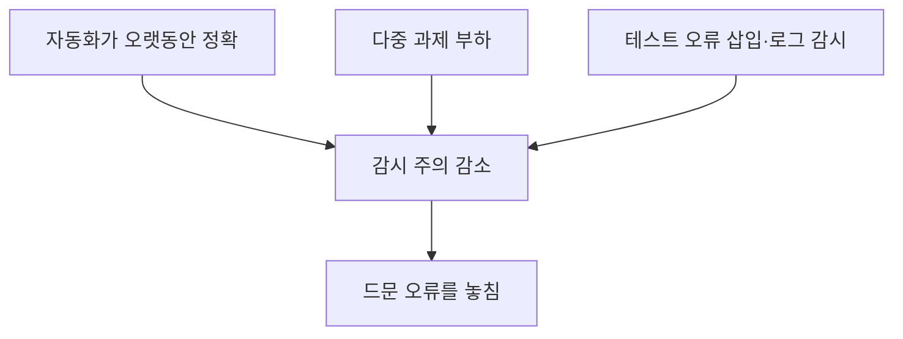

# 자동화 안주

> 자동 시스템이 잘 작동한다고 믿어 그 시스템을 감시하는 주의가 줄어드는 현상. 자동화 편향과 서로 겹치지만 주의(attention) 문제에 더 초점이 있다.

## 쉽게 말하면
자동 운전 모드가 몇 달간 무사했다면 운전자는 도로를 덜 보게 된다. 그러다 갑자기 개입해야 할 때 반응이 늦는다.

## 자세히
출처: Parasuraman & Manzey(2010, Human Factors 52(3):381-410) 초록·서지 기록(검색 결과 확인, 전문은 열지 못함).
- **연구 요지**: 두 현상(안주와 편향)을 따로 연구해 온 문헌을 통합 검토하고 주의가 핵심 역할을 한다는 모형을 제시. 둘은 자동화로 유발되는 겹치는 현상의 다른 발현이다.
- **안주(complacency)**: 여러 과제를 동시에 하는 부하 상황에서 수동 과제와 자동 과제가 주의를 놓고 경쟁할 때 나타난다. 초보와 전문가 모두에서 나타나며 짧은 연습으로는 사라지지 않는다.
- **자동화 편향**: 보조가 불완전할 때 누락 오류(알림 없으면 행동하지 않음)와 수행 오류(틀린 조언을 따름)로 나타난다. 훈련이나 지시만으로 막히지 않고 팀에도 영향이 있다.
- **AI 서비스에서**: 모델 출력이 대부분 맞아 보이면 검수자의 주의가 떨어진다. 틀림이 드물수록 오류를 놓치기 쉽다. 이 연결은 일반적 적용이다.
- **완화(일반 제안)**: 오류 샘플(의도적 테스트 건)을 섞어 감시 주의 유지, 검토 로그로 무수정 승인 비율 감시, 업무 교대·휴식, [인지적 강제 장치](#cognitive-forcing-function).

## 그림으로 보기

## 예시
- 콘텐츠 검수 AI가 99% 정확하면 사람 검수자는 나머지 1%를 놓친다 → 일부러 알려진 위반 사례를 섞어 검수 정확도를 주기적으로 측정.

## 헷갈리는 것과 비교
| 개념 | 차이 |
|---|---|
| 자동화 안주 | 감시 주의 저하 |
| [자동화 편향](#automation-bias) | 추천에 과의존(누락·수행 오류) |
| [숙련도 저하](#deskilling) | 장기적 역량 하락 |

## 더 읽을거리
- [Complacency and bias in human use of automation (PubMed)](https://pubmed.ncbi.nlm.nih.gov/21077562/) — 초록
